<div align="center">

# Secure File Upload System
### Building a File Upload Feature That Blocks Malicious Files

**WEB404: Secure Coding Practices · Assignment 1**

</div>

---

## Table of Contents

1. [Aim](#1-aim)
2. [Objectives](#2-objectives)
3. [Introduction](#3-introduction)
4. [What Is a File Upload Vulnerability?](#4-what-is-a-file-upload-vulnerability)
5. [About the Application (SecureVault)](#5-about-the-application-securevault)
6. [How the Application Works (with Screenshots)](#6-how-the-application-works-with-screenshots)
7. [Attack Tests: Trying to Upload Malicious Files](#7-attack-tests-trying-to-upload-malicious-files)
8. [Prevention: How the Application Protects Itself](#8-prevention-how-the-application-protects-itself)
9. [Testing and Results](#9-testing-and-results)
10. [Limitations and Future Improvements](#10-limitations-and-future-improvements)
11. [Conclusion](#11-conclusion)
12. [References](#12-references)
13. [Appendix: How to Run the Project](#appendix-how-to-run-the-project)

---

## 1. Aim

The aim of this assignment is to **build a working file upload feature** for a website and **protect it with security checks** so that attackers cannot use it to upload harmful files that could damage the server or its users.

---

## 2. Objectives

1. **Understand** what file upload vulnerabilities are, how attackers use them, and what damage they can cause.
2. **Build** a simple web application where users can upload, view, search and download files.
3. **Check every file on the server** before saving it:
   - only allow safe file types (PNG, JPG, GIF, PDF),
   - block hidden or "double" extensions such as `shell.php.jpg`,
   - check that the file's real content matches its extension,
   - detect extra code hidden inside or after a real file,
   - limit the file size.
4. **Store files safely** with random names in a folder that the public cannot open directly.
5. **Test the application** by attacking it with fake malicious files and show the results with screenshots.
6. **Explain** the remaining weaknesses and how the system could be improved.

---

## 3. Introduction

Many websites let users upload files: profile pictures, assignments, CVs, receipts or reports. This feature looks simple, but it is one of the **riskiest** features a developer can build.

When a user uploads a file, they are putting **their own data onto the server**. If the website does not carefully check that file, an attacker can upload something dangerous instead of a normal picture or document. For example:

- a **script file** that the server runs, which gives the attacker control of the server,
- a **fake image** that actually contains code,
- a **PDF with hidden JavaScript** that attacks whoever opens it,
- a **very large file** that fills the disk and crashes the website.

This problem is so common that the security organisation **OWASP** lists it as *Unrestricted File Upload*, and **MITRE** lists it as **CWE-434: Unrestricted Upload of File with Dangerous Type**.

In this assignment I first explain how file upload attacks work (Section 4). Then I present **SecureVault**, a web application I built that accepts normal images and PDFs but blocks malicious files (Sections 5 and 6). Next, I attack my own application with fake malicious files and show the results with screenshots (Section 7). Finally, I explain the security measures in the code (Section 8), the test results (Section 9) and the conclusion (Section 11).

The main idea behind the design is **defence in depth**. This means using **many layers of protection** instead of only one. If one check fails or is tricked, another check will still catch the attack.

---

## 4. What Is a File Upload Vulnerability?

### 4.1 Simple definition

A **file upload vulnerability** happens when a website accepts a file from a user **without checking it properly**, or saves it in an unsafe place. The upload feature itself is not the problem. The problem is the **missing or weak checks** around it.

### 4.2 What can the attacker control?

Every uploaded file has four parts, and **the attacker controls all four**:

| Part of the file | Example | Why it is dangerous |
|---|---|---|
| **File name** | `../../server.js`, `shell.php.jpg` | Can change where the file is saved, or trick the server into running it |
| **Extension** | `.php`, `.exe`, `.html` | Decides whether the server or browser will run the file |
| **Declared type** (`Content-Type`) | `image/png` | Sent by the user's browser, so it can easily be a lie |
| **Content** (the actual bytes) | Hidden code, a 10 GB file | This is what actually runs or uses up resources |

A secure website must **not trust any of these four parts**.

### 4.3 What damage can it cause?

| Security goal | How a bad upload breaks it |
|---|---|
| **Confidentiality** (keeping data secret) | The attacker reads passwords, databases and private files |
| **Integrity** (keeping data correct) | The attacker changes website files or plants malware for others to download |
| **Availability** (keeping the site running) | Huge files fill the disk and the website stops working |

The worst result is **Remote Code Execution (RCE)**, which means the attacker can run any command they want on the server.

### 4.4 How a typical attack works

```
 1. The attacker writes a small PHP script (called a "web shell") that runs any command sent to it.
 2. They save it as shell.php and upload it through a "profile picture" form.
 3. The weak website saves it as:      /public/uploads/shell.php
 4. The attacker opens:                https://site.com/uploads/shell.php?command=whoami
 5. The server sees ".php", RUNS the script and shows the result.
 6. The attacker now controls the server.
```

### 4.5 Example of insecure code

The code below looks normal and is often found in tutorials, but it is **very unsafe**:

```js
// ❌ INSECURE: do not use
const storage = multer.diskStorage({
  destination: 'public/uploads/',                          // (1) saved in a public folder
  filename: (req, file, cb) => cb(null, file.originalname) // (2) uses the user's file name
});
const upload = multer({ storage });                        // (3) no size or type checks

app.use(express.static('public'));                         // (4) uploads can be opened by URL
app.post('/upload', upload.single('file'), (req, res) => {
  res.send(`Uploaded to /uploads/${req.file.originalname}`); // (5) user text put into the page
});
```

| # | Mistake | What can go wrong |
|---|---------|-------------------|
| 1 | Files saved inside the public folder | Anyone can open them by URL, and scripts may run |
| 2 | The user's own file name is used | `../../` can save files in other folders and overwrite code |
| 3 | No checks on type, content or size | Any file is accepted: scripts, malware, huge files |
| 4 | The upload folder is served to browsers | Uploaded HTML or SVG files can run JavaScript (XSS) |
| 5 | The file name is written into the page | A file name containing code can run in the browser (XSS) |

### 4.6 Common attack techniques

| # | Technique | Simple explanation | Example |
|---|-----------|--------------------|---------|
| 1 | **Web shell upload** | Upload a script that the server will run | `shell.php` |
| 2 | **Double extension** | Hide a dangerous extension before a safe one | `shell.php.jpg` |
| 3 | **Fake file / disguised file** | Rename a script so it looks like an image | PHP code saved as `photo.jpg` |
| 4 | **Polyglot file** | A real image that also has code hidden in it | PNG with PHP added at the end |
| 5 | **MIME type spoofing** | Lie about the file type in the request | A PNG sent as `text/html` |
| 6 | **Malicious PDF** | A PDF that runs JavaScript when opened | `/OpenAction /JavaScript` |
| 7 | **Stored XSS** | Upload an SVG or HTML file containing JavaScript | `logo.svg` with `<script>` |
| 8 | **Path traversal** | Use `../` in the name to save the file in another folder | `../../../evil.png` |
| 9 | **Denial of service (DoS)** | Upload very large or many files to crash the site | A 10 GB file |

### 4.7 Real-world examples

- **WordPress "File Manager" plugin (CVE-2020-25213, 2020):** attackers could upload PHP web shells without logging in. Many websites were hacked through this flaw.
- **ImageTragick (CVE-2016-3714, 2016):** specially made image files caused websites that used the ImageMagick library to run the attacker's commands. This shows that even "images only" uploads can be dangerous.

### 4.8 Official classification

| Standard | Category |
|---|---|
| **CWE-434** | Unrestricted Upload of File with Dangerous Type |
| **CWE-22** | Path Traversal |
| **CWE-79** | Cross-Site Scripting (XSS) |
| **CWE-400** | Uncontrolled Resource Consumption (DoS) |
| **OWASP Top 10 (2021)** | A03 Injection, A04 Insecure Design, A05 Security Misconfiguration |

---

## 5. About the Application (SecureVault)

### 5.1 What the application does

**SecureVault** is a web application where users can:

- upload **PNG, JPG/JPEG, GIF and PDF** files (up to **5 MB**, one file at a time),
- see a list of their uploaded files and search it,
- download their files safely.

Every file goes through a **series of security checks** on the server **before** it is saved.

### 5.2 Technologies used

| Part | Technology | Used for |
|---|---|---|
| Server | **Node.js** with **Express 5** | Running the website and handling requests |
| Upload handling | **Multer 2** | Receiving uploaded files and limiting their size |
| Frontend | **HTML, CSS and JavaScript** | The user interface |
| Icons | **Feather icons** (from `react-icons`) | Simple black icons |
| Security tools | Node's built-in `crypto` module | Random file names and file fingerprints (SHA-256) |
| Testing | Node's built-in test runner | 26 automated security tests |

### 5.3 How a file moves through the system

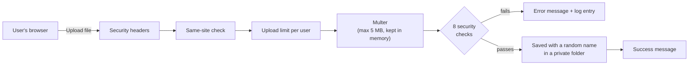

### 5.4 The 8 security checks

Every uploaded file must pass **all eight checks in order**. If one check fails, the file is rejected straight away.

| Step | Check | What it looks for |
|---|---|---|
| 1 | **File name** | Not too long, no hidden characters, no `../` or slashes |
| 2 | **Double extension** | No dangerous extension hidden in the name (`shell.php.jpg`) |
| 3 | **Allowed types** | The extension must be png, jpg, jpeg, gif or pdf |
| 4 | **Size** | Not empty and not bigger than 5 MB |
| 5 | **Declared type** | The type sent by the browser must match the extension |
| 6 | **File signature** | The first bytes of the file must match the real format |
| 7 | **File ending** | The file must end the way that format should end, with nothing extra after it |
| 8 | **Content scan** | No hidden code such as `<?php`, `<script` or PDF JavaScript |

Only after all eight checks pass is the file saved.

---

## 6. How the Application Works (with Screenshots)

This section shows the application from a normal user's point of view, step by step.

### 6.1 Home page

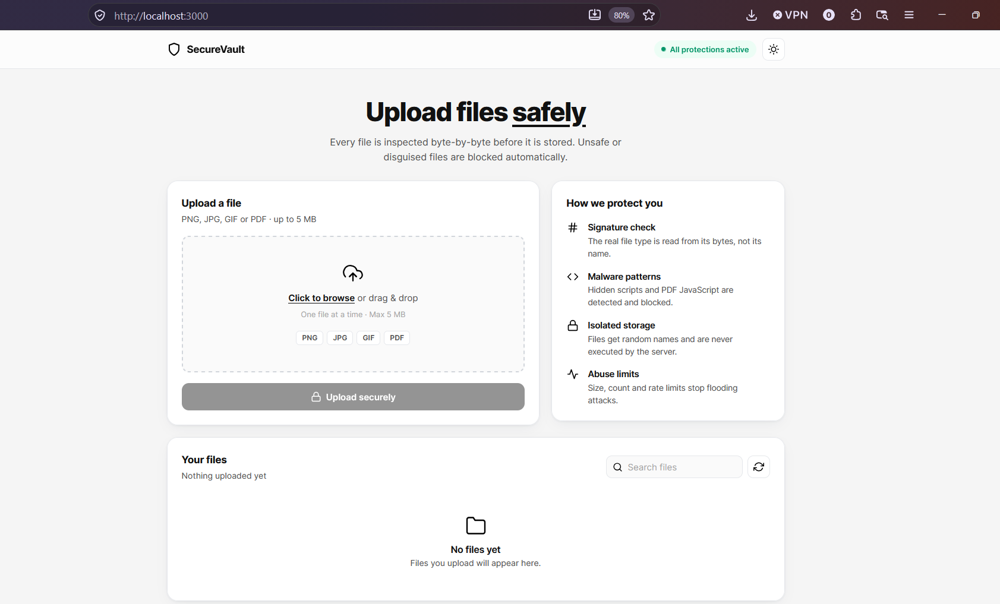

*Figure 1: The SecureVault home page.*

The home page has four parts:

- **Header:** the name *SecureVault*, a green **"All protections active"** badge and a button to switch between light and dark mode.
- **Upload a file:** a box where the user can click to browse or drag and drop a file. It clearly shows the allowed types (**PNG, JPG, GIF, PDF**) and the **5 MB** limit, so the user knows the rules before uploading.
- **How we protect you:** a short, plain-language list of the four main protections (signature check, malware patterns, isolated storage and abuse limits).
- **Your files:** the list of uploaded files. It is empty at the start and shows *"No files yet"*.

The **Upload securely** button is grey (disabled) because no file has been selected yet.

### 6.2 Choosing a file

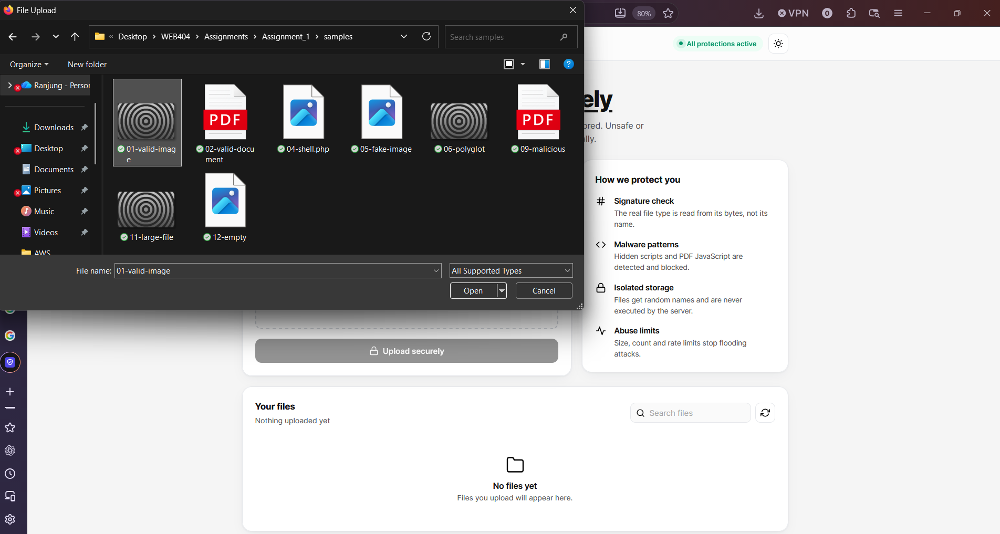

*Figure 2: Clicking "Click to browse" opens the normal Windows file window. Here the `samples` folder is open, showing the test files.*

The `samples` folder contains two **safe files** (`01-valid-image.png` and `02-valid-document.pdf`) and several **fake malicious files** created for testing (such as `04-shell.php.jpg`, `05-fake-image.jpg`, `06-polyglot.png` and `09-malicious.pdf`). These "malicious" files are **harmless copies** that only look like real attacks. They are used in Section 7.

### 6.3 File selected and ready to upload

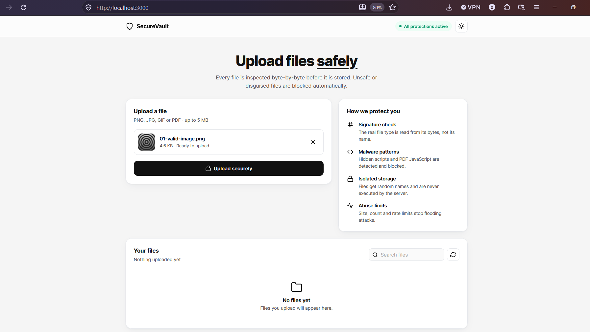

*Figure 3: After choosing `01-valid-image.png`, the app shows a small preview, the file name, its size (4.6 KB) and "Ready to upload".*

Now the **Upload securely** button turns black, which means it can be clicked. The **×** button removes the file if the user picked the wrong one.

When a file is selected, the browser also does some **quick checks** (file type, size and empty file) to give instant feedback. These browser checks are **only for convenience**. An attacker can skip the browser completely, so the **server repeats every check** (this is shown in Figure 9).

### 6.4 Successful upload

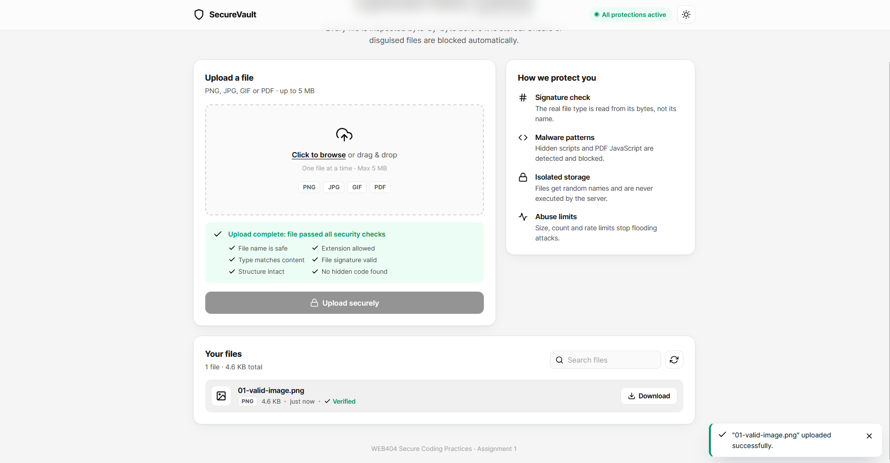

*Figure 4: The image passed all security checks and was uploaded.*

After clicking **Upload securely**:

- A green box says **"Upload complete: file passed all security checks"** and lists the checks the file passed: *File name is safe, Extension allowed, Type matches content, File signature valid, Structure intact, No hidden code found*.
- A notification in the bottom-right corner says **"01-valid-image.png" uploaded successfully**.
- The file now appears under **Your files** with its type (PNG), size, time ("just now") and a green **Verified** tag.

**What happens on the server when Upload securely is clicked:**

1. The browser sends the file to the server (`POST /api/upload`).
2. The server checks that the request came from its own website and that the user has not uploaded too many files too quickly.
3. Multer receives the file **into memory only** (not onto the disk) and stops if it goes over 5 MB.
4. The 8 security checks examine the name, type and actual bytes of the file.
5. Only if every check passes is the file saved to disk with a **random name**.
6. The result is written to `logs/security.log`, along with the file's SHA-256 fingerprint.

### 6.5 Uploading a PDF

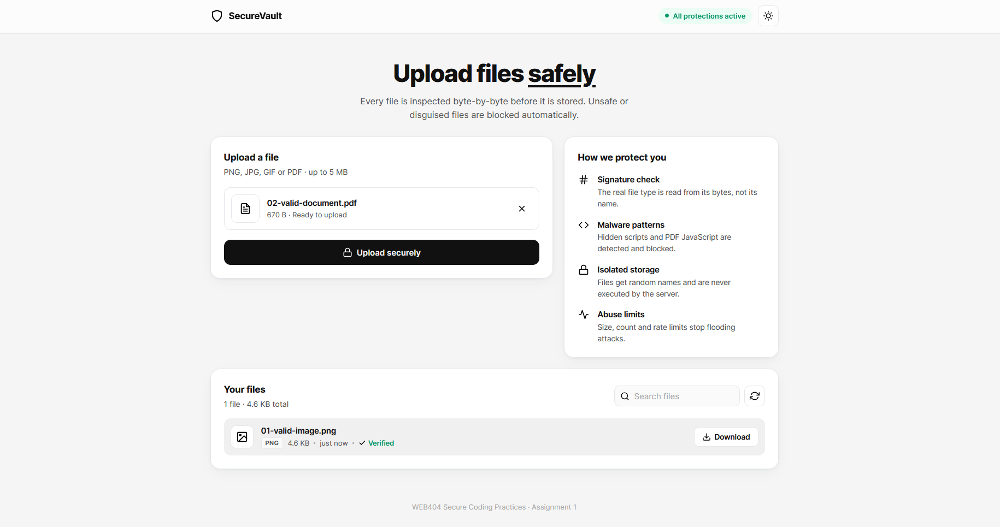

*Figure 5: A PDF document (`02-valid-document.pdf`, 670 bytes) is selected. Because it is not an image, a document icon is shown instead of a preview.*

The image uploaded earlier is already listed under **Your files** (1 file, 4.6 KB in total). The PDF is uploaded in the same way and passes all the checks, which shows that the application works for documents as well as images.

### 6.6 Viewing and searching files

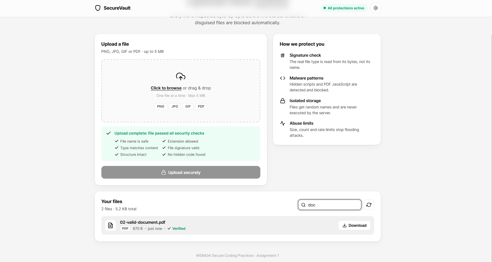

*Figure 6: There are now 2 files (5.2 KB in total). Typing "doc" in the search box instantly filters the list to show only `02-valid-document.pdf`.*

Each file shows its **type**, **size**, **upload time**, a **Verified** tag and a **Download** button.

File names are shown on the page as **plain text** (using `textContent`, never `innerHTML`). So even if someone named a file `.png`, it would just appear as text and could not run any code.

### 6.7 Downloading a file

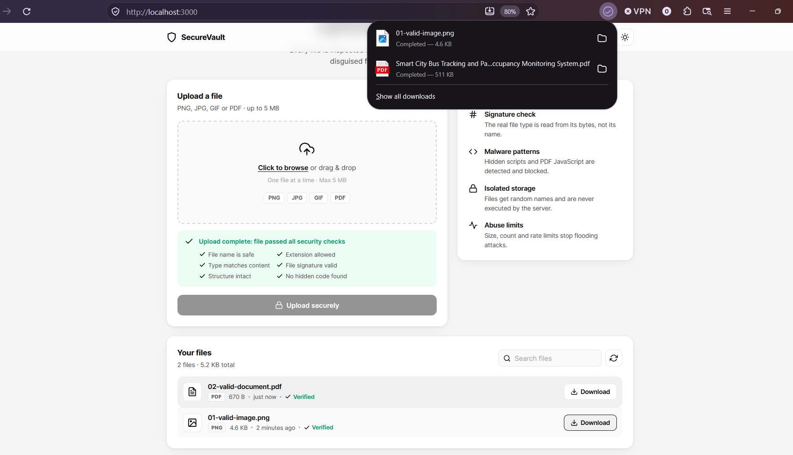

*Figure 7: Clicking **Download** saves the file to the computer. The browser's download list shows `01-valid-image.png` completed (4.6 KB).*

The server **always forces a download** instead of opening the file inside the website (using the `Content-Disposition: attachment` header). This means that even if a dangerous file somehow got through, the browser would only save it and would never run it as part of the website.

### 6.8 How the files are stored on the server

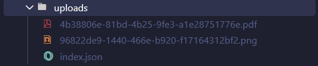

*Figure 8: Inside the `uploads` folder, the two files are saved with random names, for example `4b38806e-81bd-4b25-9fe3-a1e28751776e.pdf`, not their original names.*

This one screenshot shows three protections:

- **Random names (UUIDs):** the attacker cannot choose, guess or overwrite the saved file name.
- **Private folder:** `uploads` is **outside** the `public` folder, so nobody can open these files by typing a URL.
- **`index.json`:** stores each file's original name, type, size and fingerprint. The original name is only used for display and is never used to build a file path.

---

## 7. Attack Tests: Trying to Upload Malicious Files

In this section I **attack my own application** using the techniques from Section 4. The attack files were created with `npm run samples`. They are **harmless**: they have the same structure as real attacks but do nothing dangerous.

Some attacks were done in the browser, and others with **`curl`**, a command-line tool. Using `curl` **skips the browser completely**, just like a real attacker would, so it proves that the protection is on the server and not only in the browser.

### 7.1 Attack 1: Uploading a PHP web shell

**The vulnerability:** If a server accepts `.php` files and saves them where they can be run, the attacker can open the file's URL and take control of the server.

**The attack:** Upload `03-shell.php` directly to the server with `curl`, skipping the browser.

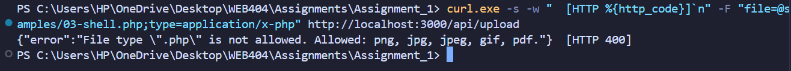

*Figure 9: Even when the browser is skipped, the server replies `File type ".php" is not allowed. Allowed: png, jpg, jpeg, gif, pdf.` with **HTTP 400** (Bad Request).*

**Why it was blocked:** The server uses an **allow-list**. It only accepts `png, jpg, jpeg, gif` and `pdf`. Everything else is rejected automatically. This is safer than a "block-list" (a list of banned extensions), because a block-list always forgets something, such as `.php5` or `.phtml`.

This screenshot is important because it shows that **security does not depend on the browser**.

---

### 7.2 Attack 2: Double extension (`shell.php.jpg`)

**The vulnerability:** Some web servers run any file whose name **contains** `.php`, even if it ends in `.jpg`. A weak check that only looks at the last part of the name (`.jpg`) would let this file through.

**The attack:** Upload `04-shell.php.jpg`. The name ends in `.jpg`, so it looks like an image.

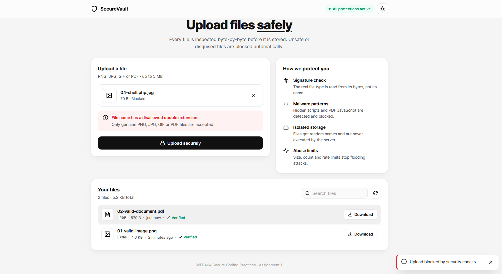

*Figure 10: The app shows **"File name has a disallowed double extension."**, marks the file as **Blocked**, and a red notification says "Upload blocked by security checks." The file list still only contains the two safe files.*

**Why it was blocked:** The server splits the file name at every dot and checks **each part** against a list of more than 40 dangerous extensions (php, asp, jsp, exe, html, svg and others). Normal names with dots, such as `holiday.photo.jpg`, are still allowed because `photo` is not dangerous.

---

### 7.3 Attack 3: Fake image (PHP code renamed to `.jpg`)

**The vulnerability:** If a website only looks at the extension, an attacker can simply rename a script from `shell.php` to `photo.jpg` and upload it.

**The attack:** Upload `05-fake-image.jpg`, which is really PHP code with a `.jpg` name.

To understand how the server catches this, we can look at the **first bytes** of each file using PowerShell's `Format-Hex` command:

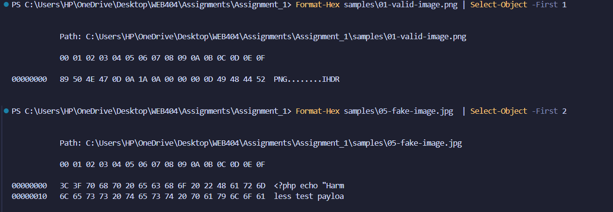

*Figure 11: The real PNG starts with `89 50 4E 47` (which reads as "PNG"). The fake JPG starts with `3C 3F 70 68 70`, which is the text `<?php`. A real JPEG file would start with `FF D8 FF`.*

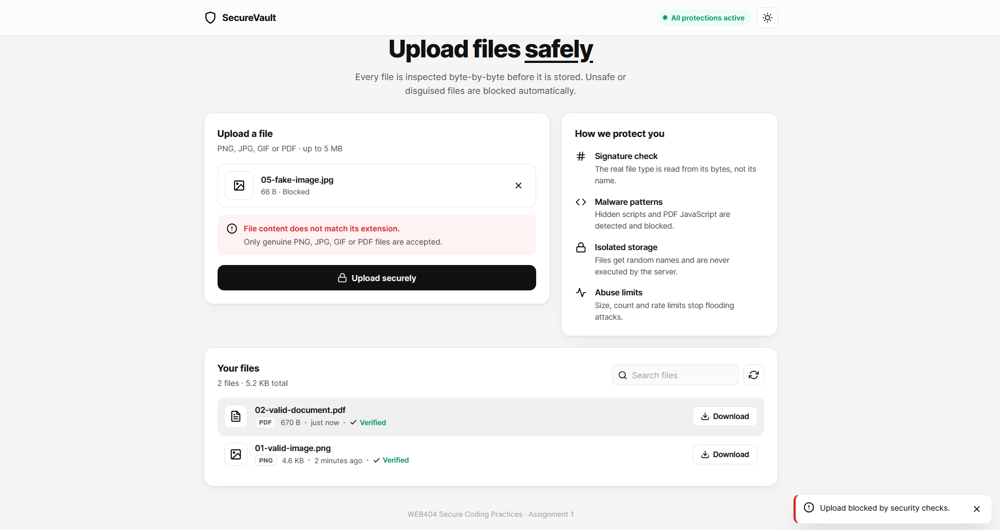

*Figure 12: The server replies **"File content does not match its extension."** and the file is blocked.*

**Why it was blocked:** This is called **file signature** (or "magic byte") checking. Every real file format starts with a fixed pattern of bytes, a bit like a fingerprint. The server reads the real first bytes and checks that they match the extension:

| Format | First bytes (hex) |
|---|---|
| PNG | `89 50 4E 47 0D 0A 1A 0A` |
| JPEG | `FF D8 FF` |
| GIF | `47 49 46 38 37/39 61` (`GIF87a` / `GIF89a`) |
| PDF | `25 50 44 46 2D` (`%PDF-`) |

Renaming a file changes its name but **not its bytes**, so the trick does not work.

---

### 7.4 Attack 4: Polyglot file (a real image with hidden code)

**The vulnerability:** A smarter attacker can make a file that is **a real, working image** but also has code hidden inside it. It has the correct first bytes and opens normally as a picture, so a signature check alone would **not** catch it.

**The attack:** Upload `06-polyglot.png`, which is a real PNG image with PHP code added after the end of the picture.

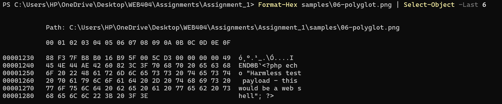

*Figure 13: The last bytes of the file. A PNG should finish with the end marker `IEND AE 42 60 82`. But here the marker is followed by extra text: `<?php echo "Harmless test payload - this would be a web shell"; ?>`.*

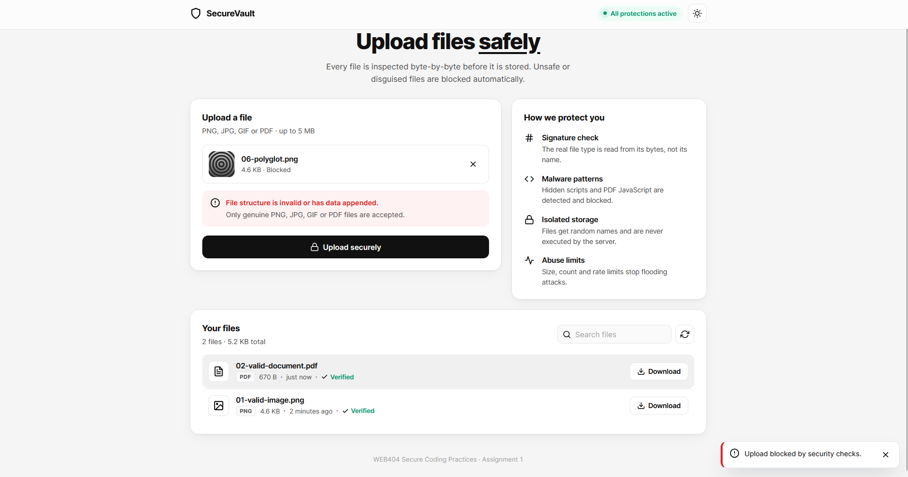

*Figure 14: The preview shows a normal-looking image, but the server replies **"File structure is invalid or has data appended."** and blocks it.*

**Why it was blocked:** Two separate checks catch this file:

1. **File ending check:** a real PNG must **end** with the `IEND` marker. Here there is extra data after it, so the file is rejected.
2. **Content scan:** the file contains `<?php`, which the scanner would also detect.

Even if the code were hidden **in the middle** of the image instead of at the end, the content scan would still catch it. This is a good example of **defence in depth**: the file passed the extension, type and signature checks, but was still stopped by the later layers.

---

### 7.5 Attack 5: PDF with hidden JavaScript

**The vulnerability:** PDF files can contain JavaScript and "actions" that run automatically when the file is opened. Attackers use this to spread malware through documents that look normal, such as invoices.

**The attack:** Upload `09-malicious.pdf`. It is a real, valid PDF, but it contains an `/OpenAction` with `/JavaScript` that runs when the file is opened.

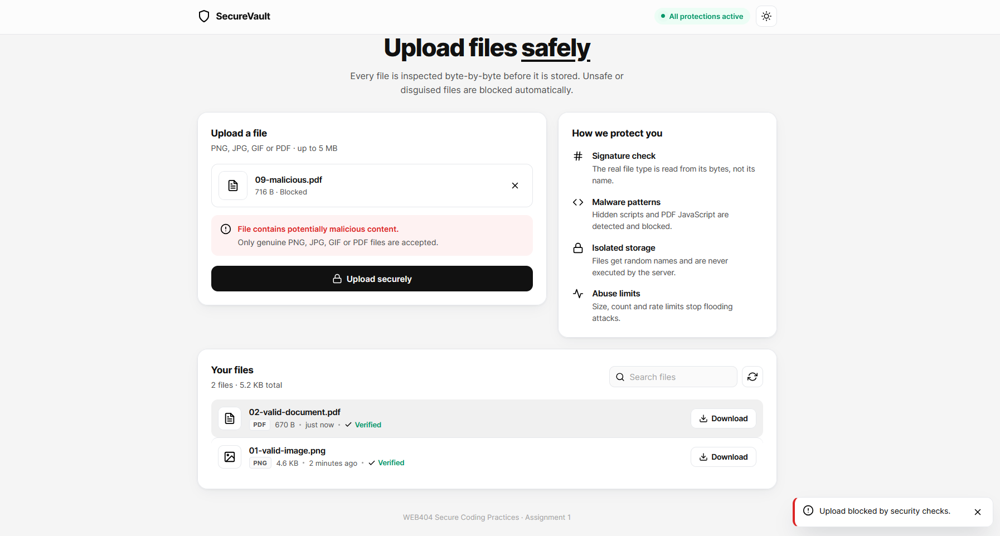

*Figure 15: The file has a correct PDF signature and ending, but the server finds the hidden script and replies **"File contains potentially malicious content."***

**Why it was blocked:** The content scanner looks for dangerous PDF keywords such as `/JavaScript`, `/JS`, `/Launch` and `/EmbeddedFile`. The safe PDF from Figure 5 was **accepted**, which shows that the check blocks only the dangerous features, not PDFs in general.

---

### 7.6 Attack 6: Lying about the file type (MIME spoofing)

**The vulnerability:** When a file is uploaded, the browser also sends its "type" (for example `image/png`). This value is chosen by the sender, so an attacker can change it to anything. A website that trusts it can be tricked, or might later send the file back as a web page (`text/html`), which could run code in the browser.

**The attack:** Send a real PNG image with `curl`, but declare its type as `text/html`.

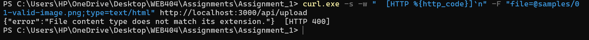

*Figure 16: The server replies **"File content type does not match its extension."** with **HTTP 400**.*

**Why it was blocked:** The declared type must match the extension, **and** the real bytes must match both. Also, when a file is downloaded later, the server sends the type **it checked itself**, never the type the user claimed.

---

### 7.7 Attack 7: Very large file and empty file (Denial of Service)

**The vulnerability:** Without a size limit, an attacker could upload huge files to fill the server's memory and disk until the website crashes. Empty files can also cause errors in badly written code.

**The attack:** Upload `11-large-file.png` (6 MB) and `12-empty.png` (0 bytes) with `curl`.

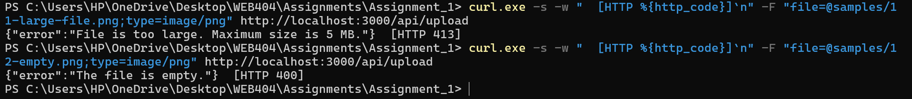

*Figure 17: The 6 MB file is rejected with **"File is too large. Maximum size is 5 MB."** (**HTTP 413**, Payload Too Large). The empty file is rejected with **"The file is empty."** (**HTTP 400**).*

**Why it was blocked:** Multer checks the size **while the file is still arriving**. As soon as it passes 5 MB, the server stops reading, so it never has to receive the whole file. The server also limits each request to **one file** and a small number of form fields.

---

### 7.8 Attack 8: Path traversal in the file name

**The vulnerability:** If a server uses the uploaded file name to decide where to save it, a name like `../../../evil.png` means "go up three folders and save it there". This could save files outside the upload folder and even overwrite the website's own code.

**The attack:** Upload a real PNG with `curl`, but change its name to `../../../evil.png`.

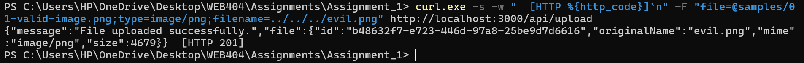

*Figure 18: The server accepts the image (**HTTP 201**) because the picture itself is safe. But the `../../../` part has been **removed**: the stored name is just `evil.png`, and the file is saved with a random ID (`b48632f7-e723-446d-97a8-25be9d7d6616`) **inside** the `uploads` folder. Nothing was written outside it.*

**Why the attack failed:**

- The folder part of the name (`../../../`) is removed when the upload is received, and the file name check also rejects names containing `/`, `\` or `..`.
- The user's file name is **never used as a path**. The server always creates a random name with `crypto.randomUUID()`.
- The function `resolveSafe()` double-checks that the final path is **inside** the uploads folder before saving.
- When downloading, the file ID must be a valid UUID, so a request such as `/api/files/../../package.json` is rejected.

---

## 8. Prevention: How the Application Protects Itself

This section explains the main security measures in the code and why each one is needed.

### 8.1 Never trust the browser

All the real checks happen on the **server**. The checks in the browser (`public/app.js`) are only there to give users quick feedback. Figure 9 proves this: when the browser was skipped using `curl`, the server still blocked the PHP file.

### 8.2 Allow only safe file types (allow-list)

```js
// src/validators/fileValidator.js
const ALLOWED_TYPES = {
  png: { extensions: ['png'],         mime: 'image/png',       header: …, trailer: … },
  jpg: { extensions: ['jpg', 'jpeg'], mime: 'image/jpeg',      header: …, trailer: … },
  gif: { extensions: ['gif'],         mime: 'image/gif',       header: …, trailer: … },
  pdf: { extensions: ['pdf'],         mime: 'application/pdf', header: …, trailer: … },
};
```

Only these four types are allowed. **Everything else is rejected.** *(Stops Attack 1.)*

### 8.3 Check the file name

```js
if (/[\x00-\x1f\x7f]/.test(originalName))                 // hidden characters / null byte
  throw new ValidationError('File name contains invalid characters.', 'control-characters');
if (/[\\/]/.test(originalName) || originalName.includes('..'))   // path traversal
  throw new ValidationError('File name contains invalid characters.', 'path-traversal');

const parts = originalName.toLowerCase().split('.');
const inner = parts.slice(1, -1).map((p) => p.trim());
if (inner.some((p) => DANGEROUS_EXTENSIONS.has(p)))       // shell.php.jpg
  throw new ValidationError('File name has a disallowed double extension.', 'double-extension');
```

The name is changed to lower case first, so tricks like `shell.PhP` do not work. *(Stops Attacks 2 and 8.)*

### 8.4 Check the declared type and the real file signature

```js
if (file.mimetype !== def.mime)          // declared type must match the extension
  throw new ValidationError('File content type does not match its extension.', …);

if (!def.header(file.buffer))            // real first bytes must match the format
  throw new ValidationError('File content does not match its extension.', 'magic-bytes-mismatch');

// Example for PNG:
header: (b) => b.subarray(0, 8).equals(Buffer.from([0x89, 0x50, 0x4e, 0x47, 0x0d, 0x0a, 0x1a, 0x0a])),
```

*(Stops Attacks 3 and 6.)*

### 8.5 Check how the file ends

```js
// PNG must end with IEND, JPEG with FF D9, GIF with 0x3B, PDF with %%EOF
trailer: (b) => b.subarray(-12).equals(Buffer.from([0,0,0,0, 0x49,0x45,0x4e,0x44, 0xae,0x42,0x60,0x82])),
```

This catches extra data **added after** a real file. *(Stops Attack 4.)*

### 8.6 Scan the content for hidden code

```js
const MALICIOUS_PATTERNS = [
  { name: 'PHP code',          regex: /<\?php/i },
  { name: 'Script tag',        regex: /<script[\s>]/i },
  { name: 'HTML document',     regex: /<html[\s>]/i },
  { name: 'JSP/ASP directive', regex: /<%@\s*(page|import|language)/i },
  { name: 'PDF JavaScript',    regex: /\/JavaScript\b|\/JS\s*[(<]/ },
  { name: 'PDF launch action', regex: /\/Launch\b/ },
  // … 11 patterns in total
];
```

The patterns are specific (for example `<script` must be followed by a space or `>`), so normal image data is not blocked by mistake. *(Stops Attacks 4 and 5.)*

### 8.7 Check the file in memory before saving it

```js
const upload = multer({
  storage: multer.memoryStorage(),        // file stays in memory until it passes all checks
  limits: { fileSize: 5 * 1024 * 1024, files: 1, fields: 5, parts: 6 },
});
```

A malicious file is **never written to the disk**, so it never exists on the server. The size limit also stops large files early. *(Stops Attack 7.)*

### 8.8 Save files safely

```js
// src/storage.js
const id = crypto.randomUUID();                 // random name the user cannot choose
const storedName = `${id}.${ext}`;              // extension comes from the CHECKED type
const target = this.resolveSafe(storedName);    // must stay inside uploads/
await fsp.writeFile(target, buffer, { flag: 'wx', mode: 0o640 });
//                                    'wx'  = never overwrite an existing file
//                                    0o640 = file cannot be executed

resolveSafe(name) {
  const full = path.resolve(this.dir, name);
  if (path.dirname(full) !== this.dir) throw new Error('Path traversal attempt blocked');
  return full;
}
```

Only the `public` folder is shared with browsers. The `uploads` folder is outside it, as Figure 8 shows. *(Stops Attack 8 and direct execution of uploaded files.)*

### 8.9 Safe downloads

```js
if (!UUID_RE.test(id)) return res.status(400).json({ error: 'Invalid file id.' });
res.setHeader('Content-Type', record.mime);                         // type checked by the server
res.setHeader('Content-Disposition', `attachment; filename="…"`);   // always download, never open
res.setHeader('Content-Security-Policy', "default-src 'none'; sandbox");
res.sendFile(store.resolveSafe(record.storedName));
```

Downloaded files are always **saved, never opened inside the website**, and the browser is told not to guess the file type (`X-Content-Type-Options: nosniff`).

### 8.10 Extra protection for the whole website

Besides checking files, the application also protects itself in other ways:

| Protection | What it does |
|---|---|
| **Security headers** (CSP, `nosniff`, `X-Frame-Options`) | Stop the browser from running injected scripts, guessing file types or loading the site inside another site |
| **Same-site check** (`Origin` header) | Rejects uploads sent from other websites (protection against CSRF), with HTTP 403 |
| **Rate limiting** | Allows at most 20 uploads per user every 15 minutes, then replies HTTP 429 |
| **Safe display of names** | File names are shown with `textContent`, so they can never run as code |
| **Simple error messages** | Users see short messages only. Internal details are never shown |
| **Security log** | Every accepted and rejected upload is saved in `logs/security.log` with the time, IP address, reason and file fingerprint |

### 8.11 Summary: which protection stops which attack

| Attack (Section 7) | Protection that stopped it | Result |
|---|---|---|
| 1. PHP web shell | Allow-list of file types | Blocked (400) |
| 2. Double extension | File name check | Blocked (400) |
| 3. Fake image | File signature check | Blocked (400) |
| 4. Polyglot image | File ending check + content scan | Blocked (400) |
| 5. Malicious PDF | Content scan | Blocked (400) |
| 6. MIME spoofing | Declared type check | Blocked (400) |
| 7. Large / empty file | Size limits | Blocked (413 / 400) |
| 8. Path traversal | Name cleaning + random names + `resolveSafe()` | Made harmless |
---

## 11. Conclusion

The aim of this assignment was to build a file upload feature that is both **easy to use** and **secure**. This aim was achieved.

In the first part, I explained that file upload vulnerabilities are very serious. They can let an attacker take control of the server, attack other users or crash the website. I also showed why simple upload code fails: it trusts the file name, the extension and the declared type, and **all of these are controlled by the attacker**.

In the second part, I built **SecureVault**. Its interface is simple and clear: users can see the allowed file types, preview their file, get clear success or error messages, and search and download their files. Behind this simple interface, every upload is kept in memory and must pass **eight security checks**: file name, double extension, allowed type, size, declared type, file signature, file ending and content scan. Only then is it saved, with a random name, in a private folder, without permission to run. Downloads are always forced to save, never opened inside the website.

I then attacked my own application with **eight different attacks**: a PHP web shell, a double extension, a fake image, a polyglot image, a PDF with hidden JavaScript, MIME spoofing, very large and empty files, and path traversal. **Every attack was blocked or made harmless**, while the normal image and PDF were still accepted. All 26 automated tests also passed.

The most important lessons I learned are:

1. **Never trust the browser.** Browser checks are helpful for users, but only server checks give real security (Figure 9).
2. **Check what a file really is, not what it claims to be.** A name and a declared type can be faked, but the real bytes cannot (Figures 11 and 12).
3. **Use many layers of protection.** The polyglot image passed the extension, type and signature checks, but it was still caught by the file ending check and the content scan (Figures 13 and 14). Because each layer assumes the others might fail, an attacker would have to beat all of them at the same time.

With the improvements listed in Section 10, such as antivirus scanning, file rebuilding and user accounts, the system could be made ready for a real public website.

---

## 12. References

1. OWASP Foundation. *File Upload Cheat Sheet.* https://cheatsheetseries.owasp.org/cheatsheets/File_Upload_Cheat_Sheet.html
2. OWASP Foundation. *Unrestricted File Upload.* https://owasp.org/www-community/vulnerabilities/Unrestricted_File_Upload
3. OWASP Foundation. *OWASP Top 10: 2021.* https://owasp.org/Top10/
4. MITRE. *CWE-434: Unrestricted Upload of File with Dangerous Type.* https://cwe.mitre.org/data/definitions/434.html
5. MITRE. *CWE-22: Improper Limitation of a Pathname to a Restricted Directory ('Path Traversal').* https://cwe.mitre.org/data/definitions/22.html
6. MITRE. *CWE-79: Improper Neutralization of Input During Web Page Generation ('Cross-site Scripting').* https://cwe.mitre.org/data/definitions/79.html
7. NIST National Vulnerability Database. *CVE-2020-25213 (WordPress File Manager plugin).* https://nvd.nist.gov/vuln/detail/CVE-2020-25213
8. NIST National Vulnerability Database. *CVE-2016-3714 (ImageMagick "ImageTragick").* https://nvd.nist.gov/vuln/detail/CVE-2016-3714
9. PortSwigger Web Security Academy. *File upload vulnerabilities.* https://portswigger.net/web-security/file-upload
10. MDN Web Docs. *Content Security Policy (CSP).* https://developer.mozilla.org/en-US/docs/Web/HTTP/CSP
11. Express.js. *Multer documentation.* https://github.com/expressjs/multer
12. Wikipedia. *List of file signatures.* https://en.wikipedia.org/wiki/List_of_file_signatures

---