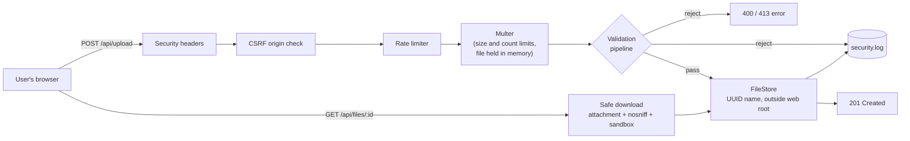

<div align="center">

# Secure File Upload System
### Developing a File Upload Feature with Protection Against Malicious Uploads

**WEB404: Secure Coding Practices · Assignment 1**

| | |
|---|---|
| **Name** | *[Your Name]* |
| **Student ID** | *[Your Student ID]* |
| **Programme** | *[Your Programme]* |
| **Institution** | *[Your College / University]* |
| **Submitted to** | *[Lecturer's Name]* |
| **Date of submission** | *[DD Month YYYY]* |

</div>

---

## Table of Contents

1. [Aim](#1-aim)
2. [Objectives](#2-objectives)
3. [Introduction](#3-introduction)
4. [Understanding File Upload Vulnerabilities](#4-understanding-file-upload-vulnerabilities)
5. [System Design of the Application](#5-system-design-of-the-application)
6. [Application Walkthrough](#6-application-walkthrough)
7. [Attack Demonstrations: Vulnerabilities and Results](#7-attack-demonstrations-vulnerabilities-and-results)
8. [Prevention: Security Measures Implemented](#8-prevention-security-measures-implemented)
9. [Testing and Results](#9-testing-and-results)
10. [Threat and Defence Mapping](#10-threat-and-defence-mapping)
11. [Limitations and Future Improvements](#11-limitations-and-future-improvements)
12. [Conclusion](#12-conclusion)
13. [References](#13-references)
14. [Appendix A: How to Run the Project](#appendix-a-how-to-run-the-project)

---

## 1. Aim

To design and develop a working web-based **file upload feature** and protect it with **layered security controls** that detect and reject malicious files, so that uploaded content can never be used to compromise the server, the application, or its users.

---

## 2. Objectives

1. **Study** file upload vulnerabilities: how they occur, how attackers exploit them, and what damage they cause.
2. **Develop** a functional file upload application (Node.js and Express) where users can upload, list and download files through a simple, user-friendly interface.
3. **Implement** server-side validation that does not trust anything sent by the client, including:
   - an extension allow-list with double-extension and null-byte checks,
   - MIME type verification,
   - magic-byte (file signature) verification,
   - file structure checks to detect appended payloads,
   - content scanning for embedded scripts.
4. **Store** files securely using random server-generated names, outside the public web root, with no execute permission.
5. **Protect** the application against related attacks: path traversal, stored cross-site scripting (XSS), cross-site request forgery (CSRF) and denial of service (DoS).
6. **Demonstrate** each attack against the application and show, with screenshots, that it is blocked.
7. **Verify** the security controls with an automated test suite.
8. **Evaluate** the remaining limitations and recommend further improvements.

---

## 3. Introduction

Almost every modern web application lets users upload files: profile pictures, assignments, invoices, medical reports, or documents to share. The feature looks simple, but it is one of the most dangerous a developer can build. When a user uploads a file, the user is placing **their own data on the server's disk**. If the application does not strictly control what that data is, where it goes and how it is later served, an attacker can upload something that the server or another user's browser will **execute**.

The consequences range from a defaced website to a full server takeover. One uploaded PHP file (a "web shell") can give an attacker a command line on the server. An uploaded SVG image can steal other users' session cookies. A carefully named file can overwrite application code. Thousands of large files can fill the disk and take the service offline.

The **Open Worldwide Application Security Project (OWASP)** recognises this risk as *Unrestricted File Upload*, and MITRE catalogues it as **CWE-434: Unrestricted Upload of File with Dangerous Type**.

This assignment addresses the problem in two parts:

1. **Understanding the vulnerability:** how file uploads are attacked and why naive implementations fail (Section 4).
2. **Building a secure solution:** a complete web application, *SecureVault*, that accepts legitimate images and PDFs but rejects malicious files using multiple independent layers of defence (Sections 5–9). Each attack technique is demonstrated against the application, and the screenshots show how it is stopped (Section 7).

The guiding principle throughout is **defence in depth**: no single check is trusted to be perfect, so several independent checks are combined. To compromise the system, an attacker would have to defeat all of them at once.

---

## 4. Understanding File Upload Vulnerabilities

### 4.1 What is a file upload vulnerability?

A file upload vulnerability exists when a web application accepts files from users **without sufficiently validating their name, type, content or size**, or stores and serves them in an unsafe way. The vulnerability is not the upload feature itself. It is the **missing or weak controls** around it.

Every uploaded file carries attacker-controlled data in four places:

| Attacker-controlled part | Example | Why it matters |
|---|---|---|
| **File name** | `../../server.js`, `shell.php.jpg` | Decides where the file is saved and how the server treats it |
| **Extension** | `.php`, `.svg`, `.html` | Decides whether the server or browser executes it |
| **Declared MIME type** (`Content-Type`) | `image/png` | Set freely by the client, so it can be a lie |
| **File content** (the bytes) | PHP code, JavaScript, a 10 GB stream | What actually runs or consumes resources |

A secure application must treat **all four** as untrusted.

### 4.2 Why is it dangerous? (Impact)

| Security goal | How an insecure upload breaks it |
|---|---|
| **Confidentiality** | A web shell reads databases, configuration files and passwords. Stored XSS steals session cookies. |
| **Integrity** | Files overwrite application code or deface pages. Malware is planted for other users to download. |
| **Availability** | Huge or numerous uploads fill the disk, or the attacker simply deletes the site. |

The worst case is **Remote Code Execution (RCE)**: the attacker can run any command on the server.

### 4.3 How does an attack work? A step-by-step example

```
 1. Attacker writes a tiny PHP "web shell": a one-line script that runs any OS command passed in the URL.
 2. Saves it as  shell.php  and uploads it through the profile-picture form.
 3. The vulnerable server stores it as           /public/uploads/shell.php
 4. Attacker visits                               https://site.com/uploads/shell.php?command=whoami
 5. The web server sees ".php", EXECUTES the file, and returns the command output.
 6. Attacker now controls the server.
```

### 4.4 Example of a vulnerable implementation

The following Express code is typical of tutorials, and it is **dangerously insecure**:

```js
// ❌ VULNERABLE: do not use
const storage = multer.diskStorage({
  destination: 'public/uploads/',                          // (1) inside the web root
  filename: (req, file, cb) => cb(null, file.originalname) // (2) user-controlled name
});
const upload = multer({ storage });                        // (3) no size or type limits

app.use(express.static('public'));                         // (4) uploads served directly
app.post('/upload', upload.single('file'), (req, res) => {
  res.send(`Uploaded to /uploads/${req.file.originalname}`); // (5) reflected name (XSS)
});
```

| # | Flaw | Consequence |
|---|------|-------------|
| 1 | Files saved inside the public folder | Anyone can request them by URL. With PHP or CGI, they execute. |
| 2 | Original file name used on disk | Path traversal (`../../`), overwriting files, dangerous extensions |
| 3 | No type, content or size validation | Any file of any size is accepted: web shells, malware, DoS |
| 4 | Upload folder served statically | Uploaded HTML/SVG renders in the browser, causing stored XSS |
| 5 | User input written into HTML | Reflected XSS through the file name |

### 4.5 Common attack techniques

| # | Technique | How it works | Example |
|---|-----------|--------------|---------|
| 1 | **Web shell upload** | Upload a server-side script and request it so the server executes it | `shell.php`, `cmd.aspx`, `shell.jsp` |
| 2 | **Extension block-list bypass** | Use executable extensions the developer forgot to block | `.php5`, `.phtml`, `.phar`, `.PhP` |
| 3 | **Double extension** | Misconfigured servers (e.g. Apache with `AddHandler`) execute any file containing `.php` | `shell.php.jpg` |
| 4 | **Null-byte injection** | `%00` ends the string in some languages, so the `.jpg` part is dropped | `shell.php%00.jpg` |
| 5 | **MIME type spoofing** | The `Content-Type` header is set by the client and can be anything | PHP file sent as `image/jpeg` |
| 6 | **Magic-byte spoofing / disguised file** | Prepend a fake image header, or simply rename a script | `GIF89a<?php …` saved as `cat.gif` |
| 7 | **Polyglot files** | A file that is a valid image **and** contains executable code | Real PNG with PHP appended |
| 8 | **Stored XSS via SVG/HTML** | SVG and HTML can contain `<script>`, which runs in the victim's browser | `logo.svg` with `<script>` |
| 9 | **Malicious PDF** | PDFs can contain JavaScript, launch actions and embedded files | `/OpenAction /JavaScript` |
| 10 | **Path traversal** | `../` in the file name writes outside the upload folder | `../../app/server.js` |
| 11 | **Configuration override** | Upload server config files that change how files are handled | `.htaccess`, `web.config` |
| 12 | **Denial of service** | Very large files, many files, or decompression bombs exhaust resources | 10 GB upload, upload flooding |
| 13 | **CSRF upload** | A malicious site makes a victim's browser upload a file using the victim's session | Hidden auto-submitting form |
| 14 | **MIME sniffing** | Browsers "guess" the type of a served file and may render an "image" as HTML | Image containing HTML served without `nosniff` |

### 4.6 Real-world examples

- **WordPress "File Manager" plugin (CVE-2020-25213, 2020):** an unauthenticated file upload flaw let attackers upload PHP web shells to WordPress sites that used the plugin. It was actively exploited in the wild shortly after disclosure.
- **ImageTragick (CVE-2016-3714, 2016):** specially crafted image files uploaded to websites that processed them with ImageMagick led to remote code execution. This shows that even "image only" uploads are dangerous if the content is trusted.

These cases show that file upload flaws are a real, frequently exploited attack vector, not just a theoretical risk.

### 4.7 Classification

| Standard | Category |
|---|---|
| **CWE-434** | Unrestricted Upload of File with Dangerous Type |
| **CWE-22** | Path Traversal |
| **CWE-79** | Cross-Site Scripting |
| **CWE-400** | Uncontrolled Resource Consumption |
| **CWE-352** | Cross-Site Request Forgery |
| **OWASP Top 10 (2021)** | A01 Broken Access Control, A03 Injection, A04 Insecure Design, A05 Security Misconfiguration |

---

## 5. System Design of the Application

### 5.1 Overview

**SecureVault** is a web application where users can:

- upload **PNG, JPG/JPEG, GIF and PDF** files (maximum **5 MB**, one file per request),
- see a searchable list of uploaded files,
- download files safely.

Every upload passes through a **security pipeline** before anything is written to disk.

### 5.2 Technologies used

| Layer | Technology | Purpose |
|---|---|---|
| Runtime | **Node.js** (v20+) | Server-side JavaScript |
| Web framework | **Express 5** | Routing, middleware, static files |
| Upload parsing | **Multer 2** (memory storage) | Parses `multipart/form-data` and enforces size and count limits |
| Frontend | **HTML5, CSS3, vanilla JavaScript** | User interface (no frameworks, CSP-friendly) |
| Icons | **Feather icons** (from `react-icons/fi`) | Inline SVG sprite |
| Hashing / IDs | Node `crypto` | UUID file names, SHA-256 file hashes |
| Testing | Node built-in test runner (`node:test`) | Automated security tests |

### 5.3 Architecture



### 5.4 The validation pipeline

Each uploaded file must pass **all** of these checks, in order. The first failure stops processing.

```
┌───────────────────────────────────────────────────────────────────────────┐
│ 1. File name     length ≤ 255 · no control chars/null bytes · no ../ \ /  │
│ 2. Double ext.   no executable extension anywhere (shell.php.jpg)         │
│ 3. Allow-list    final extension ∈ {png, jpg, jpeg, gif, pdf}             │
│ 4. Size          not empty · ≤ 5 MB                                       │
│ 5. MIME type     declared Content-Type matches the extension              │
│ 6. Magic bytes   first bytes match the real format (89 50 4E 47 …)        │
│ 7. Structure     file ends correctly (IEND, FFD9, 0x3B, %%EOF)            │
│ 8. Content scan  no <?php, <script, <html, PDF /JavaScript, /Launch …     │
└───────────────────────────────────────────────────────────────────────────┘
                 ✔ all passed → save with random UUID name
```

### 5.5 API endpoints

| Method | Endpoint | Description | Protections |
|---|---|---|---|
| `GET` | `/` | Web interface | CSP and security headers |
| `POST` | `/api/upload` | Upload one file (field name `file`) | Origin check, rate limit, Multer limits, 8-step validation |
| `GET` | `/api/files` | List uploaded files (metadata only) | Only safe fields are returned |
| `GET` | `/api/files/:id` | Download a file | UUID format check, forced download, `nosniff`, sandbox CSP |

### 5.6 Project structure

```
Assignment_1/
├── public/                      # Frontend: the ONLY folder served to browsers
│   ├── index.html               # Page layout and icon sprite
│   ├── app.js                   # Upload flow, progress, file list, notifications
│   ├── theme.js                 # Light/dark theme
│   ├── style.css                # Design system and responsive layout
│   └── favicon.svg
├── src/
│   ├── server.js                # Express app, routes, error handling, logging
│   ├── config.js                # Limits and paths
│   ├── storage.js               # Secure file storage (UUID names, path checks)
│   ├── middleware/security.js   # Security headers, rate limiter, CSRF check
│   └── validators/fileValidator.js  # The 8-step validation pipeline
├── test/upload.test.js          # 26 automated security tests
├── scripts/make-samples.js      # Generates safe and malicious sample files
├── docs/screenshots/            # Figures used in this report
├── uploads/                     # Stored files (created at runtime, not public)
└── logs/security.log            # Security event log (created at runtime)
```

---

## 6. Application Walkthrough

This section shows how the application works from a user's point of view.

### 6.1 Home page


*Figure 1: The SecureVault home page.*

The interface has four parts:
- **Header:** the application name, an "All protections active" status badge, and a light/dark mode toggle.
- **Upload card:** a drop zone where users click to browse or drag and drop a file. The allowed types (PNG, JPG, GIF, PDF) and the 5 MB limit are shown up front, so users know the rules before they try.
- **"How we protect you" panel:** explains the main protections in plain language.
- **"Your files":** a searchable list of uploaded files.

### 6.2 Dark mode and responsive design


*Figure 2: Dark mode. It follows the operating system setting and can be toggled manually; the choice is remembered.*


*Figure 3: On small screens the layout becomes a single column with touch-friendly controls.*

### 6.3 Selecting a file


*Figure 4: After selecting a file, the user sees a preview (image thumbnail or file icon), the name and size. The upload button becomes active only now.*

When a file is selected, the browser performs **quick checks** on the extension, size and empty files, and gives instant feedback. These checks are **only for user convenience**. An attacker can bypass the browser completely, so the server repeats every check (see Figure 10).

### 6.4 Uploading a file successfully


*Figure 5: A successful upload. A progress bar is shown during the upload, then a green panel lists the six security checks the file passed, and a notification confirms it.*

What happens behind the scenes when **Upload securely** is clicked:

1. The browser sends the file to `POST /api/upload`.
2. The server checks that the request comes from its own website (CSRF protection) and that the user has not exceeded the rate limit.
3. Multer receives the file **into memory** (not onto disk), stopping at 5 MB.
4. The 8-step validation pipeline inspects the name, type and actual bytes.
5. Only after every check passes is the file written to disk under a **random UUID name**.
6. The event is recorded in `logs/security.log`, together with the file's SHA-256 hash.

### 6.5 Viewing and searching files


*Figure 6: Uploaded files with type badge, size, upload time and a "Verified" tag. The search box filters the list instantly.*

File names are displayed with `textContent` (never `innerHTML`). A file named `.png` would appear as plain text and could not run code.

### 6.6 Downloading a file


*Figure 7: Files are always downloaded, never opened inside the website.*

The server forces a download with `Content-Disposition: attachment`. Even if a dangerous file somehow got through, the browser would save it rather than render or execute it inside the application's origin.

### 6.7 How files are stored on the server


*Figure 8: Files are stored with random UUID names, not the names the user chose. `index.json` maps each ID to its metadata.*

This shows three protections at once:
- **Random names:** the user cannot choose, guess or overwrite stored file names.
- **Outside the web root:** `uploads/` is not inside `public/`, so files cannot be opened by URL.
- **Original names kept only for display:** they are sanitised and never used to build a file path.

---

## 7. Attack Demonstrations: Vulnerabilities and Results

This section attacks the application using the techniques from Section 4. The sample attack files were generated with `npm run samples`. They are **harmless imitations** that have the structure of real attacks but do no damage. Attacks were tested both through the browser and with `curl`, which bypasses the browser just as a real attacker would.

### 7.1 Attack 1: Web shell upload (`.php`)

**Vulnerability:** If a server accepts `.php` files and stores them where the web server can run them, visiting the file's URL executes it and gives the attacker control of the server (Remote Code Execution).

**Attack:** Upload `03-shell.php`, a PHP script.


*Figure 9: The browser's quick check refuses the `.php` file immediately.*


*Figure 10: Bypassing the browser with `curl`, the **server** still rejects it with HTTP 400.*

**Why it was blocked:** The server uses an **allow-list**. Only `png, jpg, jpeg, gif, pdf` are accepted, so `.php` and every other extension is rejected. Figure 10 is important: it proves that security does not depend on the browser.

---

### 7.2 Attack 2: Double extension (`shell.php.jpg`)

**Vulnerability:** Some servers (for example Apache configured with `AddHandler application/x-httpd-php .php`) execute any file whose name *contains* `.php`. A naive check that only looks at the last extension (`.jpg`) would accept the file.

**Attack:** Upload `04-shell.php.jpg`. It passes the browser's check because it ends in `.jpg`.


*Figure 11: The server detects the hidden `.php` extension.*

**Why it was blocked:** The validator splits the name and checks **every** inner extension against a list of over 40 executable types (php, phtml, asp, jsp, exe, html, svg …). Legitimate names with dots, such as `holiday.photo.jpg`, are still accepted.

---

### 7.3 Attack 3: Disguised file (PHP renamed to `.jpg`)

**Vulnerability:** If an application trusts the extension or the `Content-Type` header, an attacker can simply rename a script to `cat.jpg` and send it as `image/jpeg`.

**Attack:** Upload `05-fake-image.jpg`, which is actually PHP code.


*Figure 12: A real PNG starts with the signature `89 50 4E 47` ("‰PNG"). The fake JPG starts with `3C 3F 70 68 70` (`<?php`), not the JPEG signature `FF D8 FF`.*


*Figure 13: The server detects that the content does not match the extension.*

**Why it was blocked:** **Magic-byte verification.** Every file format starts with a known signature. The server reads the actual first bytes of the file and compares them with the signature expected for the extension:

| Format | Signature (hex) |
|---|---|
| PNG | `89 50 4E 47 0D 0A 1A 0A` |
| JPEG | `FF D8 FF` |
| GIF | `47 49 46 38 37/39 61` (`GIF87a`/`GIF89a`) |
| PDF | `25 50 44 46 2D` (`%PDF-`) |

---

### 7.4 Attack 4: Polyglot image (valid PNG with PHP appended)

**Vulnerability:** An advanced attacker can make a file that is **both** a valid image **and** contains code. It has the correct magic bytes and displays as a normal image, so signature checks alone are not enough. If it is ever included or executed (for example through a local file inclusion bug), the hidden code runs.

**Attack:** Upload `06-polyglot.png`, a genuine PNG with PHP code added after the end of the image.


*Figure 14: The PNG's end marker `IEND AE 42 60 82` is followed by hidden PHP code.*


*Figure 15: The preview shows a normal image, but the server rejects it.*

**Why it was blocked:** Two independent checks catch this:
1. **Structure check:** a valid PNG must *end* with the `IEND` chunk. Here extra data follows it.
2. **Content scan:** the bytes contain `<?php`.

Even if the PHP were hidden *inside* the image instead of after it, the content scan would still catch it (this case is covered by the automated tests).

---

### 7.5 Attack 5: Stored XSS via SVG and HTML

**Vulnerability:** SVG images and HTML files can contain JavaScript. If they are uploaded and later displayed on the site, the script runs in **other users' browsers** under the site's domain. It can then steal cookies, perform actions as the victim, or deface the page (stored cross-site scripting).

**Attack:** Upload `07-xss.svg` (contains `<script>alert(document.cookie)</script>`) and `08-page.html`.


*Figure 16: SVG and HTML files are rejected by the server.*

**Why it was blocked:**
- SVG and HTML are **not on the allow-list**.
- The content scanner also detects `<script`, `<html`, `<iframe` and `javascript:` in any file.
- As a further safety net, downloads use `X-Content-Type-Options: nosniff` and `Content-Disposition: attachment`, so a browser will never render an uploaded file as a web page.

---

### 7.6 Attack 6: Malicious PDF with embedded JavaScript

**Vulnerability:** PDF files can contain JavaScript (`/JavaScript`, `/JS`), actions that launch programs (`/Launch`) and hidden embedded files (`/EmbeddedFile`). These are used to deliver malware to people who open the document.

**Attack:** Upload `09-malicious.pdf`, a valid PDF that runs JavaScript when opened.


*Figure 17: The PDF has a valid signature and structure, but its active content is detected.*

**Why it was blocked:** The content scanner looks for PDF active-content keywords (`/JavaScript`, `/JS`, `/Launch`, `/EmbeddedFile`). The safe sample PDF (`02-valid-document.pdf`) is accepted, which shows that the check targets the dangerous features, not PDFs in general.

---

### 7.7 Attack 7: MIME type spoofing

**Vulnerability:** The `Content-Type` of an uploaded file is chosen by the client. Applications that trust it can be fooled into accepting the wrong type, or into serving a file with a dangerous type such as `text/html`.

**Attack:** Send a real PNG but declare it as `text/html`.


*Figure 18: The mismatch between the declared type and the extension is rejected.*

**Why it was blocked:** The declared MIME type must match the extension, and the magic bytes must match both. When a file is later downloaded, the server sends the **type it verified itself**, never the type the user claimed.

---

### 7.8 Attack 8: Denial of service (oversized and empty files)

**Vulnerability:** Without limits, an attacker can upload huge files, or many files, to fill the disk and memory and crash the service. Empty or malformed files can also trigger errors.

**Attack:** Upload `11-large-file.png` (6 MB) and `12-empty.png` (0 bytes).


*Figure 19: The 6 MB file is rejected with HTTP 413 (Payload Too Large) and the empty file with HTTP 400.*

**Why it was blocked:** Multer enforces the 5 MB limit **while the file is still streaming**, so the server stops reading as soon as the limit is exceeded instead of receiving the whole file. Limits also apply to the number of files (1), form fields (5) and parts (6) per request.

---

### 7.9 Attack 9: Path traversal

**Vulnerability:** If the server uses the uploaded file name to build the save path, a name like `../../../evil.png` can write files **outside** the upload folder and possibly overwrite application code. The same risk applies to download endpoints that take a file name from the URL.

**Attack (upload):** Send a file named `../../../evil.png`.


*Figure 20: The traversal sequence is stripped and the file is saved inside `uploads/` with a random UUID name. Nothing is written outside the folder.*

**Attack (download / direct access):** Request `/api/files/..%2F..%2Fpackage.json`, and try to open an uploaded file directly at `/uploads/<name>`.


*Figure 21: The download endpoint rejects anything that is not a valid UUID, and uploaded files cannot be reached by URL (404).*

**Why it was blocked:**
- The user's file name is **never used as a path**. The server generates `crypto.randomUUID()` + the verified extension.
- `resolveSafe()` confirms every resolved path is directly inside the upload folder.
- The validator also rejects names containing `/`, `\` or `..`.
- The download ID must match a strict UUID pattern before any lookup happens.
- The `uploads/` folder is outside `public/`, so it is never served.

---

### 7.10 Attack 10: Cross-site request forgery (CSRF)

**Vulnerability:** A malicious website can contain a hidden form that automatically uploads a file to the target site using the visitor's logged-in session.

**Attack:** Send an upload request with `Origin: https://evil.example`.


*Figure 22: Requests from a foreign origin are rejected with HTTP 403.*

**Why it was blocked:** Browsers always send the `Origin` header on cross-site POST requests. The server compares it with its own origin and rejects any mismatch.

---

### 7.11 Attack 11: Upload flooding

**Vulnerability:** Even small files, uploaded thousands of times by a script, can exhaust disk space and server resources.

**Attack:** Send uploads in a rapid loop (demonstrated with the limit temporarily lowered to 3).


*Figure 23: After the limit is reached, further uploads receive HTTP 429 (Too Many Requests).*

**Why it was blocked:** A rate limiter allows a maximum number of uploads per IP address in each 15-minute window (20 by default). It returns `429` with a `Retry-After` header once the limit is exceeded.

---

## 8. Prevention: Security Measures Implemented

This section explains each control in the code and why it is needed.

### 8.1 Never trust the client

All validation runs on the **server**. The browser's checks in `public/app.js` exist only to give users quick feedback. Figures 9 and 10 show the difference: the browser blocks the file for a normal user, and the server blocks it for an attacker using `curl`.

### 8.2 Extension allow-list

```js
// src/validators/fileValidator.js
const ALLOWED_TYPES = {
  png: { extensions: ['png'],         mime: 'image/png',       header: …, trailer: … },
  jpg: { extensions: ['jpg', 'jpeg'], mime: 'image/jpeg',      header: …, trailer: … },
  gif: { extensions: ['gif'],         mime: 'image/gif',       header: …, trailer: … },
  pdf: { extensions: ['pdf'],         mime: 'application/pdf', header: …, trailer: … },
};
```

An **allow-list** names what is permitted. Everything else is denied. A block-list (denying `.php`, `.exe` …) always misses something, such as `.php5`, `.phtml` or `.phar`.

### 8.3 File name validation (double extension, null byte, traversal)

```js
if (/[\x00-\x1f\x7f]/.test(originalName))                 // null bytes / control characters
  throw new ValidationError('File name contains invalid characters.', 'control-characters');
if (/[\\/]/.test(originalName) || originalName.includes('..'))   // path traversal
  throw new ValidationError('File name contains invalid characters.', 'path-traversal');

const parts = originalName.toLowerCase().split('.');
const inner = parts.slice(1, -1).map((p) => p.trim());
if (inner.some((p) => DANGEROUS_EXTENSIONS.has(p)))       // shell.php.jpg
  throw new ValidationError('File name has a disallowed double extension.', 'double-extension');
```

Converting to lower case also defeats case tricks such as `shell.PhP`.

### 8.4 MIME type and magic-byte verification

```js
if (file.mimetype !== def.mime)          // declared type must match extension
  throw new ValidationError('File content type does not match its extension.', …);

if (!def.header(file.buffer))            // real bytes must match the format
  throw new ValidationError('File content does not match its extension.', 'magic-bytes-mismatch');

// e.g. PNG
header: (b) => b.subarray(0, 8).equals(Buffer.from([0x89, 0x50, 0x4e, 0x47, 0x0d, 0x0a, 0x1a, 0x0a])),
```

### 8.5 File structure (trailer) check

```js
// PNG must end with the IEND chunk, JPEG with FF D9, GIF with 0x3B, PDF with %%EOF
trailer: (b) => b.subarray(-12).equals(Buffer.from([0,0,0,0, 0x49,0x45,0x4e,0x44, 0xae,0x42,0x60,0x82])),
```

This catches data **appended** after a valid file: the classic polyglot technique.

### 8.6 Malicious content scanning

```js
const MALICIOUS_PATTERNS = [
  { name: 'PHP code',          regex: /<\?php/i },
  { name: 'Script tag',        regex: /<script[\s>]/i },
  { name: 'HTML document',     regex: /<html[\s>]/i },
  { name: 'JSP/ASP directive', regex: /<%@\s*(page|import|language)/i },
  { name: 'PDF JavaScript',    regex: /\/JavaScript\b|\/JS\s*[(<]/ },
  { name: 'PDF launch action', regex: /\/Launch\b/ },
  // … 11 patterns in total
];
```

The patterns are deliberately specific (for example `<script` followed by a space or `>`), which keeps false positives on random binary image data low.

### 8.7 Validate in memory, before touching the disk

```js
const upload = multer({
  storage: multer.memoryStorage(),        // file kept in RAM until validated
  limits: { fileSize: 5 * 1024 * 1024, files: 1, fields: 5, parts: 6 },
});
```

A malicious file is **never written to disk**, so there is no window where it exists on the server waiting to be executed.

### 8.8 Secure storage: random names, outside the web root, not executable

```js
// src/storage.js
const id = crypto.randomUUID();                 // unpredictable, user cannot choose it
const storedName = `${id}.${ext}`;              // extension from the VERIFIED type
const target = this.resolveSafe(storedName);    // must stay inside uploads/
await fsp.writeFile(target, buffer, { flag: 'wx', mode: 0o640 });
//                                    'wx'  = never overwrite an existing file
//                                    0o640 = no execute permission

resolveSafe(name) {
  const full = path.resolve(this.dir, name);
  if (path.dirname(full) !== this.dir) throw new Error('Path traversal attempt blocked');
  return full;
}
```

Only `public/` is served statically. `uploads/` sits outside it.

### 8.9 Safe file download

```js
if (!UUID_RE.test(id)) return res.status(400).json({ error: 'Invalid file id.' });
res.setHeader('Content-Type', record.mime);                         // server-verified type
res.setHeader('Content-Disposition', `attachment; filename="…"`);   // force download
res.setHeader('Content-Security-Policy', "default-src 'none'; sandbox");
res.sendFile(store.resolveSafe(record.storedName));
```


*Figure 24: Response headers of a download, seen in Chrome DevTools.*

### 8.10 Rate limiting, CSRF protection and security headers

```js
// src/middleware/security.js
res.setHeader('Content-Security-Policy', "default-src 'self'; script-src 'self'; … frame-ancestors 'none'");
res.setHeader('X-Content-Type-Options', 'nosniff');   // no MIME sniffing
res.setHeader('X-Frame-Options', 'DENY');             // no clickjacking
res.setHeader('Referrer-Policy', 'no-referrer');

// CSRF: reject cross-origin POSTs
if (origin && origin !== `${req.protocol}://${req.get('host')}`) return res.status(403)…

// Rate limit: max N uploads per IP per 15 minutes → 429 + Retry-After
```

The strict CSP (no inline scripts, same-origin only) means that even if an attacker managed to inject HTML into the page, the browser would refuse to run their script.

### 8.11 XSS-safe frontend

```js
row.insertCell().textContent = f.originalName;   // ✔ treated as text
// never: element.innerHTML = f.originalName;    // ✘ would parse HTML
```

File names are also sanitised on the server (`sanitizeDisplayName`) before being stored.

### 8.12 Secure error handling and security logging

Users receive short, generic messages. Stack traces and internal paths are never revealed. Every accepted and rejected upload is logged as JSON with the time, IP address, reason and SHA-256 hash. This supports monitoring and incident investigation (OWASP A09).


*Figure 25: `logs/security.log` records each upload decision and the exact reason for each rejection.*

### 8.13 Summary of controls

| # | Control | Stops |
|---|---------|-------|
| 1 | Extension allow-list | Web shells, executables, SVG/HTML, `.htaccess` |
| 2 | Double-extension check | `shell.php.jpg` |
| 3 | Control-character check | Null-byte injection |
| 4 | MIME type match | Content-Type spoofing |
| 5 | Magic-byte verification | Renamed/disguised scripts |
| 6 | Trailer/structure check | Appended payloads (polyglots) |
| 7 | Content scanning | Hidden PHP/JS, malicious PDFs |
| 8 | In-memory validation | Malicious files touching disk |
| 9 | UUID file names | Path traversal, overwriting, guessing |
| 10 | Storage outside web root, mode 0640 | Direct execution of uploads |
| 11 | Safe download headers | Stored XSS, MIME sniffing |
| 12 | Size and count limits | Large-file DoS |
| 13 | Rate limiting | Upload flooding |
| 14 | Origin check | CSRF |
| 15 | Security headers and CSP | XSS, clickjacking, information leakage |
| 16 | `textContent` rendering | XSS through file names |
| 17 | Generic errors and logging | Information disclosure; supports detection |

---

## 9. Testing and Results

### 9.1 Automated tests

The project includes **26 automated tests** (`test/upload.test.js`). They start the real server and send genuine attack payloads to it. Run them with `npm test`.


*Figure 26: All 26 tests pass.*

| Category | Tests |
|---|---|
| Legitimate files accepted | Valid PNG · valid JPEG (`holiday.photo.jpeg`) · valid PDF |
| Malicious files rejected | `.php` · `.exe` · `shell.php.jpg` · PHP renamed to `.jpg` · PNG with PHP appended · PNG with PHP hidden inside · MIME spoofing · SVG XSS · HTML XSS · PDF with JavaScript · null byte · `.htaccess` · empty file · file > 5 MB · multiple files |
| Request-level attacks | Path traversal file name · CSRF (foreign origin) · rate limiting (429) |
| Storage and download | Random stored names · forced attachment + `nosniff` · invalid/traversal IDs · uploads not reachable by URL · security headers present |

### 9.2 Manual test results

| # | Test | Input | Expected | Actual | Result |
|---|------|-------|----------|--------|--------|
| 1 | Valid image | `01-valid-image.png` | Accepted (201) | Accepted (201) | ✅ Pass |
| 2 | Valid PDF | `02-valid-document.pdf` | Accepted (201) | Accepted (201) | ✅ Pass |
| 3 | Web shell | `03-shell.php` | Rejected (400) | "File type ".php" is not allowed" | ✅ Pass |
| 4 | Double extension | `04-shell.php.jpg` | Rejected (400) | "disallowed double extension" | ✅ Pass |
| 5 | Disguised script | `05-fake-image.jpg` | Rejected (400) | "content does not match its extension" | ✅ Pass |
| 6 | Polyglot | `06-polyglot.png` | Rejected (400) | "structure is invalid or has data appended" | ✅ Pass |
| 7 | SVG XSS | `07-xss.svg` | Rejected (400) | "File type ".svg" is not allowed" | ✅ Pass |
| 8 | HTML XSS | `08-page.html` | Rejected (400) | "File type ".html" is not allowed" | ✅ Pass |
| 9 | Malicious PDF | `09-malicious.pdf` | Rejected (400) | "potentially malicious content" | ✅ Pass |
| 10 | Executable | `10-setup.exe` | Rejected (400) | "File type ".exe" is not allowed" | ✅ Pass |
| 11 | Oversized | `11-large-file.png` (6 MB) | Rejected (413) | "File is too large" (413) | ✅ Pass |
| 12 | Empty | `12-empty.png` | Rejected (400) | "The file is empty" | ✅ Pass |
| 13 | MIME spoofing | PNG as `text/html` | Rejected (400) | "content type does not match" | ✅ Pass |
| 14 | Path traversal (upload) | `../../../evil.png` | Stored safely | Saved as UUID inside `uploads/` | ✅ Pass |
| 15 | Path traversal (download) | `/api/files/..%2F..%2Fpackage.json` | Rejected (400) | "Invalid file id" | ✅ Pass |
| 16 | Direct access | `/uploads/<uuid>.png` | Not found (404) | 404 | ✅ Pass |
| 17 | CSRF | `Origin: https://evil.example` | Rejected (403) | "Cross-origin request rejected" | ✅ Pass |
| 18 | Upload flooding | 5 uploads, limit 3 | 4th+ rejected (429) | "Too many uploads" (429) | ✅ Pass |

**Result: every attack was blocked and every legitimate file was accepted.**

---

## 10. Threat and Defence Mapping

| Attack | OWASP / CWE | Defence layers | Result |
|---|---|---|---|
| Web shell (`.php`) | CWE-434 · A03 | Allow-list → content scan → storage outside web root | Blocked (400) |
| Double extension | CWE-434 · A05 | Double-extension check | Blocked (400) |
| Null byte | CWE-158 | Control-character check / parser | Blocked (400) |
| Disguised script | CWE-434 | Magic bytes → content scan | Blocked (400) |
| Polyglot image | CWE-434 | Trailer check → content scan | Blocked (400) |
| MIME spoofing | CWE-434 | MIME match → magic bytes → verified type on download | Blocked (400) |
| Stored XSS (SVG/HTML) | CWE-79 · A03 | Allow-list → content scan → `nosniff` + attachment + CSP | Blocked (400) |
| Malicious PDF | CWE-434 | PDF active-content scan | Blocked (400) |
| `.htaccess` override | CWE-434 · A05 | Allow-list | Blocked (400) |
| Path traversal | CWE-22 · A01 | Name check → UUID names → `resolveSafe()` → UUID-only download IDs | Contained |
| Direct execution | A05 | Storage outside web root, mode 0640 | 404 |
| Large-file DoS | CWE-400 | Streaming size limit | Blocked (413) |
| Upload flooding | CWE-400 | Rate limiter | Blocked (429) |
| CSRF | CWE-352 · A01 | Origin check | Blocked (403) |
| Clickjacking | A05 | `X-Frame-Options: DENY`, `frame-ancestors 'none'` | Blocked |
| Information disclosure | CWE-209 · A05 | Generic errors, `X-Powered-By` removed | Prevented |
| Lack of monitoring | A09 | JSON security log with reasons and hashes | Implemented |

The implementation follows the recommendations of the **OWASP File Upload Cheat Sheet**: allow-listed extensions, file signature validation, server-generated file names, size limits, storage outside the web root and protective response headers. The Cheat Sheet's remaining recommendations (authentication and antivirus/CDR) are listed as future work in Section 11.

---

## 11. Limitations and Future Improvements

No upload filter is perfect. The following would further strengthen the system in a production environment:

| Limitation | Recommended improvement |
|---|---|
| Pattern scanning can miss content hidden inside **compressed** PDF streams or encoded data | Add **antivirus scanning** (e.g. ClamAV) and **Content Disarm and Reconstruction (CDR)**: re-encode images with a library such as `sharp`, and flatten or sanitise PDFs |
| Images keep their metadata (EXIF, including GPS location) | Strip metadata during re-encoding to protect user privacy |
| No user accounts: anyone can upload and download | Add **authentication and authorisation**, link files to their owners and check ownership on download |
| Rate limiter is in memory (resets on restart, single server only) | Use a shared store such as **Redis**, plus per-user storage quotas |
| Metadata is stored in a JSON file | Use a proper database (PostgreSQL / MongoDB) |
| Files are served from the same origin as the application | Serve user content from a **separate domain** or private cloud storage (e.g. Amazon S3 with signed URLs) |
| Runs over HTTP locally | Deploy behind **HTTPS** with HSTS |

---

## 12. Conclusion

This assignment set out to build a file upload feature that is both **useful** and **secure**, and it achieved both aims.

The research in Section 4 showed that file upload vulnerabilities are severe (they can lead directly to remote code execution, stored XSS and denial of service) and that they come in many forms: web shells, double extensions, null bytes, MIME spoofing, disguised and polyglot files, malicious SVGs and PDFs, path traversal and upload flooding. It also showed why naive implementations fail: they trust the file name, the extension and the `Content-Type`, all of which the attacker controls.

The resulting application, **SecureVault**, treats every part of an upload as untrusted. A file is held in memory and passes an eight-step validation pipeline that checks its name, extension, size, declared type, real signature, structure and content. Only then is it written to disk, under a random UUID name, outside the web root and without execute permission. Downloads are forced as attachments with a verified type, `nosniff` and a sandbox policy. Rate limiting, CSRF protection, strict security headers, an XSS-safe interface and security logging protect the surrounding application.

All **eleven attack scenarios** demonstrated in Section 7 were blocked, all **18 manual tests** and all **26 automated tests** passed, and legitimate images and PDFs were still accepted without friction. The browser-versus-`curl` comparison (Figures 9 and 10) highlighted a key lesson: **client-side checks improve usability, but only server-side checks provide security.**

The most important principle learned is **defence in depth**. The polyglot attack (Section 7.4), for example, passes the extension, MIME and magic-byte checks, but is still caught by both the structure check and the content scan. Because each layer assumes the others might fail, an attacker must defeat all of them at once, which makes a successful attack far harder. The limitations identified in Section 11, such as antivirus scanning, content reconstruction and authentication, show where the system could be taken next.

---

## 13. References

1. OWASP Foundation. *File Upload Cheat Sheet.* https://cheatsheetseries.owasp.org/cheatsheets/File_Upload_Cheat_Sheet.html
2. OWASP Foundation. *Unrestricted File Upload.* https://owasp.org/www-community/vulnerabilities/Unrestricted_File_Upload
3. OWASP Foundation. *OWASP Top 10: 2021.* https://owasp.org/Top10/
4. MITRE. *CWE-434: Unrestricted Upload of File with Dangerous Type.* https://cwe.mitre.org/data/definitions/434.html
5. MITRE. *CWE-22: Improper Limitation of a Pathname to a Restricted Directory ('Path Traversal').* https://cwe.mitre.org/data/definitions/22.html
6. MITRE. *CWE-79: Improper Neutralization of Input During Web Page Generation ('Cross-site Scripting').* https://cwe.mitre.org/data/definitions/79.html
7. NIST National Vulnerability Database. *CVE-2020-25213 (WordPress File Manager plugin).* https://nvd.nist.gov/vuln/detail/CVE-2020-25213
8. NIST National Vulnerability Database. *CVE-2016-3714 (ImageMagick "ImageTragick").* https://nvd.nist.gov/vuln/detail/CVE-2016-3714
9. PortSwigger Web Security Academy. *File upload vulnerabilities.* https://portswigger.net/web-security/file-upload
10. MDN Web Docs. *Content Security Policy (CSP).* https://developer.mozilla.org/en-US/docs/Web/HTTP/CSP
11. Express.js. *Multer documentation.* https://github.com/expressjs/multer
12. Wikipedia. *List of file signatures.* https://en.wikipedia.org/wiki/List_of_file_signatures

---

## Appendix A: How to Run the Project

**Requirements:** Node.js 20 or newer.

```bash
npm install          # install dependencies
npm start            # start the server → http://localhost:3000
npm test             # run the 26 automated security tests
npm run samples      # generate safe and malicious sample files in samples/
```

**Configuration (environment variables):**

| Variable | Default | Description |
|---|---|---|
| `PORT` | `3000` | Server port |
| `UPLOAD_DIR` | `./uploads` | Where validated files are stored |
| `LOG_DIR` | `./logs` | Where `security.log` is written |
| `RATE_LIMIT_MAX` | `20` | Uploads allowed per IP every 15 minutes |

> **Note on antivirus:** while building this project, Windows Defender quarantined a test file because it contained a realistic PHP web-shell string. The tests and samples now use harmless payloads (`<?php echo "…"; ?>`) assembled at runtime. This is a practical reminder that antivirus scanning is itself a valuable extra layer of defence (see Section 11).
