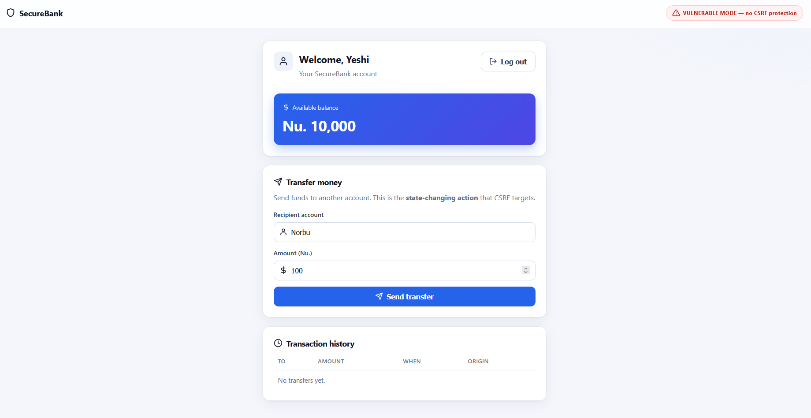
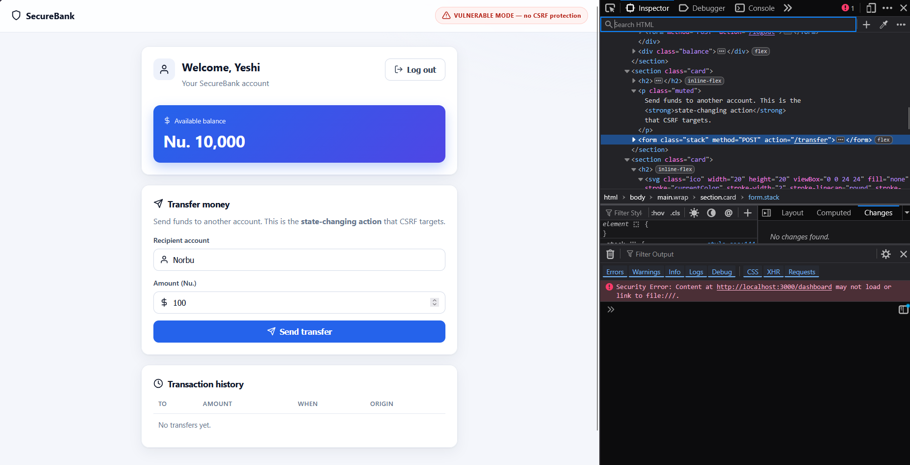
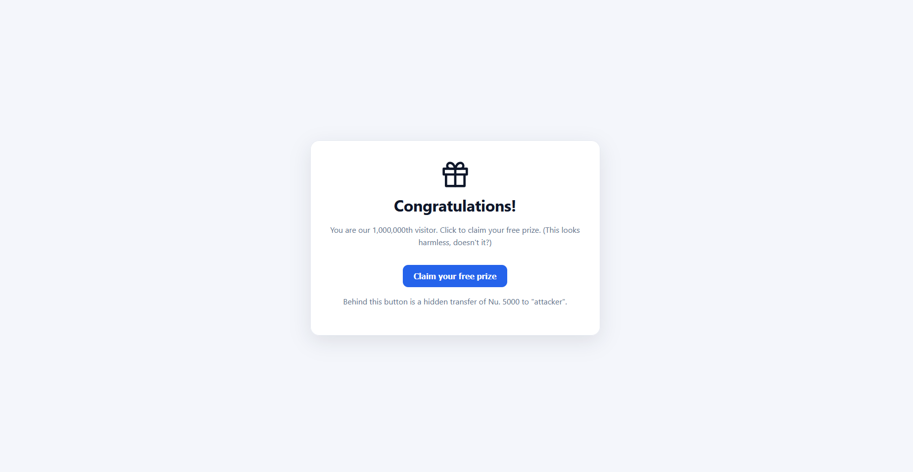
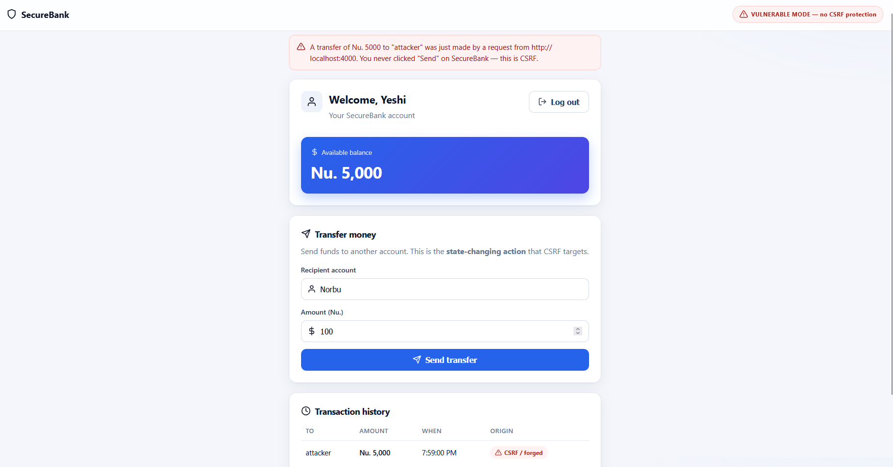
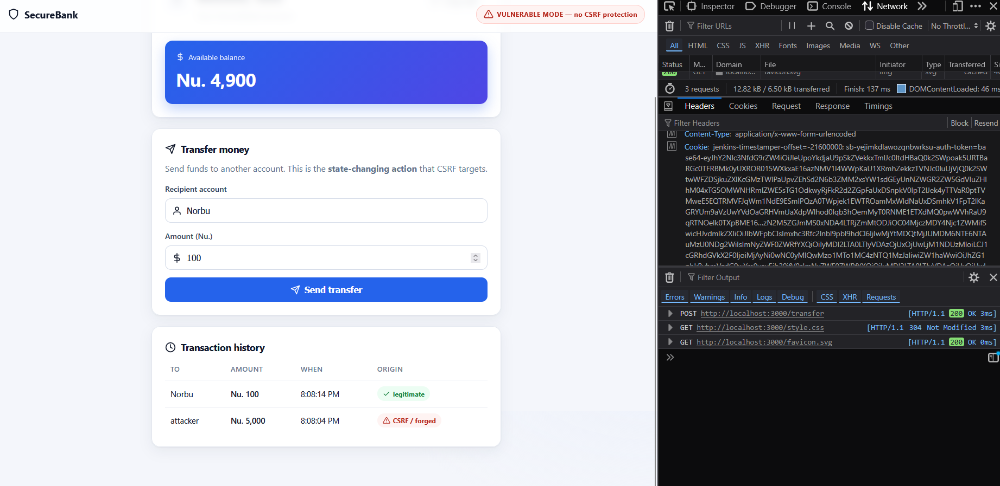
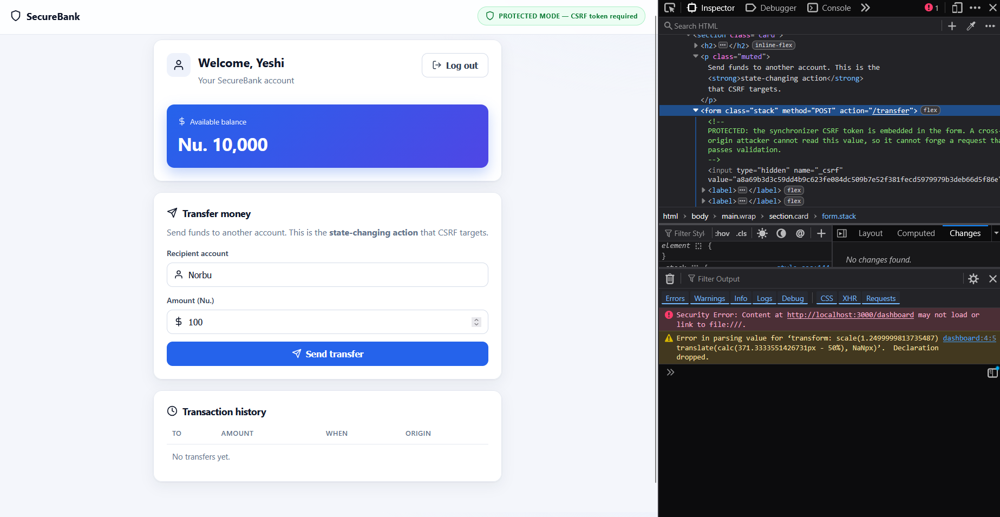
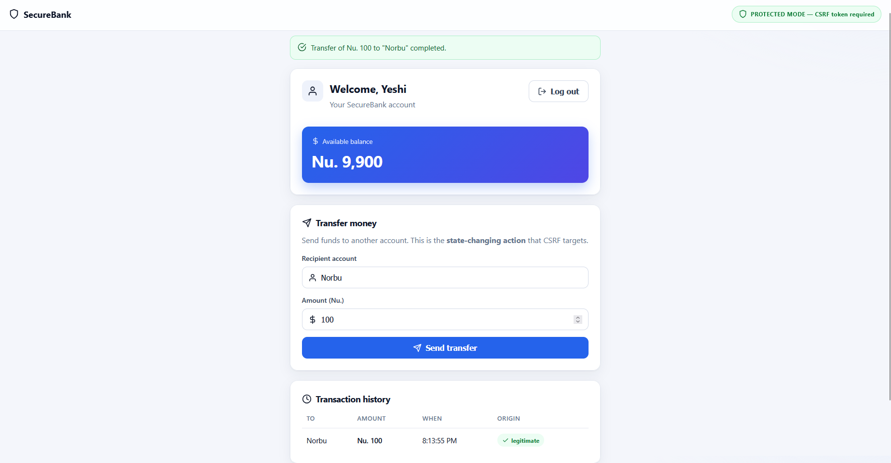
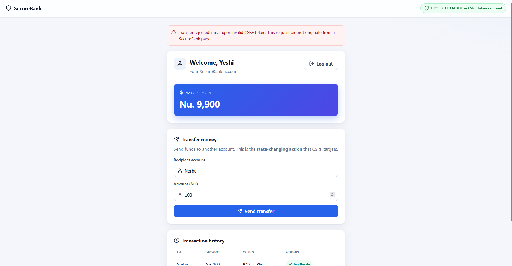
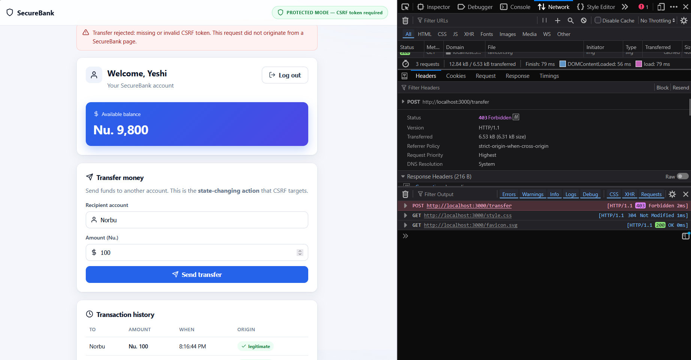

<div align="center">

# Cross-Site Request Forgery (CSRF)
### Building a Vulnerable Form and Protecting It with CSRF Tokens

**WEB404: Secure Coding Practices · Assignment 2**

</div>

---

## Table of Contents

1. [Introduction](#1-introduction)
2. [Objectives](#2-objectives)
3. [Tools and Technologies](#3-tools-and-technologies)
4. [Project Structure](#4-project-structure)
5. [How the Application Works](#5-how-the-application-works)
6. [Part 1: The Vulnerable Version](#6-part-1-the-vulnerable-version)
7. [Part 2: The CSRF Attack](#7-part-2-the-csrf-attack)
8. [Why the Attack Works](#8-why-the-attack-works)
9. [Part 3: The Fix — CSRF Tokens](#9-part-3-the-fix-csrf-tokens)
10. [Part 4: Proving the Fix Works](#10-part-4-proving-the-fix-works)
11. [Vulnerable vs Protected](#11-vulnerable-vs-protected)
12. [Testing Summary](#12-testing-summary)
13. [What I Learned](#13-what-i-learned)
15. [Conclusion](#15-conclusion)
16. [References](#16-references)

---

## 1. Introduction

When you log in to a website, the server gives your browser a **session cookie**.
After that, your browser **automatically sends that cookie with every request to
that site** — it does not matter whether *you* clicked a button on the site, or
whether some *other* page you have open told your browser to send the request.

**Cross-Site Request Forgery (CSRF)** abuses exactly this behaviour. A malicious
page tricks your browser into sending a request to a site where you are already
logged in. Because the browser attaches your cookie automatically, the site
thinks the request is a genuine action by you — and performs it.

The scary part: the attacker never needs your password and never installs any
malware. They simply borrow the fact that you are *already logged in* to make the
site do something on your behalf, such as transferring money or changing your
email address. This attack is known as **CWE-352** and is a well-known entry in
the OWASP list of web risks.

This assignment is in two halves:

- **First**, I build a small banking app, **SecureBank**, with **no CSRF
  protection**, and show a working attack that steals money from a logged-in user.
- **Then**, I add **CSRF token protection** and show that the exact same attack no
  longer works.

> **Note on safety:** everything runs on my own computer (`localhost`). The
> "attacker" page is one I host myself and it only targets my own demo app. It
> never touches any real website.

---

## 2. Objectives

1. Explain what CSRF is and why it is possible.
2. Build a web app with a login and a money-transfer form (a state-changing action).
3. Show a real, controlled CSRF attack against the unprotected version.
4. Add a CSRF token that is random, tied to the session, and checked on the server.
5. Prove the same attack is now blocked, while normal transfers still work.

---

## 3. Tools and Technologies

| Tool | Why it is used |
|------|----------------|
| **Node.js (≥ 20)** | Runs the application. |
| **Express 5** | Simple web framework for the pages and routes. |
| **cookie-parser** | Reads the session cookie from requests. |
| **Node `crypto`** | Creates the random session id and CSRF token securely. |
| **HTML + CSS** | The pages are rendered on the server so you can clearly see where the token is (or is not) in the form. |

No CSRF library is used: the protection is written by hand so every step is visible.

---

## 4. Project Structure

```
Assignment_2/
├── src/                  The SecureBank app (the victim)
│   ├── server.js         Routes + the ONE token check that flips vulnerable/protected
│   ├── config.js         Reads CSRF_PROTECTION=on|off
│   ├── session.js        Stores sessions (session id + CSRF token)
│   ├── csrf.js           Creates and checks the token
│   └── views.js          The HTML pages
├── public/               style.css, favicon
├── attacker/
│   └── server.js         The malicious page (runs on a different port)
├── screenshots/          Evidence images used in this report
├── instruction.md        Setup + how to take the screenshots
└── README.md             This report
```

**One codebase, two modes.** The vulnerable and protected versions are the *same
program*. A single setting, `CSRF_PROTECTION`, turns the token check on or off.
This keeps the comparison fair: the only thing that changes is the security check.

---

## 5. How the Application Works

SecureBank is a tiny banking app with three pages:

1. **Login**: you sign in (any username works; this assignment is about CSRF,
   not passwords). The server creates a session, gives you a balance of **Nu.
   10,000**, and sets a session cookie.
2. **Dashboard**: shows your balance and a **Transfer money** form. This transfer
   is the "state-changing action" an attacker wants to abuse.
3. **Transfer**: moves the money.

A coloured banner at the top of every page shows the current mode: **red** =
vulnerable, **green** = protected. The attacker's page runs separately on
`http://localhost:4000`, a different **origin** from the bank on
`http://localhost:3000`: which is what makes the attack genuinely "cross-site".

---

## 6. Part 1: The Vulnerable Version

In the vulnerable version, the transfer form has **no protection**. The server
performs the transfer as long as a session cookie is present: it never checks
*who* actually started the request.

```js
// src/server.js  (vulnerable mode)
app.post('/transfer', requireLogin, (req, res) => {
  // No CSRF check here. ANY request with a valid session cookie moves money,
  // no matter which page triggered it.
  req.session.balance -= amount;
  ...
});
```



**Figure 1: The vulnerable application.** The red banner shows CSRF protection
is OFF. The account starts with Nu. 10,000 and has a simple transfer form.



**Figure 2: The form has no CSRF token.** Looking at the page source, the form
contains only the recipient and amount — there is nothing secret that proves a
request really came from SecureBank. This is the weakness the attack will use.

---

## 7. Part 2: The CSRF Attack

The attacker hosts an innocent-looking "You won a prize" page on
`http://localhost:4000`. Hidden inside it is a form that **submits itself
automatically** to the bank's transfer endpoint:

```html
<!-- Served by the attacker on localhost:4000 -->
<form id="attack" action="http://localhost:3000/transfer" method="POST">
  <input type="hidden" name="to" value="attacker">
  <input type="hidden" name="amount" value="5000">
</form>
<script>document.getElementById('attack').submit();</script>
```

Notice the attacker includes **no cookie and no token** : they do not need to.
When the form submits, the victim's browser **adds the SecureBank session cookie
by itself**.

**The steps:**
1. The victim logs in to SecureBank (a normal session).
2. In the same browser, the victim opens the attacker's page.
3. The hidden form fires automatically.
4. The browser attaches the victim's cookie to the request.
5. The vulnerable bank sees a valid cookie, asks no further questions, and
   **transfers Nu. 5,000 to the attacker**.



**Figure 3: What the victim sees.** A harmless-looking page on a different site.
The malicious form is hidden; the victim has no idea anything happened.



**Figure 4: The attack worked.** Back on SecureBank, a transfer of Nu. 5,000 to
"attacker" appears — tagged **CSRF / forged** — and the balance has dropped to
Nu. 5,000. The victim never filled in or submitted this transfer.



**Figure 5: Proof at the network level.** The browser's DevTools show the POST
to `/transfer` carried the victim's **Cookie** even though it came from
`Origin: localhost:4000`, and the server replied **200 OK**. This is the heart of
CSRF: the browser sent the cookie automatically.

---

## 8. Why the Attack Works

The problem is that a session cookie answers only **"who are you?"** It does *not*
answer **"did you mean to do this?"**

| | |
|---|---|
| **The cause** | The browser attaches the cookie to *every* request to the bank, including ones started by another site. |
| **The gap** | The bank treats "a valid cookie is present" as "the user intended this action". Those are not the same thing. |
| **The result** | Any other page can quietly make requests to the bank *as the logged-in victim*. |

**Could the attacker just read the token instead?** No. Even if the bank had a
token, the browser's **Same-Origin Policy** stops the attacker's JavaScript on
`localhost:4000` from reading pages on `localhost:3000`. The attacker can make the
browser *send* a request, but cannot *read* the bank's response. This is the exact
weakness the fix relies on.

---

## 9. Part 3: The Fix: CSRF Tokens

The fix is the **synchronizer token pattern**. The idea is simple: give every
genuine form a secret value that only the bank's own pages can know, then check
for it on the server.

**Step 1: Create a random token and store it in the session** (`src/session.js`):

```js
csrfToken: crypto.randomBytes(32).toString('hex'),  // 256-bit random secret
```

**Step 2: Put the token inside the real form** (`src/views.js`, protected mode):

```html
<input type="hidden" name="_csrf" value="...the session's token...">
```

**Step 3: Check the token before moving any money** (`src/server.js`):

```js
if (!isValidToken(req.session.csrfToken, req.body._csrf)) {
  return res.status(403).send('missing or invalid CSRF token');
}
```

The check uses `crypto.timingSafeEqual` (not `===`) so the comparison time does
not leak the token.



**Figure 6: The fix in place.** The banner is now green (protected), and the page
source shows the form includes a hidden `_csrf` token. Only pages served by
SecureBank itself know this value.



**Figure 7: Normal use still works.** When the transfer is submitted from the
bank's own form (which carries the correct token), it succeeds and is tagged
**legitimate**. The fix does not get in the way of real users.

---

## 10. Part 4: Proving the Fix Works

Now I run the **exact same attack** from Part 2 against the protected bank.



**Figure 8: The attack is rejected.** The attacker's request arrives with the
cookie but **without the token**, so the server refuses it. SecureBank shows
*"Transfer rejected: missing or invalid CSRF token,"* and the balance stays at
Nu. 10,000: no money is lost.



**Figure 9: Proof at the network level.** DevTools show the same forged POST to
`/transfer` now returns **403 Forbidden**. The server blocked it *before* touching
the balance.

---

## 11. Vulnerable vs Protected

| | Vulnerable (`off`) | Protected (`on`) |
|---|---|---|
| Token in the form | None | Hidden `_csrf` token |
| Server check | Cookie only | Cookie **+ valid token** |
| Forged transfer from attacker page | **Succeeds** (HTTP 200) | **Blocked** (HTTP 403) |
| Victim's balance after attack | 10,000 → 5,000 | Unchanged (10,000) |
| Normal transfers | Work | Still work |

---

## 12. Testing Summary

| Test | Mode | Request | Result |
|------|------|---------|--------|
| 1 | Vulnerable | Forged transfer, cookie, **no token** | Accepted — **HTTP 200**, Nu. 5,000 stolen |
| 2 | Protected | Forged transfer, cookie, **no token** | Blocked — **HTTP 403**, balance safe |
| 3 | Protected | Normal transfer, cookie **+ token** | Accepted — **HTTP 200** |
| 4 | Protected | Transfer with a **wrong/guessed token** | Blocked — **HTTP 403** |

These four tests show the protection is both **effective** (tests 2 and 4 stop the
attack) and **does not break normal use** (test 3).

---

## 13. What I Learned

While building this project, the most important thing I learned is that being
logged in is not the same as giving permission. A session cookie only tells the
website who I am; it does not tell the website that I actually meant to make a
particular request. CSRF attacks slip straight through this gap.

I also learned that the browser sends the session cookie automatically with every
request to a site, even when the request was started by a completely different
website. Because of this, any action that changes data is a possible CSRF target
unless it has an extra check on top of the cookie.

The CSRF token is that extra check, and I learned why it has to be random and tied
to the user's session: so that an attacker cannot guess it or reuse an old one.
The reason the token works comes down to the browser's Same-Origin Policy. The
attacker's page can make my browser *send* a request to the bank, but it cannot
*read* the bank's pages, so it can never find out the token to include it.

Finally, I learned that good security uses more than one layer. The CSRF token is
the main defence, but it works best together with `SameSite` cookies and checking
where a request came from. No single check should be trusted on its own.

---

## 15. Conclusion

This assignment showed a complete CSRF attack and its defence. In the vulnerable
version, a page on a *different site* was able to transfer money out of a
logged-in account with no action from the victim beyond opening a page. After
adding a CSRF token — a random, session-bound secret that the server checks before
acting: the **exact same attack was blocked with HTTP 403**, while genuine
transfers kept working.

The key lesson is that CSRF is a failure to check **intent**. A session cookie
says *who* you are but not *whether you meant to act*. A CSRF token supplies that
missing proof of intent, and only the real site's pages can provide it.

---

## 16. References

1. OWASP Foundation. *Cross-Site Request Forgery (CSRF)*. https://owasp.org/www-community/attacks/csrf
2. OWASP Foundation. *CSRF Prevention Cheat Sheet*. https://cheatsheetseries.owasp.org/cheatsheets/Cross-Site_Request_Forgery_Prevention_Cheat_Sheet.html
3. MITRE. *CWE-352: Cross-Site Request Forgery*. https://cwe.mitre.org/data/definitions/352.html
4. MDN Web Docs. *SameSite cookies*. https://developer.mozilla.org/en-US/docs/Web/HTTP/Headers/Set-Cookie/SameSite
5. MDN Web Docs. *Same-origin policy*. https://developer.mozilla.org/en-US/docs/Web/Security/Same-origin_policy

---