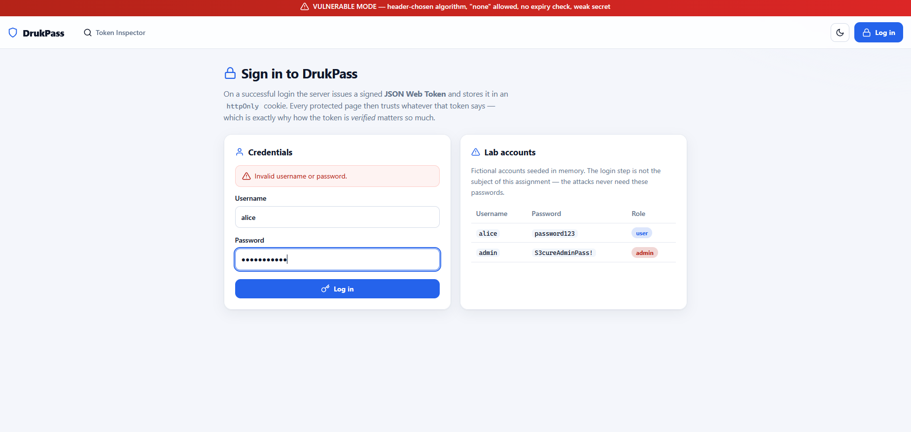
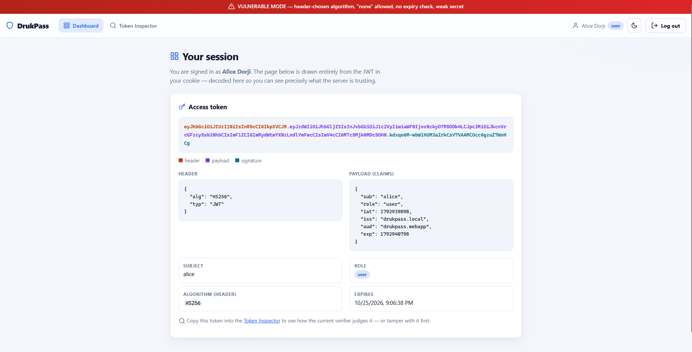
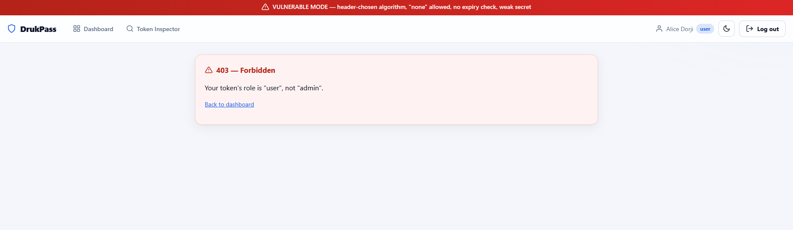
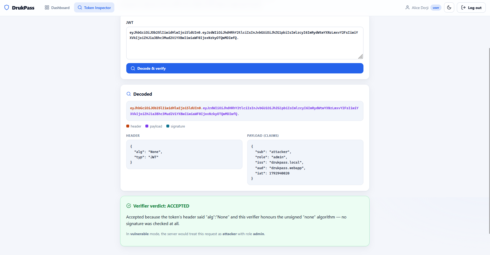
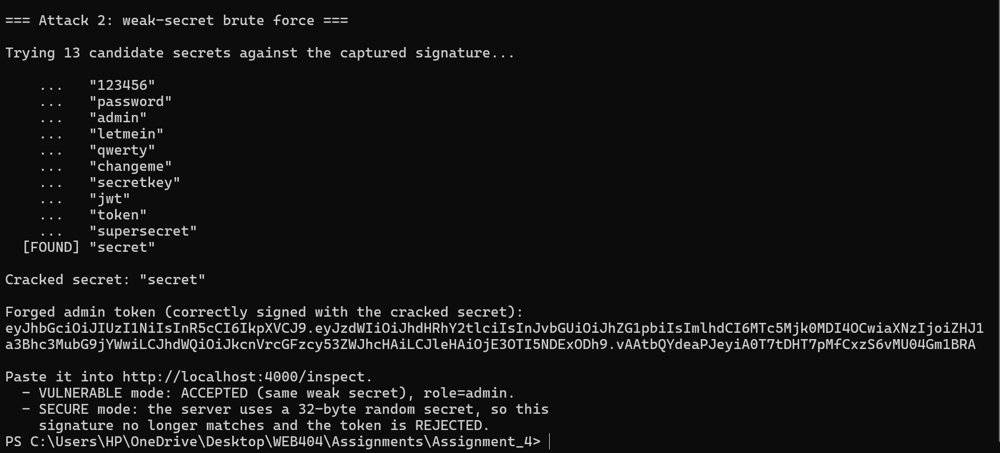
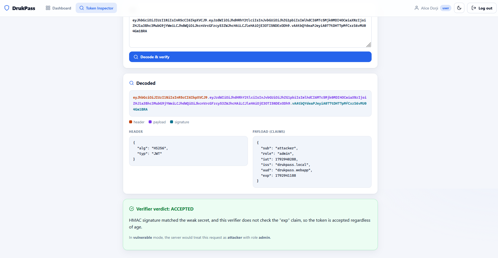
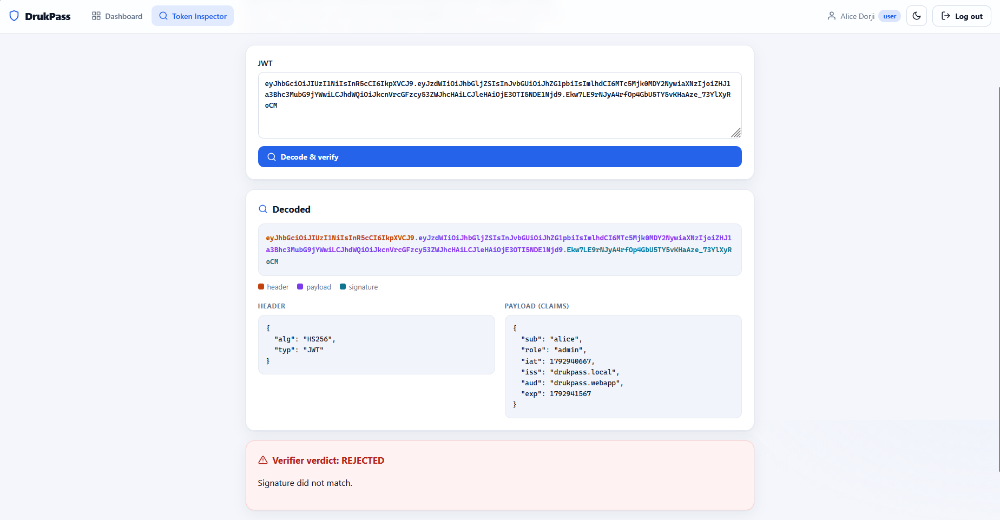
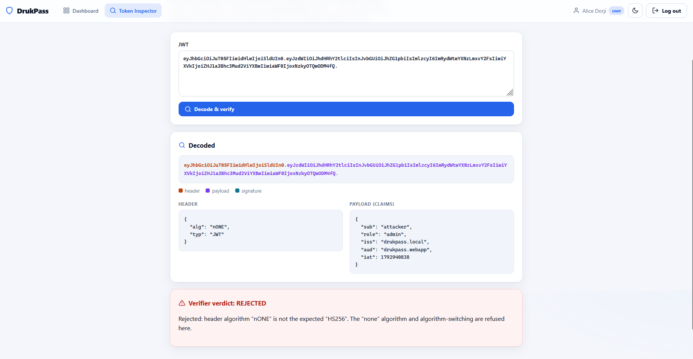
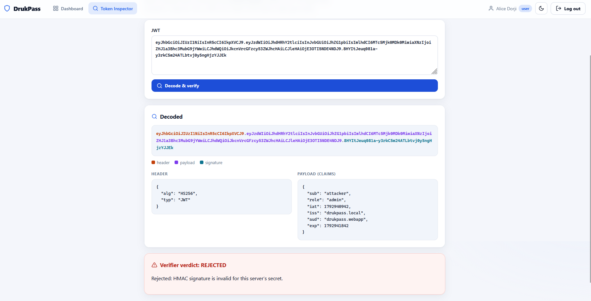
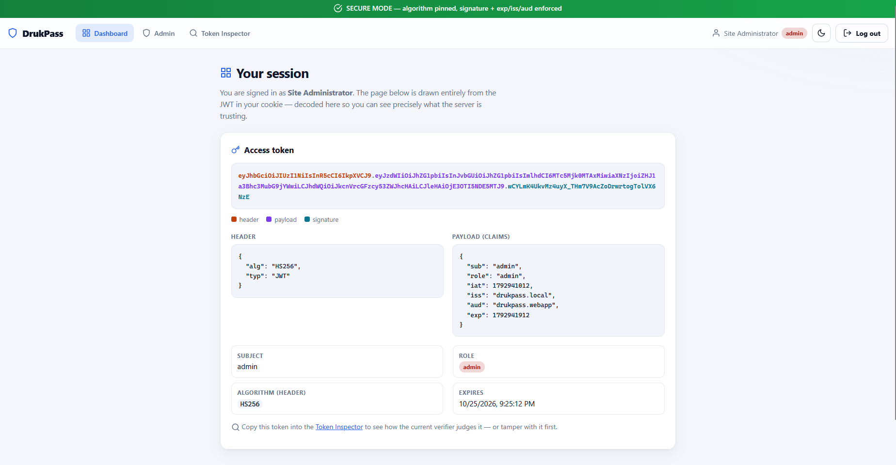

<div align="center">

# DrukPass: JWT Authentication
### Building a JWT Based Authentication System, Demonstrating Common JWT Attacks, and Implementing Secure JWT Handling

**WEB404: Secure Coding Practices · Assignment 4**

</div>

---

## Table of Contents

1. [Introduction](#1-introduction)
2. [Aim](#2-aim)
3. [Objectives](#3-objectives)
4. [Technologies Used](#4-technologies-used)
5. [Project Structure](#5-project-structure)
6. [JWT Background](#6-jwt-background)
7. [System Design](#7-system-design)
8. [Application Walkthrough](#8-application-walkthrough)
9. [The Authentication System](#9-the-authentication-system)
10. [The Vulnerable Verifier](#10-the-vulnerable-verifier)
11. [JWT Attacks Demonstrated](#11-jwt-attacks-demonstrated)
12. [Why the Attacks Work](#12-why-the-attacks-work)
13. [Secure JWT Implementation](#13-secure-jwt-implementation)
14. [How the Protection Works](#14-how-the-protection-works)
15. [Testing Methodology](#15-testing-methodology)
16. [Vulnerable vs Secure Comparison](#16-vulnerable-vs-secure-comparison)
17. [Results](#17-results)
18. [Security Lessons Learned](#18-security-lessons-learned)
19. [Conclusion](#19-conclusion)
20. [References](#20-references)

---

## 1. Introduction

Most modern web applications no longer keep a session for every logged in user
on the server. Instead, they give the browser a **token** that the browser
sends back on every request, and the server reads the user's identity straight
out of that token. The most common format for these tokens is the **JSON Web
Token (JWT)**, a small, self contained string that carries facts such as *who
you are* and *what role you have*, protected by a cryptographic signature.

A JWT is safe only when the server does one thing properly: **verify the
signature before it trusts anything inside the token**. The data inside a JWT is
not encrypted, so anyone can read it. The signature is the only thing that
separates "a token this server created" from "a token an attacker made up." When
the verification step is weak, incomplete, or skipped, an attacker can build a
token that says *anything*, including `"role": "admin"`, and the application
will believe it. This family of weaknesses is listed by MITRE as **CWE-347
(Improper Verification of Cryptographic Signature)** and runs through the OWASP
guidance on broken authentication.

This assignment studies JWT security in two parts:

1. **The vulnerability.** A small but realistic login application, **DrukPass**,
   is built with a token verifier that makes the classic JWT mistakes: it trusts
   the algorithm named inside the token, it accepts the unsigned `none`
   algorithm, it signs with a secret that is easy to guess, and it never checks
   expiry. Three attacks are then carried out against it, ending with an attacker
   reaching the admin only area without ever knowing an admin's password.
2. **The defence.** The application is switched to a **hardened verifier**. It
   fixes one expected algorithm, rejects `none`, recomputes the signature and
   compares it in constant time, enforces the `exp`, `iss`, and `aud` claims, and
   uses a long random secret. Every attack that worked before is repeated and now
   fails, while legitimate logins keep working exactly as before.

> **Ethics and scope.** The whole exercise runs on `localhost` in a controlled
> lab. The user directory is fictional and held in memory. The attack scripts
> only build and inspect token strings for the demo application the student also
> runs. They contact no network service and provide no way to attack any real or
> third party system. JWT attacks are shown here only to understand and prevent
> them.

---

## 2. Aim

The aim of this assignment is to build a working JWT based authentication
system, to show clearly how common mistakes in verifying JWTs let an attacker
bypass authentication and gain administrator access, and then to implement
secure JWT handling that blocks those attacks while leaving normal logins
untouched. The same application is used for both the insecure and the secure
version so the difference is easy to see and fair to compare.

---

## 3. Objectives

1. **Explain** what a JWT is, how its three parts fit together, and why the
   signature, not the data, is what makes a token trustworthy.
2. **Build** a JWT based authentication system with login, a session stored in an
   `httpOnly` cookie, a user dashboard, and a role gated admin area.
3. **Implement** the token verifier first *without* protection and demonstrate
   working, controlled attacks: the `alg:none` signature bypass, an offline brute
   force of a weak signing secret, and payload (role) tampering.
4. **Show** that these attacks lead to full privilege escalation, where an
   attacker reaches the admin area with a token they built themselves.
5. **Implement** the correct defences across the same application: algorithm
   pinning, constant time signature checking, claim enforcement, and a strong
   secret.
6. **Demonstrate** that every attack that succeeded against the insecure version
   now fails against the secure version, without breaking normal use.
7. **Test** both versions and present the results as verifier verdicts, HTTP
   responses, and forged or recovered tokens.
8. **Reflect** on the lessons and the complementary defences such as token
   storage, short lifetimes, and rotation.

---

## 4. Technologies Used

| Technology | Role in the project |
|------------|---------------------|
| **Node.js (≥ 20)** | JavaScript runtime for the application and the attack scripts. |
| **Express 5** | Minimal web framework handling routes and form parsing. |
| **cookie-parser** | Reads the `httpOnly` cookie that carries the JWT. |
| **Node `crypto` (built in)** | HMAC-SHA256 signing, the random secret, and `timingSafeEqual` for constant time comparison. |
| **cross-env** | Sets the `JWT_SECURE` environment variable the same way on Windows, macOS, and Linux. |
| **HTML + CSS (server rendered)** | Plain templates so the exact token sent to the browser, and the verifier's verdict, are printed on the page for inspection. |

**No JWT library is used.** The signing and *both* verifier versions are written
by hand in `src/jwt.js`, so every byte of the token and every step of the check
can be read and understood. That is the whole point of the exercise.

---

## 5. Project Structure

```
Assignment_4/
├── package.json             # scripts: start:vulnerable / start:secure / attack:*
├── README.md                # this report
├── instruction.md           # how to run it and which screenshots to capture
├── src/
│   ├── config.js            # reads JWT_SECURE and flips the security posture + secret
│   ├── jwt.js               # THE HEART: hand written sign + vulnerable vs secure verify
│   ├── users.js             # in memory, salted hash user directory (fictional)
│   ├── views.js             # server rendered HTML, including the token inspector
│   └── server.js            # Express routes (login, dashboard, admin, inspect, logout)
├── attacker/
│   ├── alg-none.js          # Attack 1: forge an unsigned (alg:none) admin token
│   ├── brute-secret.js      # Attack 2: brute force the weak secret, re-sign as admin
│   └── tamper.js            # Attack 3: naive role tampering (and why it fails)
├── public/
│   ├── style.css            # styling + light/dark theme; red = vulnerable, green = secure
│   ├── app.js               # progressive enhancement: light/dark theme toggle
│   ├── theme.js             # applies the saved theme before paint (no flash)
│   └── favicon.svg
└── screenshots/             # the captured evidence used in this report
```

The only file that behaves differently between the two versions is `src/jwt.js`
(specifically which verifier the `verify()` function calls). Everything else is
shared.

---

## 6. JWT Background

### 6.1 The three parts of a token

A JWT is three **Base64URL** pieces joined by dots:

```
eyJhbGciOiJIUzI1NiIsInR5cCI6IkpXVCJ9 . eyJzdWIiOiJhbGljZSIsInJvbGUiOiJ1c2VyIn0 . oIxqglZazMwUoJ3W...
└──────────── header ───────────────┘   └──────────── payload ───────────────┘   └──── signature ────┘
```

- **Header:** JSON that describes the token, for example
  `{"alg":"HS256","typ":"JWT"}`. The `alg` field names the algorithm used for the
  signature.
- **Payload:** the JSON **claims**, for example
  `{"sub":"alice","role":"user","exp":...}`. These are the facts the application
  acts on.
- **Signature:** for `HS256`, this is
  `HMAC-SHA256(base64url(header) + "." + base64url(payload), secret)`.

> **Base64URL is encoding, not encryption.** The header and payload are only
> encoded, not hidden. Anyone with the token can read every claim. Nothing secret
> should ever go in a JWT payload, and the only thing that stops an attacker from
> changing a claim is the signature check on the server.

### 6.2 The two algorithm families

- **HMAC (HS256 and similar):** a **symmetric** scheme. The same secret both
  signs and verifies. This project uses `HS256`.
- **RSA / ECDSA (RS256, ES256, and similar):** **asymmetric**. A private key
  signs and a matching public key verifies.

This difference matters because several classic JWT attacks come from a verifier
being careless about *which* algorithm it is using.

### 6.3 Claims that matter for security

| Claim | Meaning | Why it matters |
|-------|---------|----------------|
| `exp` | Expiry time | A token must stop being valid eventually. |
| `nbf` | Not before time | A token should not work before it is meant to. |
| `iat` | Issued at time | Supports age checks and auditing. |
| `iss` | Issuer | The server should only accept tokens it created. |
| `aud` | Audience | A token for one service should not work at another. |

A verifier that checks the signature but ignores these claims is only half
finished. An expired or foreign token with a valid signature would still pass.

---

## 7. System Design

DrukPass is a single Express application whose security posture is flipped by one
environment variable, `JWT_SECURE`, read in `src/config.js`:

```js
const secure = process.env.JWT_SECURE === 'on';

const secret = secure
  ? (process.env.JWT_SECRET || crypto.randomBytes(32).toString('hex')) // strong
  : 'secret';                                                          // weak
```

- `JWT_SECURE=off` gives the vulnerable verifier plus the weak secret `"secret"`.
- `JWT_SECURE=on` gives the hardened verifier plus a 32 byte random secret.

A coloured banner (red for vulnerable, green for secure) sits at the top of every
page, so a screenshot always shows which mode produced it.

The request flow is the same in both modes:

```
         ┌──────────┐   POST /login    ┌───────────────┐
 browser │  /login  │ ───────────────► │  users.js      │  check salted hash
         └──────────┘                  └───────┬───────┘
                                                │ ok
                                                ▼
                                   jwt.sign({sub, role}, secret, {exp,iss,aud})
                                                │
                       Set-Cookie: access_token=<JWT>  (httpOnly)
                                                │
         ┌──────────┐  GET /dashboard  ┌────────▼────────┐
 browser │  cookie  │ ───────────────► │  jwt.verify()   │  ◄── THE ONLY
         └──────────┘                  │  vuln  OR  safe │      DIFFERENCE
                                        └────────┬────────┘
                                                 │ valid → session = {sub, role}
                                                 ▼
                                   role gate on /admin (role === 'admin')
```

One important design choice: the **role the application acts on comes from the
token's claim**, not from a fresh lookup in the user directory. This is realistic
and it is exactly what makes a forged or tampered `role` claim have a visible,
provable effect.

---

## 8. Application Walkthrough

The application has four pages:

| Page | Path | Purpose |
|------|------|---------|
| **Login** | `/login` | Checks the credentials and issues a signed JWT into an `httpOnly` cookie. |
| **Dashboard** | `/dashboard` | Decodes the caller's own token and shows its parts, header, payload, algorithm, and expiry. |
| **Admin** | `/admin` | Returns the admin area only when the verified token's `role` is `admin`, otherwise **403**. |
| **Token Inspector** | `/inspect` | Decodes any pasted token, then runs it through the current mode's verifier and prints ACCEPTED or REJECTED with the reason. |

The walkthrough below uses the **vulnerable** build (red banner) for normal,
honest use.

<p align="center"></p>

<p align="center"><em><strong>Figure 1:</strong> The login page in vulnerable mode. On a correct login the server issues a signed JWT and stores it in an <code>httpOnly</code> cookie. The fictional lab accounts are listed on the right.</em></p>

<p align="center"></p>

<p align="center"><em><strong>Figure 2:</strong> Alice's dashboard after login. The page is drawn entirely from her token. It shows the three coloured parts, the header (<code>alg: HS256</code>), and the payload where <code>role</code> is <code>user</code>.</em></p>

<p align="center"></p>

<p align="center"><em><strong>Figure 3:</strong> When Alice (role <code>user</code>) opens the admin page, the server returns <strong>403 Forbidden</strong> because her token's role is not <code>admin</code>. This is the correct, expected behaviour.</em></p>

The **Token Inspector** is the centre of the demonstration. It is where the
forged tokens from the attack scripts are pasted, so the verifier's verdict can
be compared between the two modes.

---

## 9. The Authentication System

### 9.1 Issuing a token (the same in both modes)

Signing is never the weak part. Issuing a token to our own user is always done
correctly. From `src/jwt.js`:

```js
function sign(claims, secret, options = {}) {
  const header = { alg: 'HS256', typ: 'JWT' };
  const now = Math.floor(Date.now() / 1000);

  const payload = { ...claims };
  payload.iat = now;
  if (options.issuer)   payload.iss = options.issuer;
  if (options.audience) payload.aud = options.audience;
  if (options.ttlSeconds) payload.exp = now + options.ttlSeconds;

  const encodedHeader  = encodeJson(header);
  const encodedPayload = encodeJson(payload);
  const signature = hmacSign(`${encodedHeader}.${encodedPayload}`, secret);
  return `${encodedHeader}.${encodedPayload}.${signature}`;
}
```

On a successful login, `server.js` stores the token in a cookie with safe flags:

```js
res.cookie(config.tokenCookieName, token, {
  httpOnly: true,   // JavaScript cannot read it, which reduces XSS token theft
  sameSite: 'lax',  // not sent on cross site POSTs, which reduces CSRF
  path: '/',
});
```

### 9.2 Passwords

Password storage is not the subject here, but the fictional directory in
`src/users.js` still stores **salted SHA-256 hashes** instead of plaintext, so
the project never shows a plaintext password in the source. The attacks in this
assignment never need a password at all, which is exactly the danger.

---

## 10. The Vulnerable Verifier

The vulnerable verifier (`verifyVulnerable` in `src/jwt.js`) makes four classic
mistakes at once, so several attacks can be shown against one function:

```js
function verifyVulnerable(token, secret) {
  const { header, payload, parts } = decode(token);
  const alg = header.alg;

  // MISTAKE #1 + #2: the algorithm is whatever the ATTACKER put in the header,
  // and the unsigned "none" algorithm is honoured.
  if (alg === 'none' || alg === 'None' || alg === 'NONE') {
    return { valid: true, payload, reason: '...accepted an unsigned token...' };
  }

  const signingInput = `${parts[0]}.${parts[1]}`;
  const expected = hmacSign(signingInput, secret);

  // MISTAKE #3: non constant time comparison with ===.
  if (parts[2] === expected) {
    // MISTAKE #4: payload.exp is never checked.
    return { valid: true, payload, reason: '...signature matched the weak secret...' };
  }
  return { valid: false, payload, reason: 'Signature did not match.' };
}
```

| # | Mistake | Consequence | Attack it enables |
|---|---------|-------------|-------------------|
| 1 | Trusts the header's `alg` | Attacker chooses how their own token is checked | Algorithm confusion and `none` |
| 2 | Accepts `alg: none` | Unsigned tokens are accepted | **Attack 1** |
| 3 | Weak secret and `===` compare | Secret is guessable offline, plus a timing leak | **Attack 2** |
| 4 | Never checks `exp` / `iss` / `aud` | Expired or foreign tokens are accepted | Replay of stale tokens |

---

## 11. JWT Attacks Demonstrated

All three scripts live in `attacker/` and only build or inspect token strings.
Full step by step capture instructions are in `instruction.md`.

### 11.1 Attack 1: the `alg:none` signature bypass

The JWT spec defines an algorithm literally named `none`, which means "this token
is unsigned." A verifier that accepts it will take **any** claims with **no
signature**. The script `attacker/alg-none.js` builds an admin token with an
empty third part. Note there is no secret anywhere in the script:

```js
const forgedPayload = { sub: 'attacker', role: 'admin', iss: 'drukpass.local', aud: 'drukpass.webapp' };
const header  = base64urlEncode(JSON.stringify({ alg: 'none', typ: 'JWT' }));
const payload = base64urlEncode(JSON.stringify(forgedPayload));
const token = `${header}.${payload}.`;   // ← empty signature
```

The script prints three spellings (`none`, `None`, `nONE`), because a careless
blocklist often checks only the lowercase one. Pasting one of these into the
inspector in vulnerable mode gives a full admin identity made out of nothing.

<p align="center"></p>

<p align="center"><em><strong>Figure 4:</strong> Attack 1 in vulnerable mode. A forged token with <code>"alg":"None"</code> and <code>"role":"admin"</code>, carrying no signature, is still <strong>ACCEPTED</strong>. The server would treat the request as the admin user <code>attacker</code>.</em></p>

### 11.2 Attack 2: offline brute force of a weak secret

An `HS256` signature is `HMAC-SHA256(header.payload, secret)`. If the secret is a
short dictionary word, an attacker who captures **one** valid token can try
candidate secrets **offline**, with no requests and no rate limit, until one
reproduces the token's signature. The script `attacker/brute-secret.js` does
exactly this, then mints a brand new admin token with the cracked secret:

```js
for (const candidate of WORDLIST) {
  if (hmacSign(signingInput, candidate) === targetSig) { found = candidate; break; }
}
// then build a correctly signed admin token with the cracked secret:
const forged = jwt.sign({ sub: 'attacker', role: 'admin' }, found, { ... });
```

<p align="center"></p>

<p align="center"><em><strong>Figure 5:</strong> Attack 2. The script tries a short wordlist against the captured signature, recovers the secret word <code>"secret"</code>, and prints a new admin token signed with it.</em></p>

Because the signature is genuine for the server's secret, the inspector accepts
the token in vulnerable mode. This token could also be set as the cookie to open
the real admin area.

<p align="center"></p>

<p align="center"><em><strong>Figure 6:</strong> The forged admin token from Attack 2 pasted into the inspector. It is correctly signed with the weak secret, so the vulnerable verifier marks it <strong>ACCEPTED</strong> with role <code>admin</code>.</em></p>

### 11.3 Attack 3: naive payload tampering (and why it fails)

The instinctive attack is to take a real user token and change `"role":"user"`
to `"role":"admin"` without touching the signature. The script
`attacker/tamper.js` does this to show the result:

```js
const tamperedPayload = { ...payload, role: 'admin' };
const tamperedToken = `${parts[0]}.${base64urlEncode(JSON.stringify(tamperedPayload))}.${parts[2]}`;
// ↑ original signature reused, now stale
```

<p align="center"></p>

<p align="center"><em><strong>Figure 7:</strong> Attack 3. A real token whose role was changed to <code>admin</code> without re-signing is <strong>REJECTED</strong>, even in vulnerable mode, because the reused signature no longer matches the edited payload.</em></p>

This failure is important to see. It is the reason real attackers either remove
the signature (Attack 1) or recover the key and build a new one (Attack 2),
rather than editing a signed token in place.

---

## 12. Why the Attacks Work

Every attack above traces back to one root cause: **the server let the attacker
influence how the attacker's own token was checked.**

- **`alg:none`** works because the verifier read the *algorithm* from attacker
  controlled data (the header) and had a path that accepted "no signature." The
  fix is not to patch `none` on its own but to stop trusting the header's `alg` at
  all, because the server already knows which algorithm it uses.
- **Weak secret brute force** works because HMAC verification is only as strong as
  the secret. A low entropy secret turns a cryptographic check into a dictionary
  lookup that runs entirely on the attacker's machine.
- **Tampering fails** precisely because a *correct* signature check ties the
  payload to the secret. That is the property the other two attacks each find a
  way around.

A quieter problem sits under all of them: the vulnerable verifier never checks
`exp`, `iss`, or `aud`, so even a properly signed token can be replayed long
after it should have died, or used against the wrong service.

---

## 13. Secure JWT Implementation

The hardened verifier (`verifySecure` in `src/jwt.js`) closes every hole:

```js
function verifySecure(token, secret, options = {}) {
  const { header, payload, parts } = decode(token);
  if (parts.length !== 3) return reject('must have three parts');

  // FIX #1 + #2: PIN the algorithm. The server decides, not the token.
  if (header.alg !== 'HS256')
    return reject(`algorithm "${header.alg}" is not the expected HS256`);

  // FIX #3: recompute and compare in CONSTANT TIME.
  const expected = hmacSign(`${parts[0]}.${parts[1]}`, secret);
  const a = Buffer.from(parts[2]), b = Buffer.from(expected);
  if (a.length !== b.length || !crypto.timingSafeEqual(a, b))
    return reject('HMAC signature is invalid');

  // FIX #4: enforce the time and context claims.
  const now = Math.floor(Date.now() / 1000);
  if (typeof payload.exp === 'number' && now >= payload.exp) return reject('expired');
  if (typeof payload.nbf === 'number' && now <  payload.nbf) return reject('not yet valid');
  if (options.issuer   && payload.iss !== options.issuer)   return reject('wrong issuer');
  if (options.audience && payload.aud !== options.audience) return reject('wrong audience');

  return { valid: true, payload, reason: 'algorithm pinned, signature + exp/iss/aud all checked' };
}
```

Paired with a strong secret from `config.js`
(`crypto.randomBytes(32).toString('hex')`, or an injected `JWT_SECRET`), this is
a faithful small version of what a production grade JWT library does.

---

## 14. How the Protection Works

| Defence | Code | Attack it defeats |
|---------|------|-------------------|
| **Algorithm pinning** | `if (header.alg !== 'HS256') reject` | `alg:none` (Attack 1) and all algorithm confusion |
| **Strong random secret** | `crypto.randomBytes(32)` | Weak secret brute force (Attack 2) |
| **Constant time compare** | `crypto.timingSafeEqual` | Timing side channels on the signature |
| **Signature over current payload** | `hmacSign(parts[0]+'.'+parts[1])` | Payload tampering (Attack 3) |
| **`exp` / `nbf` checks** | time checks | Replay of expired tokens |
| **`iss` / `aud` checks** | claim checks | Cross service token replay |
| **`httpOnly` + `sameSite` cookie** | `res.cookie(...)` | Token theft via XSS or CSRF |

The key idea is **control**. In the secure verifier the *server* decides the
algorithm and the validity window, and the token only supplies data to be checked
against those server side decisions.

---

## 15. Testing Methodology

Both versions were exercised the same way: through the browser, through the Token
Inspector, and from the command line with `curl.exe`, so the comparison is fair.
Example automated checks:

```bash
# A forged alg:none admin token
NONE="eyJhbGciOiJub25lIi...fQ."     # (full token from attacker/alg-none.js)

# Vulnerable mode: ACCEPTED
curl -s --data-urlencode "token=$NONE" http://localhost:4000/inspect | grep -o ACCEPTED

# Secure mode: REJECTED
curl -s --data-urlencode "token=$NONE" http://localhost:4000/inspect | grep -o REJECTED

# Role gate: alice (user) is refused the admin area
curl -s -i -b alice_cookie.txt http://localhost:4000/admin | grep "403"
```

Each attack was run in **both** modes and the verifier's verdict recorded. The
normal login flow (alice as `user`, admin as `admin`) was confirmed to keep
working in the secure build, so the hardening does not break normal use.

---

## 16. Vulnerable vs Secure Comparison

In secure mode (green banner) every forged token is now refused. The figures
below show the same two forgeries from Section 11, this time rejected.

<p align="center"></p>

<p align="center"><em><strong>Figure 8:</strong> The <code>alg:none</code> token from Attack 1, tested in secure mode, is now <strong>REJECTED</strong>. The hardened verifier only accepts <code>HS256</code>, so the unsigned token never reaches a signature check.</em></p>

<p align="center"></p>

<p align="center"><em><strong>Figure 9:</strong> The cracked secret token from Attack 2, tested in secure mode, is now <strong>REJECTED</strong>. The secure server uses a long random secret, so the old signature is invalid.</em></p>

Hardening does not get in the way of real users. A genuine admin still logs in
normally and reaches the admin area.

<p align="center"></p>

<p align="center"><em><strong>Figure 10:</strong> Secure mode (green banner). A real administrator logs in with a password and reaches the Admin area. The defences block the forgeries but leave legitimate use untouched.</em></p>

The full comparison across all tests:

| Test | Vulnerable (red) | Secure (green) |
|------|------------------|----------------|
| Legitimate login (alice / admin) | Works | Works |
| **Attack 1**: `alg:none` admin token | **ACCEPTED** (admin) | Rejected: algorithm not `HS256` |
| **Attack 2**: cracked secret admin token | **ACCEPTED** (admin) | Rejected: signature fails (random secret) |
| **Attack 3**: tampered role, reused signature | Rejected (stale signature) | Rejected (stale signature) |
| Expired token (valid signature) | **ACCEPTED** (no `exp` check) | Rejected: `exp` is in the past |
| Token from a different issuer or audience | **ACCEPTED** (claims ignored) | Rejected: `iss` or `aud` mismatch |
| Admin area reached without the admin password | **Yes** (via Attack 1 or 2) | No |

The only cells that change are the attacks. Legitimate use is identical on both
sides, which is exactly what a correct fix should produce.

---

## 17. Results

- The vulnerable verifier accepted **two independently forged admin tokens**: one
  unsigned (`alg:none`) and one signed with a brute forced secret. This let an
  attacker reach the admin area with **no admin credentials at all**.
- Naive tampering was rejected even by the vulnerable verifier, which confirms
  that a signature check does tie the payload to the secret, and explains why the
  working attacks step around that check rather than face it.
- The secure verifier rejected **every** forged token while leaving legitimate
  logins and the role gate fully working.
- The two decisive fixes were **algorithm pinning** (which kills `alg:none` and
  algorithm confusion) and a **strong random secret** (which kills offline brute
  force). Claim enforcement closed the quieter replay problems.

---

## 18. Security Lessons Learned

1. **The payload is public, only the signature protects it.** Never put secrets
   in a JWT, and never trust a claim before the signature is verified.
2. **Never trust the token's `alg` header.** Fix the algorithm on the server.
   This single rule removes the whole `none` and algorithm confusion family.
3. **Secrets must be truly random.** An HMAC is only as strong as its key, and a
   dictionary word is no key at all. Use at least 32 random bytes, read from the
   environment, never written into the source.
4. **Checking the signature is necessary but not enough.** Always enforce `exp`
   (and where it applies `nbf`, `iss`, and `aud`) so a valid signature cannot be
   replayed forever or at the wrong service.
5. **Compare signatures in constant time** so a wrong signature cannot be learned
   through timing.
6. **Store tokens carefully.** `httpOnly` keeps JavaScript, and therefore XSS,
   away from the token, and `sameSite` reduces CSRF exposure.
7. **Prefer a trusted library with safe defaults.** Hand writing the code here was
   for learning. In production, use a maintained library and still give it an
   explicit list of allowed algorithms.

---

## 19. Conclusion

A JWT moves trust from the server's memory into a string the client carries, and
that trade is safe only when the server checks the string strictly. This
assignment built one authentication system and showed both sides of the trade. A
verifier that trusted the token's own header, accepted unsigned tokens, and used
a guessable secret handed an attacker a full admin identity out of thin air. A
verifier that fixed its algorithm, demanded a real signature against a strong
secret, and checked the claims rejected every one of those forgeries while
serving legitimate users unchanged. The lesson is short: **a JWT is only as
trustworthy as the weakest line in the code that verifies it**, so that code must
decide the algorithm, insist on a real signature, and check the claims every
single time.

---

## 20. References

1. OWASP. *JSON Web Token for Java Cheat Sheet* and *Testing for JWT* (WSTG). <https://cheatsheetseries.owasp.org/>
2. OWASP Top 10 (2021): A07 *Identification and Authentication Failures*. <https://owasp.org/Top10/>
3. MITRE. *CWE-347: Improper Verification of Cryptographic Signature*. <https://cwe.mitre.org/data/definitions/347.html>
4. IETF. *RFC 7519: JSON Web Token (JWT)*. <https://datatracker.ietf.org/doc/html/rfc7519>
5. IETF. *RFC 7515: JSON Web Signature (JWS)*. <https://datatracker.ietf.org/doc/html/rfc7515>
6. IETF. *RFC 8725: JSON Web Token Best Current Practices*. <https://datatracker.ietf.org/doc/html/rfc8725>
7. Auth0. *Critical vulnerabilities in JSON Web Token libraries* (the `alg:none` disclosure). <https://auth0.com/blog/>
8. PortSwigger Web Security Academy. *JWT attacks*. <https://portswigger.net/web-security/jwt>
