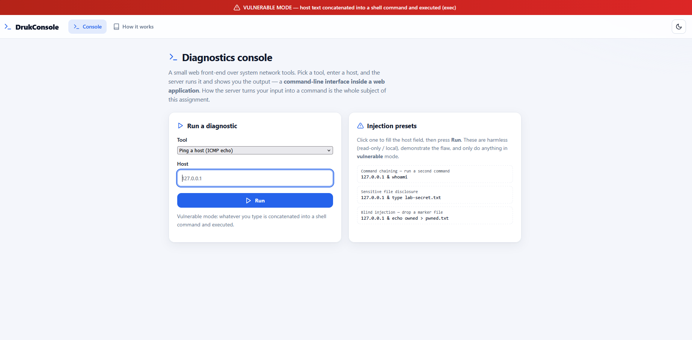
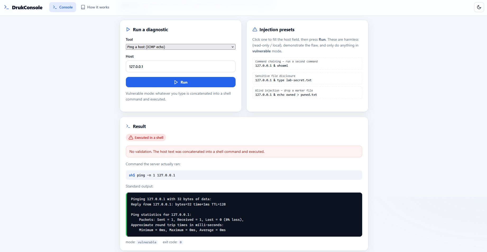
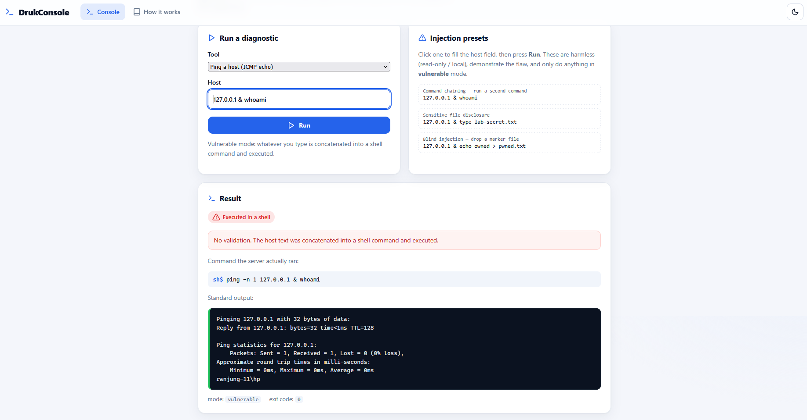
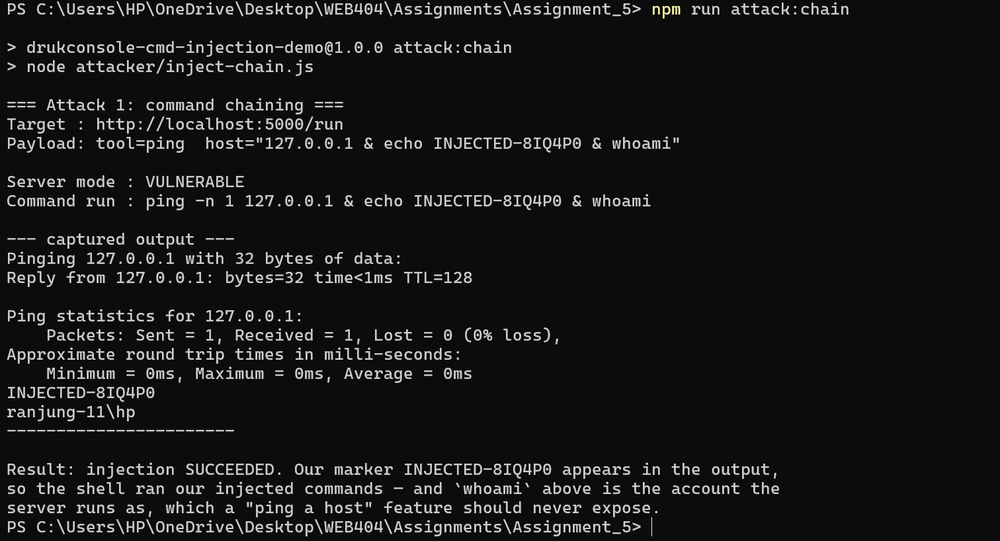
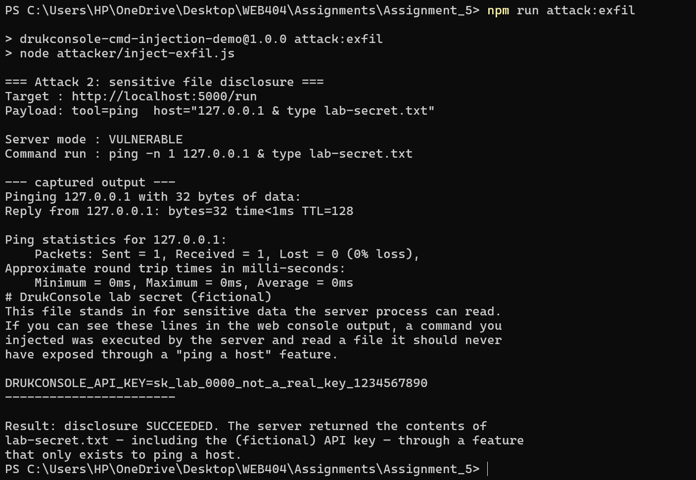
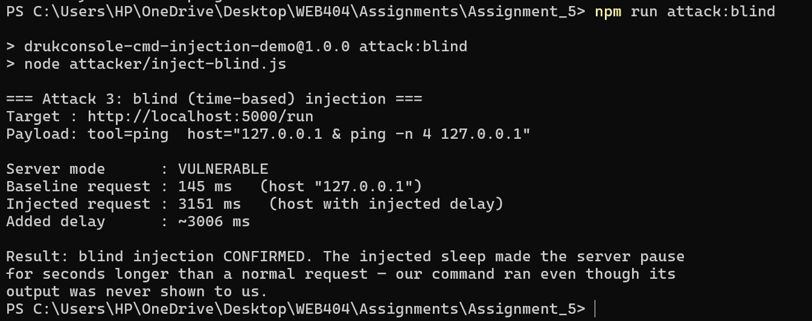
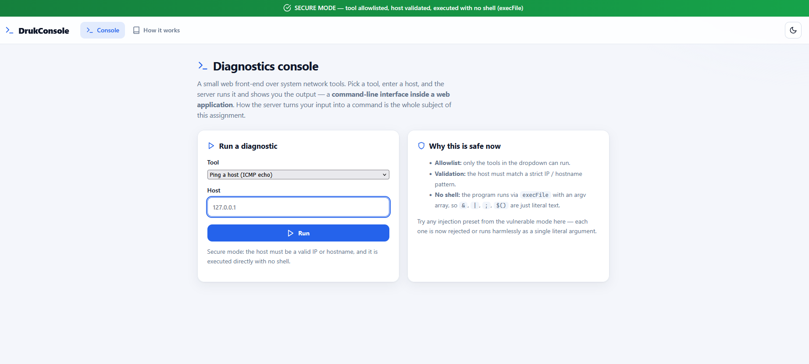
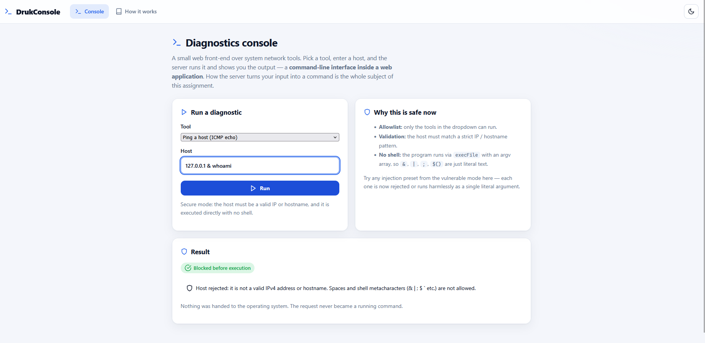
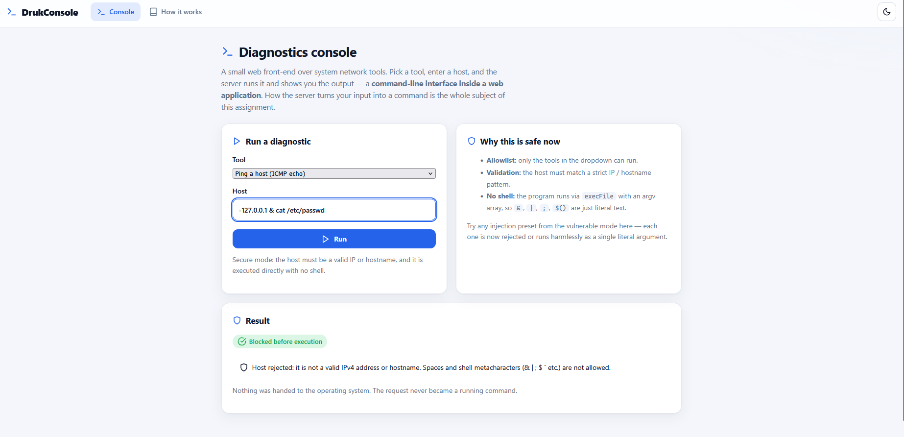
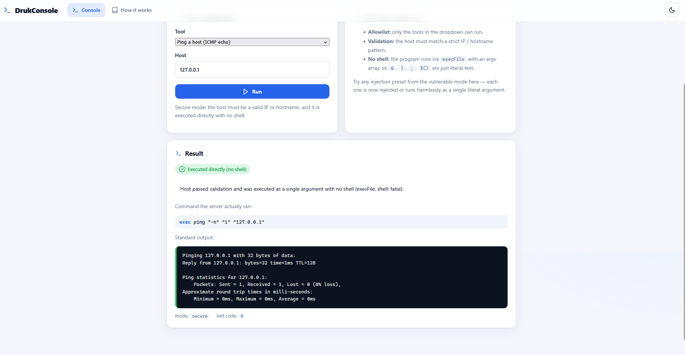

<div align="center">

# DrukConsole: A Web Command Line Interface
### Building a CLI Inside a Web Application, Demonstrating Command Injection, and Implementing Safeguards Against It

**WEB404: Secure Coding Practices · Assignment 5**

</div>

---

## Table of Contents

1. [Introduction](#1-introduction)
2. [Aim](#2-aim)
3. [Objectives](#3-objectives)
4. [Technologies Used](#4-technologies-used)
5. [Project Structure](#5-project-structure)
6. [Command Injection Background](#6-command-injection-background)
7. [System Design](#7-system-design)
8. [Application Walkthrough](#8-application-walkthrough)
9. [The Web Command Line Interface](#9-the-web-command-line-interface)
10. [The Vulnerable Runner](#10-the-vulnerable-runner)
11. [Attacks Demonstrated](#11-attacks-demonstrated)
12. [Why the Attacks Work](#12-why-the-attacks-work)
13. [The Secure Implementation](#13-the-secure-implementation)
14. [How the Safeguards Work](#14-how-the-safeguards-work)
15. [Testing Methodology](#15-testing-methodology)
16. [Vulnerable vs Secure Comparison](#16-vulnerable-vs-secure-comparison)
17. [Results](#17-results)
18. [Security Lessons Learned](#18-security-lessons-learned)
19. [Conclusion](#19-conclusion)
20. [References](#20-references)

---

## 1. Introduction

Many web applications need to ask the operating system to do something on their
behalf: ping a host, look up a domain, resize an image, or run a backup. The
quickest way to do this is to build a command as a line of text and hand it to a
shell. It is also one of the most dangerous things a web application can do. The
moment any part of that text comes from the user, the user is no longer just
filling in a form. They are helping to write a command that the server will run
with the server's own privileges.

This weakness is called **OS Command Injection**. It is catalogued as
**CWE-78 (Improper Neutralization of Special Elements used in an OS Command)**
and it appears in the OWASP Top 10 under **A03:2021 Injection**. The cause is
always the same shape: untrusted input is mixed into a command that an
interpreter then reads. A shell treats characters such as `&`, `|`, `;`, `$()`
and `` ` `` as instructions, not as plain text. So a box that is meant to hold
`127.0.0.1` can instead carry `127.0.0.1 & whoami`, which is two commands where
the developer expected one.

This assignment studies command injection in two parts, around a single small
application called **DrukConsole**. DrukConsole is a web page that gives the user
a command line console for network diagnostics (ping and DNS lookup):

1. **The vulnerability.** The console is first built the naive way. It joins the
   user's host input onto a command string and runs that string with Node's
   `child_process.exec`. Three attacks are then carried out against it: command
   chaining, sensitive file disclosure, and a blind, time based injection. Each
   one shows that an attacker can run commands of their own as the server, read
   files the feature was never meant to expose, and prove execution even when no
   output is returned (Sections 10 to 12).

2. **The defence.** The same console is then switched to a hardened runner that
   never uses a shell. It checks the chosen tool against an allowlist, validates
   the host against a strict pattern, and runs the program directly with
   `child_process.execFile` and an argument array. Every attack that worked
   before now fails, and normal diagnostics keep working (Sections 13 to 17).

> **Ethics and scope.** The whole exercise runs on `localhost` in a controlled
> lab. The only target is the student's own demo server. Every injected command
> is harmless and local: printing the current user name (`whoami`), reading a
> fictional secret file the app creates itself, and making the server pause for a
> few seconds. Nothing contacts an outside system and nothing is destroyed.
> Command injection is shown here only so it can be understood and prevented.

---

## 2. Aim

The aim of this assignment is to **build a command line interface inside a web
application and to implement effective safeguards against command injection.**

To reach that aim in a way that can be seen and tested, the project first builds
the same feature in a deliberately unsafe way, demonstrates real command
injection against it, and then rebuilds the unsafe part correctly so that every
attack fails while the feature keeps working. The two versions differ in one
file only, so the safeguards, and the reason they work, are easy to point to.

---

## 3. Objectives

1. **Build** a command line interface inside a web application: a browser front
   end where a user chooses a tool and a host, the server runs the matching
   system command, and the output is shown back on the page.
2. **Explain** what OS command injection (CWE-78) is, why mixing user input into
   a shell command causes it, and how shell characters turn data into code.
3. **Implement** the command runner first without protection and demonstrate a
   set of working, controlled attacks: command chaining, sensitive file
   disclosure, and blind time based injection.
4. **Show** that these attacks lead to arbitrary command execution as the server
   account, far beyond the intended "ping a host" feature.
5. **Implement** the correct safeguards across the exact same application: an
   allowlist of permitted tools, strict validation of the host, and argument
   array execution with no shell (`execFile`, `shell: false`), supported by a
   timeout and an output limit.
6. **Demonstrate** that every attack that succeeded against the vulnerable
   version now fails against the secure version, without breaking normal use.
7. **Test** both versions and present the results as command strings, captured
   output, guard verdicts, and HTTP responses.
8. **Reflect** on the lessons and on complementary defences such as least
   privilege and sandboxing.

---

## 4. Technologies Used

| Technology | Role in the project |
|------------|---------------------|
| **Node.js (≥ 20)** | JavaScript runtime for the application and the attack scripts. |
| **Express 5** | Minimal web framework handling routes and form / JSON parsing. |
| **Node `child_process` (built in)** | `exec` (vulnerable: runs a shell string) versus `execFile` (secure: runs a program directly with an argument array, no shell). |
| **System tools (`ping`, `nslookup`)** | The real commands the console drives. They are read only and present on Windows, macOS and Linux. |
| **cross-env** | Sets the `CLI_SECURE` environment variable the same way on Windows, macOS and Linux. |
| **HTML + CSS (server rendered)** | Plain templates, so the exact command the server ran, and its output, are printed on the page for inspection. |
| **Global `fetch` (built into Node ≥ 18)** | The three attacker scripts post payloads to the local server and read the JSON response. |

**No third party command building or sanitising library is used.** Both the
vulnerable and the secure runners are written by hand in `src/runner.js`, so
every step (the dangerous join and each safe layer) is visible, which is the
whole point of the exercise.

---

## 5. Project Structure

```
Assignment_5/
├── package.json             # scripts: start:vulnerable / start:secure / attack:*
├── README.md                # this report
├── instruction.md           # how to run it and which screenshots to capture
├── .gitignore               # ignores node_modules + runtime lab artefacts
├── src/
│   ├── config.js            # reads CLI_SECURE and flips the security posture
│   ├── commands.js          # the tool ALLOWLIST + strict host validation
│   ├── runner.js            # THE HEART: vulnerable exec vs secure execFile
│   ├── views.js             # server rendered HTML console + explainer page
│   └── server.js            # Express routes (console, /run, /about)
├── attacker/
│   ├── inject-chain.js      # Attack 1: command chaining (run a 2nd command)
│   ├── inject-exfil.js      # Attack 2: read a sensitive file via injection
│   └── inject-blind.js      # Attack 3: blind time based injection
├── public/
│   ├── style.css            # styling + light/dark theme; red = vulnerable, green = secure
│   ├── app.js               # theme toggle + "fill payload" buttons
│   ├── theme.js             # applies saved theme before paint (no flash)
│   └── favicon.svg          # terminal prompt icon
└── screenshots/             # the captured evidence used in this report
```

> `lab-secret.txt` (the fictional secret) and `pwned.txt` (a marker a blind
> attack can drop) are created at runtime, not committed. They are listed in
> `.gitignore`.

---

## 6. Command Injection Background

A **shell** (`cmd.exe` on Windows, `/bin/sh` on Linux and macOS) is a program
whose job is to read a line of text and act on it as commands. To do that, it
gives certain characters a special meaning:

| Character | Meaning to the shell |
|-----------|----------------------|
| `&` / `&&` | Run another command after this one (Windows `&`; POSIX `&&` on success). |
| `;` | Separate and run several commands in order (POSIX). |
| `\|` | Send this command's output into the next command. |
| `$(...)` / `` `...` `` | Run the inner command and paste in its output. |
| `>` / `<` | Send output to, or read input from, a file. |

When a developer writes:

```js
exec("ping -n 1 " + userHost);     // userHost comes straight from a form field
```

they are assuming `userHost` is a hostname. But it is just text that will be
pasted into a line the shell then reads. If the user sends `127.0.0.1 & whoami`,
the shell sees the `&` as an instruction and runs **two** commands. The user has
crossed the line from giving data to giving code. That is command injection, and
it is serious, because the injected command runs with all the privileges of the
server process. It can read files, open network connections, install software,
or delete data.

The root cause, stated once: an interpreter (the shell) was given a string that
mixed trusted command text with untrusted user input, and it cannot tell the two
apart. Every safeguard in Section 13 is a way to stop that mixing from happening.

---

## 7. System Design

The guiding idea, shared with the other assignments in this module, is
**one application, two modes**:

| Mode | Command | Banner | What happens to the attacks |
|------|---------|--------|-----------------------------|
| **Vulnerable** | `npm run start:vulnerable` | 🔴 red | They **work** |
| **Secure** | `npm run start:secure` | 🟢 green | They **fail** |

The same app runs at <http://localhost:5000> in both modes. The only thing that
changes is **how the server turns the request into a running command**: the
single `run(...)` call in `src/runner.js`. One environment variable,
`CLI_SECURE`, chooses the runner:

```
CLI_SECURE=off  ->  runVulnerable()   exec(`${template} ${host}`)        shell string
CLI_SECURE=on   ->  runSecure()       execFile(bin, [args], shell:false) argument array
```

Keeping every route, view and tool definition identical between the two modes
makes the comparison fair. The report can show the same payload accepted and run
by the vulnerable build, then rejected by the secure build, with nothing else
changed.

The data flow for a single request:

```
Browser form / attacker script
        │  POST /run  { tool, host }
        ▼
   server.js  ──►  runner.run(tool, host)
                        │
          CLI_SECURE ──►┤
            off │       │ on
                ▼       ▼
        runVulnerable  runSecure
          exec(string)   1. allowlist tool
                         2. validate host
                         3. execFile(bin,[host])
                        │
                        ▼
                result { commandShown, stdout, stderr, exitCode, guard }
                        │
                        ▼
             HTML result card  /  JSON (for attacker scripts)
```

---

## 8. Application Walkthrough

Opening <http://localhost:5000> shows the **console**: a coloured banner at the
top (red or green), a form with a **Tool** dropdown (Ping / DNS lookup) and a
**Host** field, and a **Run** button. In vulnerable mode the right hand panel
offers **injection presets**, so one click fills the host field with a ready made
payload and a grader can reproduce each attack instantly.

<div align="center">



**Figure 1:** The console in vulnerable mode. The red banner states that host
text is concatenated into a shell command and executed. The right panel lists
the three injection presets.

</div>

Submitting the form sends `POST /run`. The server runs the command and redraws
the page with a **Result** card that shows three things: a verdict badge, the
exact command the server ran, and the captured output with the exit code. A
normal request, pinging `127.0.0.1`, works as expected:

<div align="center">



**Figure 2:** A legitimate request. The host `127.0.0.1` is pinged and the
output is shown. The card confirms the command ran in a shell, which is exactly
the behaviour the attacks will abuse.

</div>

The `/about` page explains both runners side by side. The console is driven both
by the browser (which gets HTML back) and by the three attacker scripts (which
send `Accept: application/json` and get a JSON result). Both go through the same
`run(...)` path, so an attack script and the browser see the same security
behaviour.

---

## 9. The Web Command Line Interface

The feature itself is deliberately ordinary. It is the kind of "run a quick
diagnostic" tool that appears on admin dashboards and status pages everywhere.
The tool catalog lives in `src/commands.js` and is shared by both modes:

```js
const TOOLS = {
  ping:    { label: 'Ping a host (ICMP echo)', bin: 'ping',
             buildArgs: (host) => [...pingArgs, host],   // secure: argument array
             shellTemplate: `ping ${pingArgs.join(' ')}` // vulnerable: string
           },
  resolve: { label: 'DNS lookup (nslookup)',   bin: 'nslookup',
             buildArgs: (host) => [host],
             shellTemplate: 'nslookup' },
};
```

Each tool carries both representations on purpose: a `shellTemplate` (a string
the vulnerable runner joins onto) and a `buildArgs` function (an argument array
the secure runner passes to `execFile`). The flags are chosen per platform
(`ping -n 1` on Windows, `ping -c 1` elsewhere) so the demo behaves the same on
any machine. Pinging `127.0.0.1` works with no network connection at all, which
keeps the "a legitimate request still works" test reliable offline.

---

## 10. The Vulnerable Runner

Here is the whole vulnerability, in `src/runner.js`:

```js
function runVulnerable(toolName, host) {
  const tool = TOOLS[toolName];
  const commandLine = `${tool.shellTemplate} ${host}`;   // <-- the flaw
  exec(commandLine, runOptions, (err, stdout, stderr) => { /* ... */ });
}
```

Two decisions make this exploitable:

1. **`host` is joined into a command string.** The developer checked the tool
   (it must be one of the dropdown values) but completely trusts the free text
   host field. This is realistic. The part that looks like a choice gets checked;
   the part that looks like typing does not.
2. **`exec` runs that string in a shell.** `child_process.exec` always starts a
   shell and asks it to read the whole string. So every shell character in `host`
   is treated as an instruction.

The only guards present are a 5 second **timeout** and a 64 KB **output limit**,
applied in both modes. These limit the blast radius (a runaway command cannot
hang the server forever), but they do **not** prevent injection. A short command
such as `whoami` or `type secret.txt` finishes instantly and well inside the
limit. Limits are not a substitute for not building the string in the first
place.

---

## 11. Attacks Demonstrated

All three attacks are run from a second terminal while the **vulnerable** server
is running. Each script posts a payload to `/run` and prints the result.

### Attack 1: Command chaining (`attacker/inject-chain.js`)

**Payload** (host field): `127.0.0.1 & echo INJECTED-XXXX & whoami`
(POSIX uses `;` instead of `&`.)

The shell runs three commands: the intended ping, an `echo` of a unique marker,
and `whoami`. The marker is a reliable signal that our code ran, and `whoami`
reveals the account the server runs as. The same payload can be run straight
from the browser using the preset button:

<div align="center">



**Figure 3:** Command chaining from the browser. The server ran
`ping -n 1 127.0.0.1 & whoami`, and the output ends with `ranjung-11\hp`: the
server's own account name, returned by a feature that only pings a host.

</div>

Running the same attack from the script confirms it in the terminal:

<div align="center">



**Figure 4:** `npm run attack:chain`. Both the unique marker `INJECTED-8IQ4P0`
and the `whoami` result appear in the captured output, so the verdict is
"injection SUCCEEDED". **Arbitrary command execution is confirmed.**

</div>

### Attack 2: Sensitive file disclosure (`attacker/inject-exfil.js`)

**Payload:** `127.0.0.1 & type lab-secret.txt` (POSIX: `; cat lab-secret.txt`).

Instead of a harmless command, we chain one that reads a file the server process
can see but the feature was never meant to expose:

<div align="center">



**Figure 5:** `npm run attack:exfil`. The response now contains the contents of
`lab-secret.txt`, including the fictional key
`DRUKCONSOLE_API_KEY=sk_lab_0000_not_a_real_key_1234567890`. A "ping a host"
feature just handed an attacker a secret off the server's disk. In the real
world, this is how credentials, config files and private keys leak.

</div>

### Attack 3: Blind, time based injection (`attacker/inject-blind.js`)

Sometimes the injected command's output is not shown back to the attacker.
Injection is still exploitable: we make the server wait, and measure the delay.

**Payload:** `127.0.0.1 & ping -n 4 127.0.0.1` (POSIX: `; sleep 3`). The extra
pings take about three seconds. The script times a normal request as a baseline,
then times the injected one:

<div align="center">



**Figure 6:** `npm run attack:blind`. The baseline request takes 145 ms; the
injected request takes 3151 ms, an added delay of about 3000 ms. The gap only
appears because our command ran. Even with no output to read, timing alone
proves code execution, which is how blind injection is detected on real systems.

</div>

---

## 12. Why the Attacks Work

Every one of the three attacks has the same root cause, seen from a different
angle:

- **The shell was asked to read attacker influenced text.** `exec` hands the
  whole string to `cmd.exe` or `/bin/sh`. To the shell, `&`, `;`, `|` and `$()`
  are instructions. The application meant `host` to be data, but the shell has
  no way to know that. It sees one line of shell instructions.
- **There was no boundary between command and argument.** Because everything is
  one string, nothing marks where the host stops. A space followed by `&` is
  enough to start a new command.
- **No validation rejected the dangerous input.** Nothing checked that `host`
  looked like a host. Any string was accepted and run.
- **The server runs with useful privileges.** The injected command inherits the
  server process's identity and file access, so reading `lab-secret.txt` or
  running `whoami` simply works.

Blind injection (Attack 3) makes the key point clear. The vulnerability is in
the execution, not in whether the output happens to be shown. Hiding error
messages or output would not fix it.

---

## 13. The Secure Implementation

The secure runner (`runSecure` in `src/runner.js`) provides the same feature with
three independent layers of defence. Any one of them already stops all three
attacks. Together they are defence in depth.

```js
function runSecure(toolName, host) {
  // Layer 1: ALLOWLIST the tool. Unknown tool => nothing runs.
  const tool = TOOLS[toolName];
  if (!tool) return reject(`Unknown tool "${toolName}": not in the allowlist.`);

  // Layer 2: VALIDATE the host against a strict known-good pattern.
  if (!isValidHost(host)) return reject('Host rejected: not a valid IP/hostname.');

  // Layer 3: EXECUTE directly, NO shell, host as its own argument element.
  const argv = tool.buildArgs(host);               // e.g. ['-n','1','127.0.0.1']
  execFile(tool.bin, argv, { shell: false, timeout, maxBuffer }, cb);
}
```

The host validator (`isValidHost` in `src/commands.js`) is an **allowlist**, not
a blocklist. It accepts only two shapes and rejects everything else:

```js
const ipv4 =
  /^(25[0-5]|2[0-4]\d|1\d\d|[1-9]?\d)(\.(25[0-5]|2[0-4]\d|1\d\d|[1-9]?\d)){3}$/;
const hostname =
  /^(?=.{1,253}$)([a-zA-Z0-9](?:[a-zA-Z0-9-]{0,61}[a-zA-Z0-9])?)(\.[a-zA-Z0-9](?:[a-zA-Z0-9-]{0,61}[a-zA-Z0-9])?)*$/;
return ipv4.test(host) || hostname.test(host);
```

Because a valid IPv4 address or hostname contains no spaces and none of the
characters `& | ; $ \` ( ) < > ' "` or newlines, every injection payload is
rejected here before anything runs. Switching the app to secure mode is a single
command, and the green banner makes the change obvious:

<div align="center">



**Figure 7:** The same console in secure mode. The green banner states that the
tool is allowlisted, the host is validated, and the command runs with no shell.
The right panel now explains why the console is safe instead of offering
injection presets.

</div>

---

## 14. How the Safeguards Work

**Layer 1: Allowlist the tool.** The user can only ask for a tool that exists in
the `TOOLS` catalog. There is no code path that runs a program the user names, so
the "what to run" decision belongs entirely to the application.

**Layer 2: Validate the input against a strict pattern.** Allowlisting the shape
of the input ("it must look exactly like an IP or a hostname") is far safer than
trying to blocklist bad characters. Blocklists are fragile: miss one character,
one encoding, or one platform quirk, and the defence fails. An allowlist states
what is permitted and denies the endless rest by default. The chaining payload
is now stopped before anything runs:

<div align="center">



**Figure 8:** The same `127.0.0.1 & whoami` payload from Figure 3, now in secure
mode. The verdict is "Blocked before execution", with the reason that spaces and
shell characters are not allowed. Nothing was handed to the operating system.

</div>

The file disclosure attempt is rejected for the same reason, which shows the
validation is not specific to one payload but to the whole class of them:

<div align="center">



**Figure 9:** A file read injection (`127.0.0.1 & cat /etc/passwd`) attempted in
secure mode. Again the host fails validation and the request never becomes a
running command, so no file can leak.

</div>

**Layer 3: Execute with no shell.** This is the decisive layer. `execFile`
launches the named program directly through the operating system and passes the
argument array straight to it. No shell is involved, so there is nothing to read
the shell characters. If an attacker somehow submitted `127.0.0.1 & whoami` and
it reached this layer, `execFile('ping', ['-n','1','127.0.0.1 & whoami'])` would
pass the entire string (spaces, ampersand and all) to `ping` as **one literal
hostname argument**. `ping` would simply fail to resolve it, and `whoami` would
never run. A legitimate request still works perfectly, and the secure result
card even prints the argument array so this is visible:

<div align="center">



**Figure 10:** A normal `127.0.0.1` request in secure mode. The verdict is
"Executed directly (no shell)", and the command shown is
`ping "-n" "1" "127.0.0.1"`. Each argument is quoted and separate, so there is no
command line for a shell to re-read, because there is no shell. Exit code 0: the
feature still works.

</div>

**Supporting controls (both modes).** A 5 second timeout and a 64 KB output limit
bound the blast radius of any command, and `windowsHide: true` stops a console
window from flashing on Windows. These are extra hardening, not the main defence.
The main defence is never building a shell string from user input.

---

## 15. Testing Methodology

Testing uses the same three attacker scripts against both modes, plus a
legitimate request to confirm the feature still works when secured.

1. **Start the vulnerable server:** `npm run start:vulnerable`.
2. In a second terminal, run each attack and record the output:
   - `npm run attack:chain` : expect the marker and the `whoami` output.
   - `npm run attack:exfil` : expect the secret file contents (API key) back.
   - `npm run attack:blind` : expect a delay of about 3000 ms.
3. **Stop** the vulnerable server (Ctrl + C) and **start the secure one:**
   `npm run start:secure`.
4. Re-run all three attacks. Each must now report **BLOCKED / PREVENTED**.
5. Submit a legitimate request (`tool=ping`, `host=127.0.0.1`) and confirm it
   still returns exit code 0 and real ping output, run as an argument array.

Each script prints the target, the exact payload, the server mode, the command
the server ran, the captured output, and a plain English verdict, so the
evidence explains itself.

---

## 16. Vulnerable vs Secure Comparison

| Aspect | Vulnerable (`CLI_SECURE=off`) | Secure (`CLI_SECURE=on`) |
|--------|-------------------------------|--------------------------|
| How the command is run | `exec("ping -n 1 " + host)` : shell string | `execFile("ping", ["-n","1",host])` : argument array, no shell |
| Shell involved? | **Yes** (`cmd.exe` / `/bin/sh`) | **No** (`shell: false`) |
| Host validation | None | Strict IPv4 / hostname allowlist |
| Tool restriction | Catalog lookup only (host trusted) | Enforced allowlist |
| `127.0.0.1 & whoami` | Runs `whoami` : **injection** | Rejected by validation : **blocked** |
| `127.0.0.1 & type secret` | Leaks the file : **disclosure** | Rejected : **blocked** |
| `127.0.0.1 & ping -n 4 ...` | ~3 s delay : **blind injection** | Rejected : **no delay** |
| Legitimate `127.0.0.1` | Works | Works (unchanged) |
| Blast radius limits | Timeout + output limit | Timeout + output limit |

---

## 17. Results

| # | Attack | Vulnerable mode | Secure mode |
|---|--------|-----------------|-------------|
| 1 | Command chaining (`whoami`) | Succeeds: marker + account name returned | Blocked: host fails validation |
| 2 | Sensitive file disclosure | Succeeds: API key returned | Blocked: host fails validation |
| 3 | Blind time based injection | Succeeds: ~3000 ms added delay | Blocked: no delay, nothing ran |
| : | Legitimate ping of `127.0.0.1` | Works | Works (argument array, exit 0) |

The one line conclusion: every attack that worked against the vulnerable build
fails against the secure build, and normal use is unaffected. The only code that
changed between the two is the runner in `src/runner.js`.

---

## 18. Security Lessons Learned

1. **Do not build commands by joining strings.** The vulnerability is born the
   instant user input is joined into a command string. If you must run an outside
   program, pass arguments as a separate array and avoid a shell.
2. **Avoid the shell whenever you can.** `execFile` or `spawn` with
   `shell: false` removes the entire class of character attacks, because there is
   no interpreter to trick. Reach for `exec` or `shell: true` only when you truly
   need shell features, and then treat every input as hostile.
3. **Prefer allowlists to blocklists.** Checking that input matches a known good
   shape is robust. Trying to strip or escape "bad" characters is a losing game
   across platforms and encodings.
4. **Validate, and still do not trust.** Validation and no shell execution work
   together, not as spares. Defence in depth means an attack must beat every
   layer, not just one.
5. **Apply least privilege and blast radius limits.** Timeouts, output limits,
   and running the server with the fewest privileges needed all reduce the damage
   if something else fails.
6. **Hidden output is not safety.** Blind injection shows the flaw is in
   execution, not in whether the output is displayed.

---

## 19. Conclusion

OS command injection is one of the oldest and most damaging web vulnerabilities.
This assignment reproduced it end to end in a realistic feature, a web command
line console, and then removed it. The vulnerable build, which does nothing more
exotic than join a form field onto a shell command, let an attacker run commands
of their own, read a secret off the server's disk, and confirm execution purely
through timing. The secure build, which differs only in the `src/runner.js`
runner, defeated all three attacks by allowlisting the tool, validating the host,
and, most importantly, running the program directly with an argument array and no
shell at all, while leaving normal use untouched.

The lesson reaches far beyond this console: never let untrusted input become part
of a command an interpreter will read. Pass data as data, keep it out of the
shell, and validate it against what you expect. Do that, and an entire class of
critical vulnerabilities simply has nowhere to live.

---

## 20. References

1. MITRE. *CWE-78: Improper Neutralization of Special Elements used in an OS Command ('OS Command Injection').* <https://cwe.mitre.org/data/definitions/78.html>
2. OWASP. *A03:2021 Injection.* <https://owasp.org/Top10/A03_2021-Injection/>
3. OWASP. *OS Command Injection Defense Cheat Sheet.* <https://cheatsheetseries.owasp.org/cheatsheets/OS_Command_Injection_Defense_Cheat_Sheet.html>
4. OWASP. *Command Injection.* <https://owasp.org/www-community/attacks/Command_Injection>
5. Node.js. *Child process: `exec`, `execFile`, `spawn`.* <https://nodejs.org/api/child_process.html>
6. OWASP. *Input Validation Cheat Sheet.* <https://cheatsheetseries.owasp.org/cheatsheets/Input_Validation_Cheat_Sheet.html>
